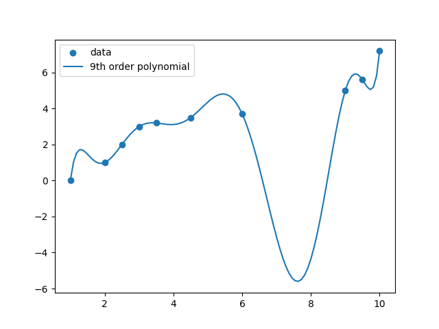
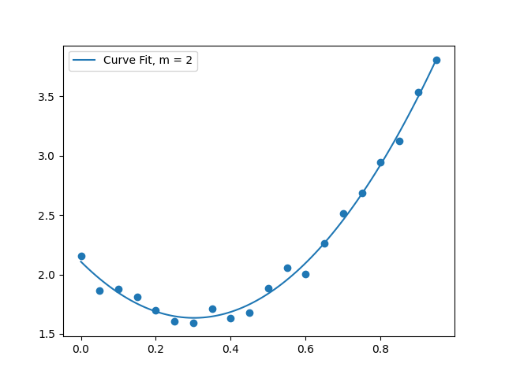
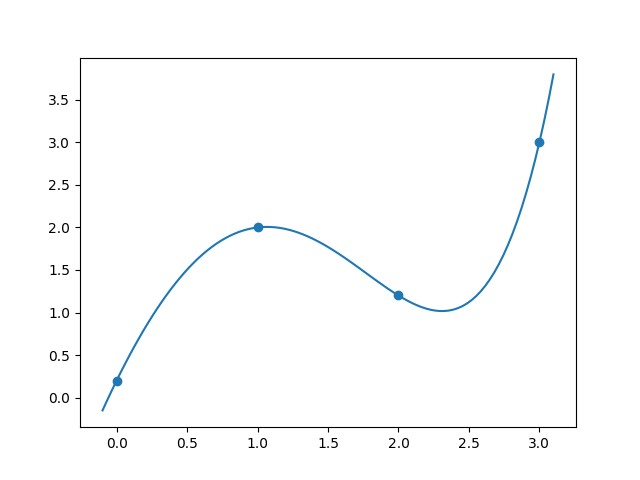
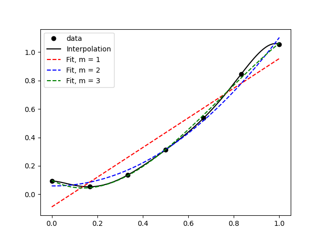
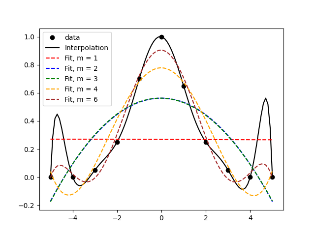

::: {.content-hidden unless-meta="solutions"}
# Solutions {.unnumbered}

:::

::: {.content-hidden when-meta="solutions"}

|              |                                              |
| ------------ | -------------------------------------------- | 
| Due Date     | Thu, Nov 19                                  | 
| Turn in link | Gradescope [PDF](https://moodle.swarthmore.edu/mod/lti/view.php?id=838662) and [Code](https://moodle.swarthmore.edu/mod/lti/view.php?id=838661)  | 
| URL          | `emadmasroor.github.io/E21-F26/Homework/HW9` |


[What to turn in]{.underline}

Combine all written HW into one PDF file.

| Problem | Format                                  |
| ------- | --------------------------------------- |
| 1     | A single Python file named `prob1_interpolation.py` |
| 2     | A single Python file named `prob2_curvefit.py` |
| 3       | PDF           |
| 4    | PDF     |

                              

:::

# Polynomial Interpolation

In class, we derived a linear system of equations for finding the coefficients of an order-$n$ polynomial that interpolates between (i.e., passes through) $n+1$ points.

$$
{\begin{bmatrix}
x_0^0 & x_0^1 & x_0^2 & \cdots & x_0^n \\
x_1^0 & x_1^1 & x_1^2 & \cdots & x_1^n \\
\vdots & \vdots & \vdots & \ddots & \vdots \\
x_n^0 & x_n^1 & x_n^2 & \cdots & x_n^n
\end{bmatrix}}
\begin{bmatrix}
a_0 \\
a_1 \\
\vdots \\
a_n
\end{bmatrix}
=
\begin{bmatrix}
y_0 \\
y_1 \\
\vdots \\
y_n
\end{bmatrix}
$$

::: {.callout-note}
## Instructions

You will submit a single Python file for this problem. Put your import statements and function definitions at the top of the file, and write the rest of your code underneath. The graders should be able to run your file as-is.
:::

## Set up the linear system of equations

Write a Python function that takes as input an array of x-values and an array of y-values, representing ordered pairs $(x_i,y_i)$, and returns (1) the system matrix, and (2) the right-hand-side vector, from the equations shown above.

::: {.content-hidden when-meta="solutions"}
```{.python}
def interpolation_system(x_values,y_values):
    # x_values and y_values should be 1-dimensional arrays of the same size.
    num = len(x_values)
    A = np.zeros((num,num))
    b = np.zeros(num)
    return A,b
```
:::

::: {.content-hidden unless-meta="solutions"}
::: {.callout-tip}
## Solution

```{.python}
def interpolation_system(x_values,y_values):
    n = len(x_values)
    A = np.zeros((n,n))
    b = np.zeros((n,))
    for row in range(n):
        for col in range(n):
            summation = 0
            for k in range(n):
                summation += x_values[k]**(row+col)
            A[row,col] = summation
    for row in range(n):
        summation = 0
        for k in range(n):
            summation += y_values[k] * x_values[k]**row
        b[row] = summation
    return A,b
```
:::
:::

## Solve the linear system for the data provided

Consider the x-y values below.


```{.default filename="interpolate_these.txt"}
1.00 0.00
2.00 1.00
2.50 2.00
3.00 3.00
3.50 3.20
4.50 3.50
6.00 3.70
9.00 5.00
9.50 5.60
10.00 7.20
```

[Download file](interpolate_these.txt){.btn .btn-primary download="interpolate_these.txt"}

Write Python code that

1. Loads the data from `interpolate_these.txt` using `numpy.loadtxt()`
2.  Assigns the columns of the text file to two separate 10-element `numpy` arrays, named, e.g., `x_data` and `y_data`
3.  Calls your function `interpolation_system` from above and stores the matrix and right-hand side.
4. Uses the `numpy` function [`numpy.linalg.solve`](https://numpy.org/doc/stable/reference/generated/numpy.linalg.solve.html) to solve the system of equations $Ax=b$, where $A$ is the matrix from `interpolation_system` and $b$ is the right-hand side from `interpolation_system`. Here, $x$, the unknown vector, contains the coefficients of our sought-for polynomial, $\{ a_0, a_1, a_2, ..., a_n \}$.

::: {.content-hidden unless-meta="solutions"}
::: {.callout-tip}
## Solution
To do this, it is sufficient to write:

```{.python}
import numpy as np
from numpy.linalg import solve

data = np.loadtxt("interpolate_these.txt")
x_vals = data[:,0]
y_vals = data[:,1]

AA,bb = interpolation_system(x_vals,y_vals)
coeffs = solve(AA,bb)
```
:::
:::


## Assemble an interpolating function that uses the coefficients

Now that you have found coefficients $\{ a_0, a_1, a_2, ..., a_n \}$ that define the $n$-degree polynomial that interpolates between these points, write a new function that evaluates this polynomial for any $x$.

Recall that the mathematical form of this interpolating function is $$f(x; a_0, a_1, ..., a_n) = a_0 + a_1 x + a_2 x^2 + a_3 x^3 + ...$$

Your task is to write a Python function that evaluates this interpolating function at any value of $x$, for any given set of coefficients $\{ a_0, a_1, a_2, ..., a_n \}$.

```{.python}
def interpolating_polynomial(x,array_a):
    # x can be any real number (NOT an array)
    # array_a will be an array containing the coefficients
    # of the order-n polynomial: a_0, a_1, a_2, etc.
    # the function should return 
    # a_0*x^0 + a_1*x^1 + a_2*x^2 + ... a_n*x^m
    return 0.0
```

::: {.callout-note}
`numpy` already contains a function that does essentially this; it's called [`numpy.polyval`](https://numpy.org/doc/stable/reference/generated/numpy.polyval.html). You may choose to implement this task as a  ['wrapper'](https://en.wikipedia.org/wiki/Wrapper_function) around `polyval`. It should be straightforward to write your own code without using `polyval`, too.
:::


**Also Note:** This function will be generic; it won't contain any information from problem 1.1 or problem 1.2. Later, when you *call* the function, you'll provide information about what exactly the coefficients are --- and they will be the ones you found in problem 1.2.

::: {.content-hidden unless-meta="solutions"}
::: {.callout-tip}
## Solution

If you read the documentation of [`numpy.polyval`](https://numpy.org/doc/stable/reference/generated/numpy.polyval.html) you will see that it expects, as its first argument, an array of coefficients. However, `polyval` expects the array of coefficients `p` to be ordered in the form 

```
p[0]*x**(N-1) + p[1]*x**(N-2) + ... + p[N-2]*x + p[N-1]
```
i.e., the coefficient of the highest power of $x$ is first, and the coefficient of the second-highest power of $x$ is second, ... and the last element of `p` is supposed to be the constant coefficient (a.k.a. the y-intercept). This is opposite to the convention that we used when we ordered our vector of unkonwns, so we need to 'flip' it.

A thin wrapper around `numpy.polyval` would be:

```{.python}
import numpy as np
def interpolating_polynomial(x,array_a):
    # Thin wrapper around polyval
    return np.polyval(np.flip(array_a),x)
```
:::
:::

## Make a plot showing the data points and the interpolation
Generate a plot that shows the data points together with the interpolating curve. The following snippets of code will help you with this.

```{.python}
import numpy as np
import matplotlib.pyplot as plt

# Assuming x_vals, y_vals contains the coordinates
# of the data points:
plt.scatter(x_vals,y_vals)

# Assuming you have solved 1.2 and you have an array
# of coefficients [a_0, a_1, a_2, ..., a_n] called "a" 
# found after solving the linear system in problem 1.2:

# Generate 100 x-values between the first and last coordinate
x_continuous = np.linspace(x_vals[0],x_vals[-1],100)

# Evaluate your interpolating function at all 100 points
y_continuous = interpolating_polynomial(x_continuous,a)

# Make a line plot
plt.plot(x_continuous,y_continuous,label='Interpolating func')
plt.legend()

# Save it
plt.savefig("interpolation.png")

# Show the plot
plt.show()
```

Your plot should look substantially similar to the one below.



# Polynomial curve fit using least-squares

In class, we saw that the linear system for finding a best-fit curve takes the following form:

$$
\begin{bmatrix}
\sum x_i^0 & \sum x_i^1 & \sum x_i^2 & \cdots & \sum x_i^m \\
\sum x_i^1 & \sum x_i^2 & \sum x_i^3 & \cdots & \sum x_i^{m+1} \\
\sum x_i^2 & \sum x_i^3 & \sum x_i^4 & \cdots & \sum x_i^{m+2} \\
\vdots & \vdots & \vdots & \ddots & \vdots \\
\sum x_i^m & \sum x_i^{m+1} & \sum x_i^{m+2} & \cdots & \sum x_i^{m+m}
\end{bmatrix}
\begin{bmatrix}
a_0 \\
a_1 \\
a_2 \\
\vdots \\
a_m
\end{bmatrix}
=
\begin{bmatrix}
\sum x_i^0 y_i \\
\sum x_i^1 y_i \\
\sum x_i^2 y_i \\
\vdots \\
\sum x_i^m y_i
\end{bmatrix}
$$


**Instructions** 

You will submit a single Python file for this problem. Put your import statements and function definitions at the top of the file, and write the rest of your code underneath. The graders should be able to run your file as-is.


## A function for generating the linear system
Complete the activity from class, i.e., write a Python function that takes as input an array of x values, an array of y values, and an integer $m$, where $m$ is the order of the polynomial that is to be fit to the data. The function should return a matrix of size $(m+1) \times (m+1)$ and an array of size $m+1$.

::: {.content-hidden when-meta="solutions"}
```{.python}
def curvefit_system(x_values,y_values,m):
    # x_values and y_values should be 1-dimensional arrays of the same size.
    A = np.zeros((m+1,m+1))
    b = np.zeros(m+1)
    return A,b
```
:::

::: {.content-hidden unless-meta="solutions"}
::: {.callout-tip}
## Solution

The following function is adequate for solving this problem.

```{.python}
def curvefit_system(x_values,y_values,m):
    n = len(x_values)
    A = np.zeros((m+1,m+1))
    b = np.zeros((m+1,))
    for row in range(m+1):
        for col in range(m+1):
            # There is a summation for each term.
            summation = 0
            for k in range(n):
                summation += x_values[k]**(row+col)
            A[row,col] = summation
    for row in range(m+1):
        # There is a summation for each term.
        summation = 0
        for k in range(n):
            summation += y_values[k]*x_values[k]**row
        b[row] = summation
    return A,b
```

:::
:::

## Solve the linear system for the data provided using $m = 2$

[Download `datapoints.txt`](datapoints.txt){.btn .btn-primary download="datapoints.txt"} 

1. Loads the data from the given text file using `numpy.loadtxt()`
2.  Assigns the columns of the text file to two separate 10-element `numpy` arrays, named, e.g., `x_data` and `y_data`
3.  Calls your function `curvefit_system` from above, with `m=2`, and stores the matrix and right-hand side.
4. Uses the `numpy` function [`numpy.linalg.solve`](https://numpy.org/doc/stable/reference/generated/numpy.linalg.solve.html) to solve the system of equations $Ax=b$, where $A$ is the matrix from `curvefit_system` and $b$ is the right-hand side from `curvefit_system`. Here, $x$, the unknown vector, contains the coefficients of our sought-for polynomial, $\{ a_0, a_1, a_2, ..., a_m \}$.

::: {.content-hidden unless-meta="solutions"}
::: {.callout-tip}
## Solution

```{.python}
import numpy as np
from numpy.linalg import solve

data = np.loadtxt("datapoints.txt")
x_vals = data[:,0]
y_vals = data[:,1]
M = 2               # fit quadratic curve to this data

mat,rhs = curvefit_system(x_vals,y_vals,M)
coeffs = solve(mat,rhs)
```
:::
:::

## Assemble a curve-fit function that uses the coefficients

Now that you have found coefficients $\{ a_0, a_1, a_2, ..., a_m \}$ that define the $m$-degree polynomial that best fits these points, write a new function that evaluates this polynomial for any $x$.

Recall that the mathematical form of this polynomial function is $$f(x; a_0, a_1, ..., a_m) = a_0 + a_1 x + a_2 x^2 + a_3 x^3 + ...$$

Your task is to write a Python function that evaluates this function at any value of $x$, for any given set of coefficients $\{ a_0, a_1, a_2, ..., a_m \}$.

:::: {.content-visible unless-meta="solutions"}

```{.python}
def curvefit_polynomial(x,array_a):
    # x can be any real number (NOT an array)
    # array_a will be an array containing the coefficients
    # of the order-m polynomial: a_0, a_1, a_2, etc.
    # the function should return 
    # a_0*x^0 + a_1*x^1 + a_2*x^2 + ... a_m*x^m
    return 0.0
```

::: {.callout-note}
`numpy` already contains a function that does essentially this; it's called [`numpy.polyval`](https://numpy.org/doc/stable/reference/generated/numpy.polyval.html). You may choose to implement this task as a  ['wrapper'](https://en.wikipedia.org/wiki/Wrapper_function) around `polyval`. It should be straightforward to write your own code without using `polyval`, too.
:::

::: {.callout-note}
This function will be generic; it won't contain any information from problem 2.1 or problem 2.2. Later, when you *call* the function, you'll provide information about what exactly the coefficients are --- and they will be the ones you found in problem 2.2.
:::

::::


::: {.content-hidden unless-meta="solutions"}
::: {.callout-tip}
## Solution

The task here is pretty much identical to the task in (1.3). We will do it by writing a wrapper around `polyval` like before.

```{.python}
def interpolating_polynomial(x,array_a):
    # Thin wrapper around polyval
    return np.polyval(np.flip(array_a),x)
```
:::
:::
 
## Make a plot showing the data points with a quadratic curve fit

Generate a plot that shows the data points together with a quadratic best-fit curve. The following snippets of code will help you with this.

```{.python}
import numpy as np
import matplotlib.pyplot as plt

# Assuming x_vals, y_vals contains the coordinates
# of the data points:
plt.scatter(x_vals,y_vals)

# Assuming you have solved 2.2 and you have an array
# of coefficients [a_0, a_1, a_2, ..., a_m] called "a" 
# found after solving the linear system in problem 2.2:

# Generate 100 x-values between the first and last coordinate
x_continuous = np.linspace(x_vals[0],x_vals[-1],100)

# Evaluate your interpolating function at all 100 points
y_continuous = curvefit_polynomial(x_continuous,a)

# Make a line plot
plt.plot(x_continuous,y_continuous,label='Best Fit')
plt.legend()

# Save it
plt.savefig("bestfit.png")

# Show the plot
plt.show()
```

Your plot should look substantially similar to the one below.



# Interpolation with non-polynomial functions
    
Find the values of coefficients $\{a,b,c,d\}$ such that the function $$f(x) = a + b e^{x} + cx^2 + d \sin x$$ passes through the points

| x | y |
|---|---|
| 0.0| 0.2  |
| 1.0 | 2.0 |
| 2.0 | 1.2 |
| 3.0 | 3.0 |

using the following procedure

1. Write down the equations that must be solved, in terms of $a$, $b$, $c$ and $d$.
2. Arrange the equations in the form of a linear system $Ax=b$, where $x$ is a vector containing the unknown parameters $[a,b,c,d]$.
3. You should now have a matrix and a right-hand side vector. Use any method you like to find the solution to this linear system. e.g., you can use `numpy.linalg.solve`, or you can use Gaussian elimination, etc.
4. Report the results as numbers, e.g., $a = 1.23, b = 4.56,...$ etc.

Turn in all of your work as part of the PDF submission for this HW.

::: {.callout-note}
You can check if your values for $a$, $b$, $c$ and $d$ are correct by plotting $f(x)$ and ensuring it passes through the points given.
:::

::: {.content-hidden unless-meta="solutions"}
::: {.callout-tip}
## Solution

The equations to be used here are:

$$ 0.2 = a + b e^{0.0} + c (0.0)^2 + d \sin 0.0$$

$$ 2.0 = a + b e^{1.0} + c (1.0)^2 + d \sin 1.0$$

$$ 1.2 = a + b e^{2.0} + c (2.0)^2 + d \sin 2.0$$

$$ 3.0 = a + b e^{3.0} + c (3.0)^2 + d \sin 3.0$$

As a linear system, this will look like:

$$
\begin{bmatrix}
1 & 1 & 0 & 0 \\
1 & e & 1^2 & \sin 1 \\
1 & e^2 & 2^2 & \sin 2 \\
1 & e^3 & 3^2 & \sin 3
\end{bmatrix}
\begin{bmatrix}
a \\
b \\
c \\
d
\end{bmatrix}
=
\begin{bmatrix}
0.2 \\
2.0 \\
1.2 \\
3.0
\end{bmatrix}
$$

Solving this system, we get the solution:

$$ a = -0.8534, b = 1.0534, c = -1.9592, d = -2.3162.$$

To check that this is correct, we can plot the function $$f(x) = a + b e^{x} + cx^2 + d \sin x$$ using the above values for $a,b,c,d$.

The end result is:



and the code to produce this is 

```{.python}
import numpy as np
from numpy import exp,sin
import matplotlib.pyplot as plt
from numpy.linalg import solve

# Points
xp = np.array([0.0,1.0,2.0,3.0])
yp = np.array([0.2,2.0,1.2,3.0])


# Set up the matrix of coefficients
A = np.array([[1,np.exp(0),0**2,np.sin(0.0)],
              [1,np.exp(1),1**2,np.sin(1.0)],
              [1,np.exp(2),2**2,np.sin(2.0)],
              [1,np.exp(3),3**2,np.sin(3.0)]
              ])

# Set up the right hand side
rhs = np.array([[0.2],
                [2.0],
                [1.2],
                [3.0]
                ])

# Solve for a,b,c and d.
abcd = solve(A,rhs)

# Define the interpolating function:

def f1(x,coeffs):
    a,b,c,d = coeffs
    return a + b*exp(x) + c*(x**2) + d*sin(x)

# Create a 'continuous' array of x and y values
# to plot. x should be evenly spaced and y should
# arise from the above function `f1`
xs = np.linspace(-0.1,3.1,100)
ys = f1(xs,abcd)

plt.scatter(xp,yp)
plt.plot(xs,ys)
plt.savefig("nonpolynomialinterpolation.png")
```

:::
:::

# Evaluating curve fits

Download the files [`data1.csv`](data1.csv) and [`data2.csv`](data2.csv), as well as the Python files [`newtonPoly.py`](newtonPoly.py) and [`polyFit.py`](polyFit.py).


::: {.columns}
::: {.column width="45%"}
[Download `data1.csv`](data1.csv){.btn .btn-primary download="data1.csv"} 

```{.default filename="data1.csv"}
0.000   0.094
0.167   0.053
0.333   0.135
0.500   0.312
0.667   0.536
0.833   0.847
1.000   1.055
```
:::
::: {.column width="5%"}
:::
::: {.column width="45%"}
[Download `data2.cv`](data2.csv){.btn .btn-primary download="data2.csv"}

```{.default filename="data2.csv"}
-5.000  0.000
-4.000  0.000
-3.000  0.050
-2.000  0.250
-1.000  0.700
0.000   1.000
1.000   0.650
2.000   0.250
3.000   0.050
4.000   0.000
5.000   0.000
```
:::
:::

:::: {.content-hidden when-meta="solutions"}
::: {.callout-note}

- `newtonPoly.py` uses Newton's polynomial to determine the (unique) interpolating polynomial that connects a set of points together. Newton's polynomial is a technique for interpolating between points with a polynomial curve. Since polynomial interpolation is typically unique, Newton's method of finding a polynomial is equivalent to the method that you used in problem 1. You are provided all of the code needed to use Newton's method for interpolation, so you should not need to write much code for problem 4. You can read about Newton's polynomial interpolation technique in the Polynomial Interpolation section of the Kiuslaas textbook.
- `polyFit.py` implements a curve-fitting procedure using ap olynomial of a specified degree.

:::

Your task is to perform polynomial interpolation as well as polynomial curve-fitting on the two given sets of data.

::: {.callout-warning}
No modifications whatsoever are needed in `newtonPoly.py` or `polyFit.py`. These functions are provided with the electronic version of the textbook.
:::
::::

## Data set 1

Make a single plot that contains:

- Scatter plot of the data points
- The (unique) polynomial interpolation between all the points, and
- Three additional curves, representing polynomial curve fits of degree 1, 2 and 3 (linear, quadratic and cubic).

Use the following code to get started.

```{.python}
# Import functions. Make sure that your downloaded files are in the present working directory.
import numpy as np
from newtonPoly import coeffts, evalPoly
from polyFit import polyFit, evalPolyFit
import matplotlib.pyplot as plt

x1 = np.loadtxt('data1.csv')[:,0]
y1 = np.loadtxt('data1.csv')[:,1]

# Create x-axis to plot
xs = np.linspace(x1[0],x1[-1],100)

# Find coefficients of Newton's Polynomial (interpolation)
a = coeffts(x1,y1)

# Evaluate Newton's polynomial at values 'xs'
y_interp = evalPoly(a,x1,xs)

# Curve fit using polynomials of different degrees.
b1 = polyFit(x1,y1,1)
b2 = polyFit(x1,y1,2)


# Evaluate curve-fit at values 'xs'
y_curvefit1 = evalPolyFit(xs,y1,b1)
y_curvefit2 = evalPolyFit(xs,y1,b2)

# Make plot
plt.plot(x1,y1,'o',label='data',color='black')
plt.plot(xs,y_interp,'-',label='Interpolation',color='black')
plt.plot(xs,y_curvefit1,'r--',label='Fit, m = 1')
plt.plot(xs,y_curvefit2,'b--',label='Fit, m = 2')
plt.legend()
plt.show()
```

Turn in your resulting plot.

## Data set 2

Make a single plot that contains:

- Scatter plot of the data points
- The (unique) polynomial interpolation between all the points, and
- Five additional curves, representing polynomial curve fits of degree 1, 2, 3, 4 and 6.

Use the following code to get started:

```{.python}
# Import functions. Make sure that your downloaded files are in the present working directory.
import numpy as np
from newtonPoly import coeffts, evalPoly
from polyFit import polyFit, evalPolyFit
import matplotlib.pyplot as plt

x1 = np.loadtxt('data2.csv')[:,0]
y1 = np.loadtxt('data2.csv')[:,1]

# Create x-axis to plot
xs = np.linspace(x1[0],x1[-1],100)

# Newton Polynomial (interpolation)
a = coeffts(x1,y1)

# Evaluate Newton's polynomial at values 'xs'
y_interp = evalPoly(a,x1,xs)

# Curve fit with order m = 1
b1 = polyFit(x1,y1,1)

# Evaluate curve-fit at values 'xs'
y_curvefit1 = evalPolyFit(xs,y1,b1)

# Make plot
plt.plot(x1,y1,'o',label='data',color='black')
plt.plot(xs,y_interp,'-',label='Interpolation',color='black')
plt.plot(xs,y_curvefit1,'r--',label='Fit, m = 1')
plt.legend()
plt.show()
```

Turn in your resulting plot.

### Discussion

Explain which curve fit, out of the ones you have plotted, you would choose to represent each of these datasets. You should write a short paragraph each for data set 1 and data set 2.


::: {.content-hidden unless-meta="solutions"}
::: {.callout-tip}
## Solution

**The first one**



In the above figure, it's clear that the data is generally increasing, so the linear fit does a good job of capturing the most basic feature, but it's not quite capable of showing the dip before the increase. The quadratic fit doesn't do much better, and the cubic fit nicely captures most of the data and pretty much looks like an interpolation.

**The second one**



In the above figure, we find that the interpolation involves some weird features like the peaks between the first and second, and between the second-last and last, data points. A cursory look at the data alone would suggest that the black line isn't really capturing any 'trend' there. This is what's called 'over-fitting' and it's what happens when there are too many parameters in your 'curve-fit'. Note that an interpolation is a special case of a curve fit. Thus, it would probably make sense to choose a low-order polynomial to fit the data. Visually, I think `m=3` does an okay job because it avoids the extra peaks and troughs. `m=6` isn't too bad either, because its peaks and troughs are quite attenuated and it does a better job of approximating the data.

:::
:::


