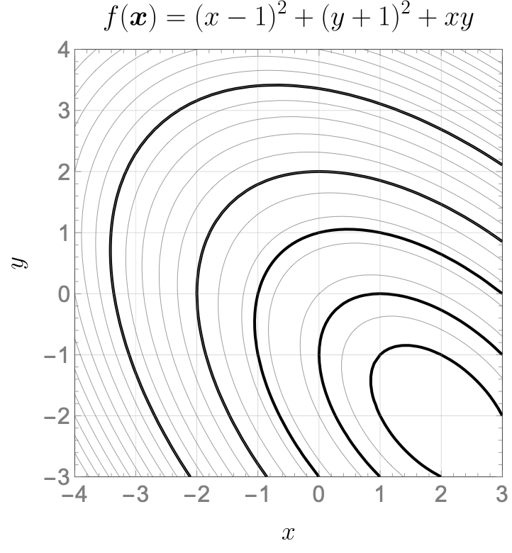
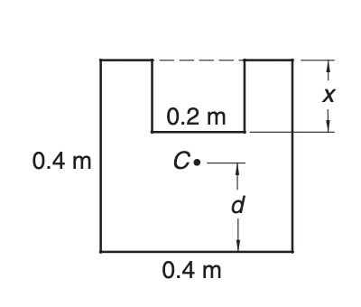

::: {.content-hidden unless-meta="solutions"}
# Solutions {.unnumbered}

:::

::: {.content-hidden when-meta="solutions"}

|              |                                              |
| ------------ | -------------------------------------------- | 
| Due Date     | Thu, Dec 03                                  | 
| Turn in link | Gradescope [PDF](https://moodle.swarthmore.edu/mod/lti/view.php?id=839622) and [Code](https://moodle.swarthmore.edu/mod/lti/view.php?id=839621)  | 
| URL          | `emadmasroor.github.io/E21-F26/Homework/HW11` |


[What to turn in]{.underline}

**Changelog**

- Changed at 1:30 PM on Friday, Nov 20: Problem 1.2 now only asks you to find a maximum; you do not need to account for finding a minimum.

Combine all written HW into one PDF file.

| Problem | Format                                  |
| ------- | --------------------------------------- |
| 1.1     | PDF |
| 1.2     | Code inside a python file called `goldensection.py` |
| 2     | PDF           |
| 3     | PDF     |
| 4     | PDF     |

                              

:::

# Golden Section Search

## By Hand

Use the Golden Section Search Method to locate the maximum of the function $f(x) = -x^6 - 2x^4 -3x+1$ between $x=-1$ and $x=0.5$. There is only one such maximum. Do this by filling out the following table up to the number of rows indicated, either by hand or electronically by downloading the LaTeX [template](GoldenSectionSearch.tex).

$$
\begin{array}{l|p{1.3cm}|p{2.5cm}|p{2.5cm}|p{1.7cm}|p{1.8cm}|p{1.5cm}}
Step & $a$ & $x_1 = b - Rh$ & $x_2 = a + Rh$ & b & $h$ & next\\ \hline 
0 &  & $x =$  &$x =$  &  & \phantom{1.2345}  & \\  
  &  &  &  &  &  & \\
   &  & $f =$ &$f=$  &  &  & \\ 
    &  &  &  &  &  & \\ \hline
1     &  &$x =$   &$x =$  &  &  & \\  
  &  &  &  &  &  & \\ 
   &  & $f =$ &$f =$  &  &  & \\ 
    &  &  &  &  &  & \\ \hline
2     &  &$x =$   &$x =$   &  &  & \\  
  &  &  &  &  &  & \\ 
   &  & $f =$ &$f =$  &  &  & \\ 
    &  &  &  &  &  & \\ \hline
3     &  &$x =$   &$x =$  &  &  & \\  
  &  &  &  &  &  & \\ 
   &  &$f =$  &$f =$   &  &  & \\ 
    &  &  &  &  &  & \\ \hline
4     &  &$x =$   &$x =$  &  &  & \\  
  &  &  &  &  &  & \\ 
   &  &$f =$  &$f =$   &  &  & \\ 
    &  &  &  &  &  & \\ \hline
5     &  &$x =$   &$x =$  &  &  & \\  
  &  &  &  &  &  & \\ 
   &  &$f =$  & $f =$ &  &  & \\ 
    &  &  &  &  &  & \\ \hline
6     &  &$x =$   &$x =$   &  &  & \\  
  &  &  &  &  &  & \\ 
   &  &$f =$  &$f =$  &  &  & \\ 
     &  &  &  &  &  & \\ 
\end{array}
$$

::: {.content-visible when-meta="solutions"}

:::


::: {.content-visible when-meta="solutions"}

::: {.callout-note}
## Solution

$$
\begin{array}{l|p{1.3cm}|p{2.5cm}|p{2.5cm}|p{1.7cm}|p{1.8cm}|p{1.5cm}}
Step & $a$ & $x_1 = b - Rh$ & $x_2 = a + Rh$ & b & $h$ & next\\ \hline 
0   &       & $x = -0.4271$     &$x =-0.0729$  &  & \phantom{1.2345}  & $f_1>f_2$ \\  
    & $-1.0$    &  &            & $0.5$             & $1.5 R^0$  & $\implies$ \\
    &       & $f = 2.2086$      &$f=1.2188$  &      & $=1.5$  &$\left[ a,x_2 \right]$  \\ 
        &       &  &  &  &  & \\ \hline
1       &       &$x = -0.6459$      &$x = -0.4271$  &  &  &$f_1>f_2$ \\  
    & $-1.0$    &  &            & $-0.0729$         & $1.5R^1$  & $\implies$ \\ 
    &       & $f =2.5170$       &$f =2.2086$  &     & $=0.9271$  &$\left[ a,x_2 \right]$ \\ 
        &       &  &  &  &  & \\ \hline
2       &       &$x =-0.7812$       &$x =-0.6459$   &  &  & $f_1<f_2$ \\  
    & $-1.0$ &  &               &  $-0.4271$        &$1.5R^2$ & $\implies$ \\ 
    &       & $f = 2.3716$      &$f =2.5170$  &     &$=0.5729$ &$\left[ x_1,b \right]$\\ 
        &       &  &  &  &  & \\ \hline
3       &       &$x =-0.6459$       &$x =0.5623$  &  &  &$f_1>f_2$ \\  
    & $-0.7812$ &  &            &  $-0.4271$        &$1.5R^3$  & $\implies$\\ 
    &       &$f = 2.5170$       &$f =2.4554$   &    &$=0.3541$  & $\left[ a,x_2 \right]$\\ 
        &       &  &  &  &  & \\ \hline
4       &       &$x =-0.6976$       &$x =0.6459$  &  &  & $f_1<f_2$ \\  
    & $-0.7812$  &  &           & $-0.5623$         &$1.5R^4$  & $\implies$\\ 
    &       &$f = 2.5039$       &$f =2.5170$   &        & $=0.2188$ & $\left[ x_1,b \right]$\\ 
        &       &  &  &  &  & \\ \hline
5       &       &$x =-0.6459$       &$x =-0.6140$  &  &  &$f_1>f_2$ \\  
    & $-0.6976$ &  &            &  $-0.5623$        &$1.5R^5$  &$\implies$ \\ 
    &       &$f =2.5170$        &$f =2.5041$ &              & $=0.1353$  & $\left[ a,x_2 \right]$ \\ 
        &       &  &  &  &  & \\ \hline
6       &       &$x =-0.6656$       &$x =-0.6459$   &  &  & $f_1>f_2$\\  
    &$-0.6976$  &  &            & $-0.6141$         &$1.5R^6$  &$\implies$\\ 
    &       &$f =2.5173$        &$f =2.5170$  &         & $=0.0836$ & $\left[ a,x_2 \right]$  \\ 
        &       &  &  &  &  & \\ 
\end{array}
$$
:::
:::

## With Python

Write a Python function that uses the Golden Section Search algorithm to find a maximum of the function $f(x)$.

Your function should accept the following arguments:

- a function, which is to be optimized
- Two real numbers `a` and `b`, corresponding to the left-ward and right-ward edges of the region which is to be searched for an optimum,
- a parameter `tol`, which in practice will be a small number such as `1e-6` or similar.

The output returned by your function should be a single numerical value of the latest estimate of the turning point of the given function. The program should conclude when the size of the bracket has successfully been brought down to less than `tol`.

::: {.content-visible when-meta="solutions"}
::: {.callout-note}
## Solutions

The given code prints out all of its reasoning.

```{.python}
import math
import numpy as np
def search(f,a,b,tol):
    R = 0.618033989
    converged = False
    while not converged:
        x1 = b - R*(b-a)
        x2 = a + R*(b-a)

        f1 = f(x1)
        f2 = f(x2)

        print(f"x1 = {x1:.3f}, x2 = {x2:.3f}")
        print(f"fx1 = {f(x1):.3f}, fx2 = {f(x2):.3f}")

        if f1 > f2:
            print("discard right side. Use [a,x2]")
            # a remains a
            b = x2 # What was originally x2 is now b.
            x2 = x1 # What was originally x1 is now x2.
            x1 = b - R*(b-a)
        elif f1 < f2:
            print("discard left side. Use [x1,b]")
            # b remains b
            a = x1 # What was originally x1 is now a
            x1 = x2 # What was originally x2 is now x1
            x2 = a + R*(b-a)
        print(f"Now, a = {a:.3f}, x1 = {x1}, x2 = {x2}, b = {b}")
        print("---")
        if abs(b-a) < tol:
            converged = True
            optim_x = (x2+x1)/2
    return optim_x

def func2(x):
    return np.sin(2.0*x)

print(search(func2,0.0,1.4,1e-6))
```
:::
:::

Test your function by finding two different maxima of the following function. Illustrate that you have done this correctly by generating a plot of the function together with points indicating the minima and maxima that you find.

```{.python}
import numpy as np

def f1(x): return np.exp(-0.5*x)*np.sin(x))
```

::: {.content-visible when-meta="solutions"}
::: {.callout-tip}
## Solution

```{python}
import math
import numpy as np
import matplotlib.pyplot as plt
def search(f,a,b,tol):
    R = 0.618033989
    converged = False
    while not converged:
        x1 = b - R*(b-a)
        x2 = a + R*(b-a)

        f1 = f(x1)
        f2 = f(x2)

        #print(f"a = {a:.3f}, x1 = {x1:.3f}, x2 = {x2:.3f}, b = {b:.3f}")
        #print(f"fx1 = {f(x1):.3f}, fx2 = {f(x2):.3f}")

        if f1 > f2:
            #print("discard right side. Use [a,x2]")
            # a remains a
            b = x2 # What was originally x2 is now b.
            x2 = x1 # What was originally x1 is now x2.
            x1 = b - R*(b-a)
        elif f1 < f2:
            #print("discard left side. Use [x1,b]")
            # b remains b
            a = x1 # What was originally x1 is now a
            x1 = x2 # What was originally x2 is now x1
            x2 = a + R*(b-a)
        #print(f"Now, a = {a:.3f}, x1 = {x1}, x2 = {x2}, b = {b}")
        #print("---")
        if abs(b-a) < tol:
            converged = True
            optim_x = (x2+x1)/2
    return optim_x

def func2(x):
    return np.sin(2.0*x)

def func3(x):
    return np.exp(-0.5*x)*np.sin(x)

x_optim1 = search(func3,5.9,9.5,1e-4)
x_optim2 = search(func3,0,3,1e-4)
        
x_plot = np.linspace(0,10,101)
y_plot = func3(x_plot)

plt.plot(x_plot,y_plot,'k-')
plt.scatter([x_optim1,x_optim2],[func3(x_optim1),func3(x_optim2)])
plt.show()
```
:::
:::



# Constraints

Determine the penalty function $P(x,y)$ associated with the following constraints for a 2-dimensional optimization problem.

1. $(x,y)$ lie on a circle of radius $3$ centered at the point $x=9,y=7$
2. $(x,y)$ lie on the left half of the plane $y = 2x$
3. $(x,y)$ lie on an ellipse centered on the origin with semimajor axis equal to $3$ in the $y$ direction and semiminor axis equal to $2$ in the $x$ direction.
4. $(x,y)$ lie inside the rectangle shown below.

```{.tikz}
%%| additionalPackages: \usepackage{pgfplots}
\begin{tikzpicture}
\begin{axis}[
    axis lines = middle,
    xlabel = {$x$},
    ylabel = {$y$},
    xmin = -0.5, xmax = 5.5,
    ymin = -0.5, ymax = 7.5,
    xtick = {1,2,3,4,5},
    ytick = {1,2,3,4,5,6,7},
    grid = both,
    grid style = {gray!25},
    axis equal image
]
  \draw[very thick, blue, fill=blue!12] (axis cs:1,1) rectangle (axis cs:4,6);
  \fill[blue] (axis cs:1,1) circle (2pt) node[below left, black] {$(1,1)$};
  \fill[blue] (axis cs:4,6) circle (2pt) node[above right, black] {$(4,6)$};
\end{axis}
\end{tikzpicture}
```

::: {.callout-note}
## Equation of an ellipse

An ellipse located at the center $(0,0)$ that has its semimajor axis equal to $a$ along the $x$ axis direction and its semiminor axis equal to $b$ along the $y$ axis direction satisfies the equation $$\frac{x^2}{a^2} + \frac{y^2}{b^2} = 1$$
:::

::: {.content-visible when-meta="solutions"}
::: {.callout-tip}
## Solutions

1. To lie on a circle is to satisfy the following equation, $$(x-x_0)^2 + (y-y_0) = r^2$$ which lends itself to a 'constraint equation' definition, i.e. $$P(\boldsymbol{x}) = (x-x_0)^2 + (y-y_0)^2 - r^2$$
2. To lie on the left half of the plane $y = 2x$ is for $y$ to be ever greater than $2x$. This can be expressed as $y \geq 2x \implies (2x-y) \leq 0$. So the penalty function is $$P(\boldsymbol{x}) = 2x-y$$
3. The penalty function is $$P(\boldsymbol{x}) = \frac{x^2}{2^2} + \frac{y^2}{b^2} - 1$$
4. A point is inside the given rectangle when it satisfies the following four inequalities.
   $$\begin{align} x \leq & 4 \\ x \geq & 1 \\ y \leq & 6 \\ y \geq & 1 \end{align}$$
   We can write each of these as functions that must be less than zero to satisfy the constraint.
   $$\begin{align}h_1(\boldsymbol{x}) =& x-4 \\ h_2(\boldsymbol{x}) =& 1-x \\ h_3(\boldsymbol{x}) =& y-6 \\ h_4(\boldsymbol{x}) =& 1-y\end{align}$$
   The penalty function has to take into account that when a given point is outside one of the designated boundaries, the associated $h$ function is negative.
   $$P(\boldsymbol{x}) = \max \{ 0,(x-4) \}^2 + \max \{ 0,(1-x) \}^2 + \max \{ 0,(y-6) \}^2 + \max \{ 0,(1-y) \}^2$$
   or, as the textbook writes it, $$P(\boldsymbol{x}) = \sum_i^4 \{ max(0, h_j(\boldsymbol{x}))]\}^2$$

:::
:::

# Naive multidimensional optimization

## Working out the steps by hand

Minimize the function $$ f(\boldsymbol{x}) = f(x,y) = (x-1)^2 + (y+1)^2 + xy \label{fmin}
$$
using naive $n$-dimensional optimization by hand for four steps, cycling through the direction vectors
$$
\boldsymbol{v_1} = \begin{bmatrix} 1 \\ 1\end{bmatrix}, \quad \boldsymbol{v_2} = \begin{bmatrix} 0 \\ 1 \end{bmatrix},
$$
starting with the guess 
$$
\boldsymbol{x_0} = \begin{bmatrix} x_0  \\ y_0 \end{bmatrix} = \begin{bmatrix} -1 \\ 2 \end{bmatrix}.
$$
This function is simple enough that you should not need to use an optimization program to carry out each of the 1-dimensional optimizations; instead, you should be able to do these by hand using single-variable calculus.

At each step, calculate the 'true relative error' in $\boldsymbol{x}$ by comparing against the correct value of the minimum, and the 'approximate relative error' by comparing against the previously-computed value (i.e., compare step 1 against step 0, step 2 against step 1, etc.). These errors can be calculated using the following definitions:

$$\text{True relative error } = \frac{\left \lVert \boldsymbol{x} - \boldsymbol{x}_{\text{true}} \right \rVert }{ \left \lVert \boldsymbol{x}_{\text{true}} \right\rVert} , \text{ and}$$

$$\text{Approximate relative error } = \frac{ \left\lVert \boldsymbol{x}_{\text{current}} - \boldsymbol{x}_{\text{previous}} \right \rVert}{ \left \lVert \boldsymbol{x}_{\text{previous}} \right \rVert}.
$$

Note that you can find the correct answer by solving a math problem; take derivatives of $f$ with respect to $x$ and $y$, equate them to zero, and solve the resulting equations 'by hand'.

Also, recall that the norm of a vector is $\left \lVert \boldsymbol{x} \right \rVert = \sqrt{x_1^2+x_2^2 + ... + x_n^2}$

Tabulate your results in the follwing format:

|                  | Step 0       | Step 1 | Step 2 | Step 3 | Step 4 |
|------------------|--------------|--------|--------|--------|--------|
| $x$         | $-1$       |        |        |        |        |
| $y$        | $\phantom{-}2$        |        |        |        |        |
| $f(x,y)$    | $11$       |        |        |        |        |
| True relative error | $\approx 1.768$  |        |        |        |        |
| Approx. relative error |N/A        |        |        |        |        |

::: {.content-visible when-meta="solutions"}
::: {.callout-tip}
## Solution

$$
\begin{array}{|c|c|l|l|l|l|}
\hline
 & \text{Step 0} & \text{Step 1} & \text{Step 2} & \text{Step 3} & \text{Step 4} \\ \hline
x & -1 & -1.5 & -1.5 & -0.625 & -0.625 \\ \hline
y & 2 & +1.5 & -0.25 & +0.625 & -0.6875 \\ \hline
f(x,y) & 11 & 10.25 & 7.1875 & 4.8906 & 3.1679 \\ \hline
\text{True relative error} & 1.7677 & 1.7500 & 1.3835 & 1.3125 & 1.0376 \\ \hline
\text{Approx. relative error} & \text{--} & 0.3162 & 0.8249 & 0.8137 & 1.4849 \\ \hline
\end{array}
$$

:::
:::

## Illustrate

Illustrate the steps from the previous problem graphically on the following plot, which shows contours of $f(\boldsymbol{x})$. Label the points $\boldsymbol{x}_0$ through $\boldsymbol{x}_4$, as well as the direction vectors $\boldsymbol{v}_1$ and $\boldsymbol{v}_2$ drawn at the appropriate locations. Altogether, you will have five points connected by four lines: two lines will have the direction of $\boldsymbol{v}_1$ and two will have the direction of $\boldsymbol{v}_2$. You may either use repeated labels or label the successive directions $[\boldsymbol{v}_1, \boldsymbol{v}_2, \boldsymbol{v}_3, \boldsymbol{v}_4]$

::: {.content-visible unless-meta="solutions"}



:::

::: {.content-visible when-meta="solutions"}
::: {.callout-tip}
## Solution

```{.tikz width="5in"}
%%| additionalPackages: \usepackage{pgfplots}

\begin{tikzpicture}
\begin{axis}[
    axis equal image,
    width=11cm,
    xmin=-4, xmax=3,
    ymin=-3, ymax=4,
    xtick={-4,-3,-2,-1,0,1,2,3},
    ytick={-3,-2,-1,0,1,2,3,4},
    xlabel={$x$},
    ylabel={$y$},
    grid=both,
    grid style={gray!20, very thin},
    ticklabel style={font=\small}
]

  % Exact contours at the 5 iterate levels (11 down to 3.168) plus inner levels (1, -1)
  \pgfplotsinvokeforeach{11, 10.25, 7.1875, 4.890625, 3.16796875, 1, -1}{
    \addplot[
      domain=0:360,
      samples=200,
      variable=\t,
      blue!65!black,
      thin
    ] (
      {2 + sqrt(#1 + 2)*(cos(\t)/sqrt(3) + sin(\t))},
      {-2 + sqrt(#1 + 2)*(cos(\t)/sqrt(3) - sin(\t))}
    );
  }

  % Contour value labels positioned inside the [-4, 3] x [-3, 4] window
  \node[font=\scriptsize, blue!75!black, fill=white, inner sep=1pt] at (axis cs:1.12, 1.88) {$f = 11$};
  \node[font=\scriptsize, blue!75!black, fill=white, inner sep=1pt] at (axis cs:1.26, 1.26) {$7.19$};
  \node[font=\scriptsize, blue!75!black, fill=white, inner sep=1pt] at (axis cs:1.46, 0.44) {$3.17$};
  \node[font=\scriptsize, blue!75!black, fill=white, inner sep=1pt] at (axis cs:1.80, -0.95) {$-1$};

  % Optimization trajectory: 4 directed 1D line-search segments
  \draw[->, >=stealth, very thick, red!80!black] (axis cs:-1, 2) -- (axis cs:-1.5, 1.5);
  \draw[->, >=stealth, very thick, red!80!black] (axis cs:-1.5, 1.5) -- (axis cs:-1.5, -0.25);
  \draw[->, >=stealth, very thick, red!80!black] (axis cs:-1.5, -0.25) -- (axis cs:-0.625, 0.625);
  \draw[->, >=stealth, very thick, red!80!black] (axis cs:-0.625, 0.625) -- (axis cs:-0.625, -0.6875);

  % Iterate markers and labels
  \fill[red!80!black] (axis cs:-1, 2) circle (2.2pt)
    node[above, font=\scriptsize, black] {Step 0 $(-1, 2)$};
  \fill[red!80!black] (axis cs:-1.5, 1.5) circle (2.2pt)
    node[left, font=\scriptsize, black] {Step 1 $(-1.5, 1.5)$};
  \fill[red!80!black] (axis cs:-1.5, -0.25) circle (2.2pt)
    node[left, font=\scriptsize, black] {Step 2 $(-1.5, -0.25)$};
  \fill[red!80!black] (axis cs:-0.625, 0.625) circle (2.2pt)
    node[right, font=\scriptsize, black] {Step 3 $(-0.625, 0.625)$};
  \fill[red!80!black] (axis cs:-0.625, -0.6875) circle (2.2pt)
    node[below left, font=\scriptsize, black] {Step 4 $(-0.625, -0.6875)$};

  % Exact global minimum marker (no text label)
  \fill[teal!80!black] (axis cs:2, -2) circle (2.6pt);

\end{axis}
\end{tikzpicture}
```
:::
:::

# Optimization for engineering problems

## Centroid calculation

A rectangle is to be cut out of a square cross-section, shown in the figure here. The width of the cut-out rectangle is fixed at $0.2$ meters but its length is variable, and is equal to $x$ meters.

Find the value of $x$ that minimizes $d$, the distance of the centroid $C$ of the cross-section from its bottom edge. In the process, write down a mathematical optimization problem.



::: {.content-visible when-meta="solutions"}
::: {.callout-tip}
## Solution

```{.tikz}

\begin{tikzpicture}[scale=1.1]
  % Outer U-channel cross-section
  \draw[very thick, black]
    (0,0) -- (4,0) -- (4,4) -- (3,4) -- (3,1.4) -- (1,1.4) -- (1,4) -- (0,4) -- cycle;

  % Horizontal differential strip (dA) in the lower base section
  \fill[blue!15] (0, 0.55) rectangle (4, 0.80);
  \draw[thick, blue!70!black] (0, 0.55) -- (4, 0.55);
  \draw[thick, blue!70!black] (0, 0.80) -- (4, 0.80);

  % Label dA inside the strip
  \node[font=\footnotesize, blue!70!black] at (2, 0.675) {$dA$};

  % Vertical coordinate y from bottom datum to strip center
  \draw[thin, gray!70] (-0.55, 0) -- (0, 0);
  \draw[thin, gray!70] (-0.55, 0.675) -- (0, 0.675);
  \draw[<->, >=stealth, semithick] (-0.35, 0) -- (-0.35, 0.675)
    node[midway, left, font=\small] {$y$};

  % Witness lines and opposing arrows defining dy
  \draw[thin, gray!70] (4, 0.80) -- (4.55, 0.80);
  \draw[thin, gray!70] (4, 0.55) -- (4.55, 0.55);
  \draw[->, >=stealth, thick] (4.35, 1.30) -- (4.35, 0.80);
  \draw[->, >=stealth, thick] (4.35, 0.05) -- (4.35, 0.55);

  % Definition of dy on the diagram
  \node[right, align=left, font=\small] at (4.60, 0.675)
    {$dy$: differential strip thickness\\[-2pt]
     \footnotesize(infinitesimal height of $dA$)};
\end{tikzpicture}
```

The equation can be derived as below.

**Centroid:**

$$
d = \frac{\int y \, dA}{\int dA}
$$

$$
\begin{aligned}
d &= \frac{\displaystyle \int_{0}^{0.4 - x} 0.4 y \, dy + \int_{0.4 - x}^{0.4} 0.2 y \, dy}{\displaystyle \int_{0}^{0.4 - x} 0.4 \, dy + \int_{0.4 - x}^{0.4} 0.2 \, dy} \\[1.4em]
  &= \frac{\left. 0.2 y^2 \right|_{0}^{0.4 - x} + \left. 0.1 y^2 \right|_{0.4 - x}^{0.4}}{\left. 0.4 y \right|_{0}^{0.4 - x} + \left. 0.2 y \right|_{0.4 - x}^{0.4}} \\[1.4em]
  &= \frac{0.2(0.4 - x)^2 + 0.1(0.4^2) - 0.1(0.4 - x)^2}{0.4(0.4 - x) + 0.2 \times 0.4 - 0.2 \times (0.4 - x)} \\[1.4em]
  &= \frac{0.1(0.4 - x)^2 + 0.1(0.4^2)}{0.2(0.4 - x) + 0.2 \times 0.4}
\end{aligned}
$$

Then, if we wish to write a program that solves the above optimization problem, it goes here:

```{python}
from scipy.optimize import minimize_scalar
import matplotlib.pyplot as plt
import numpy as np

def ff(x):
    return (0.1*(0.4-x)**2+0.1*0.4**2)/(0.2*(0.4-x)+0.2*0.4)

check = minimize_scalar(ff,bounds=[0,0.4],method="bounded")
print(f"Distance to centroid d is minimized at x = {check.x:.3f}")
```
:::
:::

