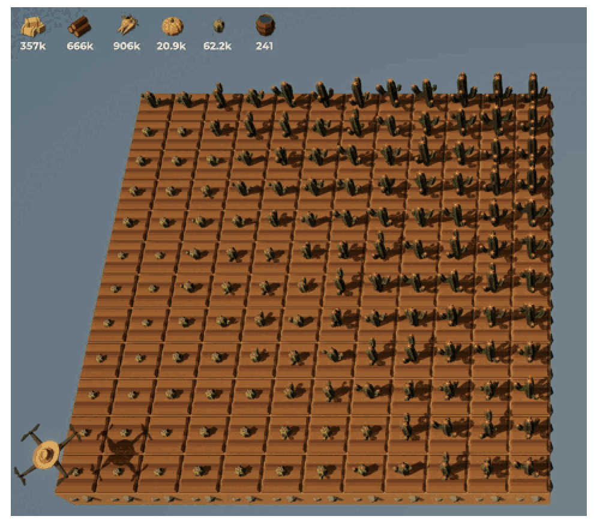
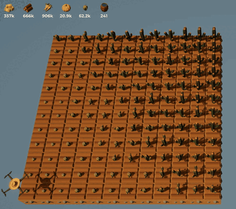
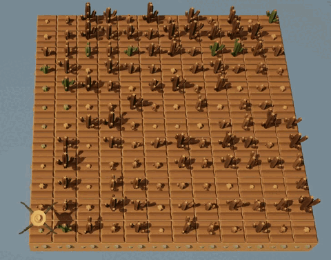
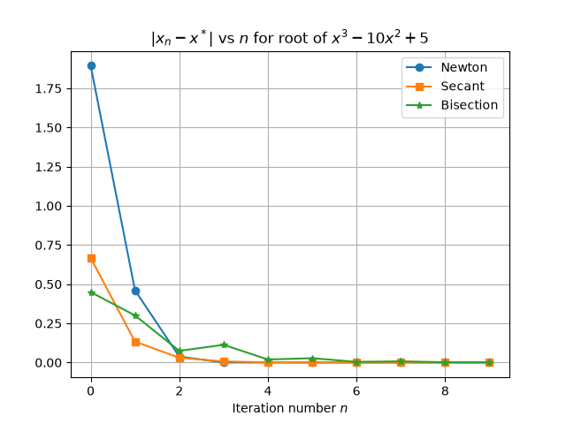
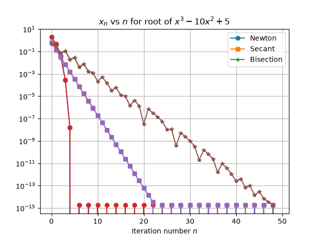

::: {.content-hidden unless-meta="solutions"}
# Solutions {.unnumbered}

:::

::: {.content-hidden when-meta="solutions"}

|              |                                              |
| ------------ | -------------------------------------------- | 
| Due Date     | Thu, Oct 29                                  | 
| Turn in link | Gradescope [PDF](https://moodle.swarthmore.edu/mod/lti/view.php?id=835486) and [Code](https://moodle.swarthmore.edu/mod/lti/view.php?id=835485)  | 
| URL          | `emadmasroor.github.io/E21-F26/Homework/HW7` |


::: {.callout-note}
## Changelog

- Added Wednesday, Oct 28 at 9 AM: Naming convention for functions in problem @sec-newton and @sec-secant. This is important for our grading workflow, but you will not be penalized for it if you submitted your homework before this time.
- Added Wednesday, Oct 28 at 3 PM: Emphasize that solutions are to be obtained graphically in problem 5.
:::

[What to turn in]{.underline}

Combine all written HW into one PDF file.

| Problem | Format                                               |
| ------- | ---------------------------------------------------- |
| 1       | Code: One `.py` file containing all TFWR code.       |
| 2       | Code: One or more `.py` files as well as image files |
| 3       | Code: One `.py` file                                 |
| 4.1,4.2 | Code: one or more `.py` files                        |
| 4.3     | PDF                                                  |
| 5       | PDF                                                  |


:::

# The Farmer Was Replaced

Download [the save file here](Save-for-HW7.zip) to ensure that you've unlocked all that's required for this assignment.

## Sorting Cacti

Cacti grow best when they are **sorted**. In TFWR, sorted cacti are those which are arranged in order of size relative to their neighboring cacti: the smallest cacti should be on the south and west, and largest cacti should be to the north and east.

You can check the size of the cactus underneath your drone using the function `measure()`, which returns an integer from 1 to 9. If you call `measure` with an argument, you can also measure the neighboring cacti (without moving your drone). For example, `measure(East)` measures the cactus to the East of the current location of the drone.

The `swap(<direction>)` function swaps the cactus underneath the dronw for the cactus located `<direction>` away from the drone. For example, `swap(North)` swaps the cactus underneath the drone with a cactus to the north of the drone.

::: {layout-ncol=2}



:::

Write a program that plants cacti on the entire farm, then sorts them into the correct order, then harvests them. It need only do this once.

::: {.callout-note}
## Hint

Your code should work 'out of the box', regardless of whether the farm is tilled or not. You can either 

- use `clear()` and start from an untilled farm, and till each spot
- check the soil type and only `till()` if needed.
:::

The precise sorting algorithm you use is not necessarily important. This is not a Computer Science class, so your algorithm does not need to be the most efficient one in the world, as long as it works correctly and accomplishes its objective.

::: {.callout-note}
## Success
You have succeeded when the entire farm of cacti can be harvested in a single 'poof', as seen in @fig-poof. Also notice that cacti are green when sorted and brown when unsorted.

::: {.content-hidden when-format="pdf"}
{#fig-poof}
:::

:::

::: {.callout-note}
## An example algorithm
On the class website you can see an example sorting algorithm in action in @fig-sort. Here, the drone works hard to sort the farm. It accomplishes its objective by **first** sorting each row, then sorting the columns.

::: {.content-hidden when-format="pdf"}
{#fig-sort}
:::

You can also find this gif in video format hosted at `Panopto` at the following [link](https://swarthmore.hosted.panopto.com/Panopto/Pages/Viewer.aspx?id=7ad84049-3574-4ffa-93ee-b4eb01042025). This will allow you to have better control over the playback of the animation in @fig-sort.

:::

::: {.content-visible when-meta="solutions"}
::: {.callout-tip}
## Solutions

The following code plants pumpkins on the entire field.

```{.python}
def zeroloc():
    xdist = get_pos_x()
    ydist = get_pos_y()
    for i in range(xdist):
        move(West)
    for i in range(ydist):
        move(South)
    return None

# Harvest anything remaining, 
# till if necessary, and plant
# cacti.
zeroloc()
for j in range(get_world_size()):
    for k in range(get_world_size()):
        if can_harvest():
            harvest()
        if get_ground_type() == Grounds.Grassland:
            till()
        plant(Entities.Cactus)
        move(East)
    move(North)
```

The following code sorts the field.

```{.python}
# Sort horizontally first
for j in range(get_world_size()):
  while True:
    count_ok = 1
    for i in range(get_world_size()):
        move(East)
        if measure() < measure(West):
            swap(West)
        else:
            count_ok += 1

    if count_ok == get_world_size():
        break
  move(North)
 
# Sort vertically next
for j in range(get_world_size()):
  while True:
    count_ok = 1
    for i in range(get_world_size()):
        move(North)
        if measure() < measure(South):
            swap(South)
        else:
            count_ok += 1

    if count_ok == get_world_size():
        break
  move(East)
```

The following code harvests it all.

```{.python}
# Should now be done. Harvest the fruits of your labor!
do_a_flip()
print("All cacti sorted!")
harvest()
```
:::
:::

# Convergence of root-finding methods

The code given below compares the performance of three root-finding algorithms for finding a root (which we call $x^*$) of the function $f(x) = x^3 - 10x^2 + 5$ near $x=8$. Each method is run for ten iterations. The numerical methods have not been correctly implemented, however, and the resulting figure is different from the desired one.

::: {.callout-note}
## True value

The true value of the root is apprxoimately `9.949491057914386`
:::

Modify the code to accomplish the following objectives.

1. Correctly implement all three root-finding algorithms
2. Create a graph of $|x_n-x^*|$ against $n$, plotted on the usual linear axes. $n$ should go up to 10.
3. Create a graph of $|x_n-x^*|$ against $n$, plotted on a logarithmic scale on the vertical axis. For this graph, [$n$ should go up to 50]{.underline}. See the documentation for [`semilogy`](https://matplotlib.org/stable/api/_as_gen/matplotlib.axes.Axes.semilogy.html#matplotlib.axes.Axes.semilogy).

```{.python}
import numpy as np
import matplotlib.pyplot as plt

f2 = lambda x: x**3 - 10 * x**2 + 5
fp2 = lambda x: -20 * x + 3 * x**2

N = 10

x_newton = np.zeros(N)
x_secant = np.zeros(N)
x_bisect = np.zeros(N)

xold = 8

# Newton iterations
for i in range(N):
    xnew = xold - f2(xold)/fp2(xold)
    xnew = xold
    x_newton[i] = xnew
    
# Secant iterations
x1 = 8
x2 = 9
for i in range(N):
    m = (f2(x2)-f2(x1))/(x2-x1)
    c = f2(x1) - m*x1
    xnew = c/m
    x1 = x2
    x2 = xnew
    x_secant[i] = xnew

# Bisection iterations
xL = 8
xR = 11

for i in range(N):
    xM = (xL+xR)/2
    fxL = f2(xL)
    fxR = f2(xR)
    fxM = f2(xM)
    
    x_bisect[i] = xM
    if np.sign(xL) == np.sign(xM):
        # search in right side
        xL = xM
    elif np.sign(xR) == np.sign(xM):
        # search in left side
        xR = xM

# Plot x value against step
plt.plot(x_newton,marker="o")
plt.plot(x_secant,marker="s")
plt.plot(x_bisect,marker="*")
plt.legend(["Newton","Secant","Bisection"])
plt.title("$x_n$ vs $n$ for root of $x^3-10x^2+5$")
plt.xlabel("Iteration number $n$")
plt.grid(visible=True)
plt.savefig("test.png")
plt.show()
```

::: {.content-hidden unless-meta="solutions"}
::: {.callout-tip}
## Solutions

The following snippets of code correctly solve this problem. It's a little more verbose than it needs to be, and has been divided into two scripts below for convenience.


```{.python}
import numpy as np
import matplotlib.pyplot as plt

f2 = lambda x: x**3 - 10 * x**2 + 5
fp2 = lambda x: -20 * x + 3 * x**2

# ---- First graph, linear scale ---- #

N = 10

x_newton = np.zeros(N)
x_secant = np.zeros(N)
x_bisect = np.zeros(N)

xold = 8

# Newton iterations
for i in range(N):
    xnew = xold - f2(xold)/fp2(xold)
    xold = xnew
    x_newton[i] = xnew
    
# Secant iterations
x1 = 8
x2 = 9
for i in range(N):
    m = (f2(x2)-f2(x1))/(x2-x1)
    c = f2(x1) - m*x1
    xnew = -c/m
    x1 = xnew
    x_secant[i] = xnew

# Bisection iterations
xL = 8
xR = 11

for i in range(N):
    xM = (xL+xR)/2
    fxL = f2(xL)
    fxR = f2(xR)
    fxM = f2(xM)
    
    x_bisect[i] = xM
    if np.sign(fxL) == np.sign(fxM):
        # search in right side
        print("Right side!")
        xL = xM
    elif np.sign(fxR) == np.sign(fxM):
        # search in left side
        print("Left side!")
        xR = xM

# Plot difference versus true value against step
true_value = 9.949491057914386
plt.plot(abs(x_newton-true_value),marker="o")
plt.plot(abs(x_secant-true_value),marker="s")
plt.plot(abs(x_bisect-true_value),marker="*")
plt.legend(["Newton","Secant","Bisection"])
plt.title("$|x_n - x^*|$ vs $n$ for root of $x^3-10x^2+5$")
plt.xlabel("Iteration number $n$")
plt.grid(visible=True)
plt.show()
```

```{.python}
# ---- Second graph, log scale ---- #

N = 50

x_newton = np.zeros(N)
x_secant = np.zeros(N)
x_bisect = np.zeros(N)

xold = 8

# Newton iterations
for i in range(N):
    xnew = xold - f2(xold)/fp2(xold)
    xold = xnew
    x_newton[i] = xnew
    
# Secant iterations
x1 = 8
x2 = 9
for i in range(N):
    m = (f2(x2)-f2(x1))/(x2-x1)
    c = f2(x1) - m*x1
    xnew = -c/m
    x1 = xnew
    x_secant[i] = xnew

# Bisection iterations
xL = 8
xR = 11

for i in range(N):
    xM = (xL+xR)/2
    fxL = f2(xL)
    fxR = f2(xR)
    fxM = f2(xM)
    
    x_bisect[i] = xM
    if np.sign(fxL) == np.sign(fxM):
        # search in right side
        xL = xM
    elif np.sign(fxR) == np.sign(fxM):
        # search in left side
        xR = xM

true_value = 9.949491057914386
plt.semilogy(np.arange(N),abs(x_newton-true_value),marker="o")
plt.semilogy(np.arange(N),abs(x_secant-true_value),marker="s")
plt.semilogy(np.arange(N),abs(x_bisect-true_value),marker="*")
plt.legend(["Newton","Secant","Bisection"])
plt.title("$x_n$ vs $n$ for root of $x^3-10x^2+5$")
plt.xlabel("Iteration number $n$")
plt.grid(visible=True)
plt.show()
```

The resulting graphs look like this

::: {layout-ncol=2}



:::

:::
:::

# A Python program for the Secant method {#sec-secant}

::: {.callout-note}
Combine all code for this problem into a single file.
:::

## Write a function{#sec-func}

Write a Python function **named `secant_method(...)`** that takes as input the following 4 arguments, **in order**:

1. A function `f`, whose root is to be found.
2. `x1`, one estimate of the root
3. `x2`, another estimate of the root
4. `n`, the number of steps of the secant method that are to be carried out.

It should output a guess for the root of $f(x)$.

::: {.callout-note}
## Functions as arguments

A Python function can be an argument to another function. For example, the following function takes as input the independent variable $x$ and the function $g$, and returns $g^2(x) = g(x) \times g(x)$

```{.python}
from numpy import sin

def square(func,xval):
    return func(xval)*func(xval)

print(f"{square(sin,2):.3f}")
```
:::

## Use your function

Use your function to determine a root of the function $\sin e^{x/2}$ starting from $x=1$ and $x=2$ as your initial guesses. For this part, your code should call the function you wrote in @sec-func and should print a value for the root.


::: {.content-hidden unless-meta="solutions"}

## Solution

::: {.callout-tip}
## Solutions

The following code is a satisfactory solution to this problem.

```{.python}
def secant(f,x1,x2,n):
    for i in range(n):
        m = (f(x2)-f(x1))/(x2-x1)
        c = f(x1) - m*x1
        xnew = -c/m
        x1 = x2
        x2 = xnew
    return xnew

# Test it on the desired function
from numpy import sin,exp
def f_test(x):
    return sin(exp(x/2))

# Call the function
print(f"The function sin(exp(x/2)) has a root at x = {secant(f_test,1,2,10):.3f}")
```
:::
:::


# A Python program for Newton's method {#sec-newton}

## Write a function

Write a Python function **named `newtons_method(...)`** for Newton's method that accepts as argument the following four entities **in order**:

1. The function $f(x)$ whose root is to be found,
2. The function $f'(x)$, its derivative,
3. A guess $x_0$ from which to start calculations, and
4. A tolerance parameter $\varepsilon$.

Given a function $f$ and its derivative $f'$, your Python function should apply Newton's method to find a root of $f(x)$ starting from $x=x_0$. It should continue searching for a root until the following termination criterion has been met. After termination, it should return the latest guess of the root's value.

::: {.callout-note}
## Termination criterion

Terminate the search for a root when $$\frac{|x_{n+1} - x_{n}|}{|x_n|} < \varepsilon,$$ where $\varepsilon$ is a tolerance parameter that is generally a small number.

A smaller $\varepsilon$ will lead to a more accurate solution.
:::

## Use your function{#sec-usefunc}

Use your function to find a root of $f(x) = \sin e^{x/2}$, starting from (1) $x_0=2$ and (2) $x_0 = 1$. Write print statements to report to a user the results of your calculations.

::: {.content-hidden unless-meta="solutions"}
::: {.callout-tip}
## Solutions

The following code is a satisfactory solution to this problem, with the added (unnecessary) feature that it counts the number of iterations it took to find the answer.
```{.python}
def newton(f,fp,x0,epsilon):
    error = 1
    xold = x0
    count_iters = 0
    while error > epsilon:
        # Calculate the new value of x
        xnew = xold - f(xold)/fp(xold)
        # Calculate error
        error = (abs(xnew-xold))/(abs(xold))
        # Update memory; forget old value
        xold = xnew
        # Count
        count_iters += 1
    print(f"Newton's method terminated after {count_iters} iters.")
    return xnew

from numpy import sin,exp,cos
# Define a function whose root will be looked for.
def f1(x):
    return sin(exp(x/2))
# Need its derivative also
def f1p(x):
    return (1/2) * exp(x/2) * cos(exp(x/2))

# From x = 2
xval = 2
print(f"Starting from x = {xval}, Newton's method finds the root {newton(f1,f1p,xval,1e-6):.6f}")

# From x = 1
xval = 1
print(f"Starting from x = {xval}, Newton's method finds the root {newton(f1,f1p,xval,1e-6):.6f}")
```

We find the following result:

```
Newton's method terminated after 4 iters.
Starting from x = 2, Newton's method finds the root 2.289460
Newton's method terminated after 4 iters.
Starting from x = 1, Newton's method finds the root 16.535193
```

This is because the function in question has many zeros.

The following sketch shows that the straight line will only intercept the $x$ axis very far from the initial guess, since it is close to a turning point of $f(x)$.

```{.tikz width="6in"}
%%| additionalPackages: \usepackage{pgfplots}
\pgfmathdeclarefunction{f}{1}{%
  \pgfmathparse{sin(deg(exp(#1/2)))}%
}
\pgfmathdeclarefunction{fp}{1}{%
  \pgfmathparse{(1/2)*exp(#1/2)*cos(deg(exp(#1/2)))}%
}
\begin{tikzpicture}
\begin{axis}[
    legend pos=south west,
    domain=-2:6, % adjust the domain as needed
    samples=200, % increase for smoother curve
    width=\textwidth, % adjust the width of the plot
    height=0.75\textwidth, % adjust the height of the plot
    %xmin=-4, xmax=0, % set the x-axis limits
    ymin=-1.2, ymax=1.2, % set the y-axis limits
    minor tick num=9,
    grid=both,
    axis x line=middle,
    axis y line=middle,
    major tick style ={thick, black},
    x tick label style = {gray!30}
  ]
    \addplot[blue,smooth,thick] {f(x)};
    \addplot[red,smooth,thick] {fp(1)*x+f(1)-fp(1)*1};
  \end{axis}
\end{tikzpicture}
```
:::
:::

## Explain its behavior

By using a graph of the function $\sin e^{x/2},$ explain the results from @sec-usefunc. Why does the program find the results it does? Sketch a few steps of Newton's method by hand to aid in your explanation.


# Graphical Illustration of Root-finding

## Bisection Method for $f(x) = (x+\pi)(x-\pi/2)(x-5)$

### Bisection Method with numbers

A root of the function $f(x) = (x+\pi)(x-\pi/2)(x-5)$ is to be found using the bisection method starting from the bracket $[-4,-3]$. Use the following table to record the results of the bisection method for six steps. Some steps have been done for you.

::: {.content-hidden when-meta="solutions"}

| $[x_L, \quad \qquad \qquad x_M, \qquad \qquad \quad x_R]$ | $[f(x_L), \quad f(x_M), \quad f(x_R)]$ | Next bracket  |
| --------------------------------------------------------- | -------------------------------------- | ------------- |
| $[-4.0000000, \, -3.5000000, \,-3.0000000]$               | $[-43.0, \quad -15.4, \quad +5.18 ]$   | right bracket |
|                                                           |    $[-15.4, \quad -4.31, \quad +5.18 ]$   |               |
|                                                           |                                        | left bracket  |
|                                                           |                                        |               |
|                                                           |                                        |               |
|                                                           |                                        |               |
|                                                           |                                        |               |


:::


::: {.content-hidden unless-meta="solutions"}
::: {.callout-tip}
## Solution

| $[x_L, \quad \qquad \qquad x_M, \qquad \qquad \quad x_R]$ | $[f(x_L), \quad f(x_M), \quad f(x_R)]$ | Next bracket  |
| --------------------------------------------------------- | -------------------------------------- | ------------- |
| $[-4.0000000, \, -3.5000000, \,-3.0000000]$               | $[-43.0, \quad -15.4, \quad +5.18 ]$   | right bracket |
| $[-3.5000000, \, -3.2500000, \,-3.0000000]$               | $[-15.4, \quad -4.31, \quad +5.18 ]$   | right bracket |
| $[-3.2500000, \, -3.1250000, \,-3.0000000]$               | $[-4.31, \quad +0.63, \quad +5.18 ]$   | left bracket  |
| $[-3.2500000, \, -3.1875000, \,-3.1250000]$               | $[-4.31, \quad -1.79, \quad +0.63 ]$   | right bracket |
| $[-3.1875000, \, -3.1562500, \,-3.1250000]$               | $[-1.79, \quad -0.56, \quad +0.63 ]$   | right bracket |
| $[-3.1562500, \, -3.1406250, \,-3.1250000]$               | $[-0.56, \quad +0.04, \quad +0.63 ]$   | right bracket |
| $[-3.1562500, \, -3.1484375, \,-3.1406250]$               | $[-1.26, \quad -0.26, \quad +0.04 ]$   | right bracket |

:::
:::

### Bisection method with pictures

Using hand-calculations and a simple calculator, explain how the bisection algorithm will behave when initialized with each of the following brackets. For each case, indicate whether or not it will converge on a solution, and if so, which root it will converge on. **Illustrate graphically on the given axes**.

- $[-4,-2]$
- $[-4,+2]$
- $[-4,+6]$
- $[0,+4.9]$
- $[+2,+4]$

You may use the following diagram to solve this problem.

```{.tikz width="6in"}
%%| additionalPackages: \usepackage{pgfplots}
\begin{tikzpicture}
\begin{axis}[
    legend pos=south west,
    domain=-4:6, % adjust the domain as needed
    samples=200, % increase for smoother curve
    width=\textwidth, % adjust the width of the plot
    height=0.75\textwidth, % adjust the height of the plot
    %xmin=-4, xmax=0, % set the x-axis limits
    ymin=-50, ymax=50, % set the y-axis limits
    minor tick num=9,
    grid=both,
    axis x line=middle,
    axis y line=middle,
    major tick style ={thick, black},
    x tick label style = {gray!60}
  ]
    \addplot[blue,smooth] {(x+pi)*(x-pi/2)*(x-5)};
  \end{axis}
\end{tikzpicture}
```

::: {.content-hidden unless-meta="solutions"}
::: {.callout-tip}
## Solution

- You start with the bracket $[-4,-2]$
    - This interval 'brackets' the root $x = -\pi$, and the algorithm will eventually converge on this root.
- You start with the bracket $[-4,+2]$
    - This interval cannot work because $f(-4)$ and $f(+2)$ both have the same sign. The algorithm has no way of deciding which half of the interval to proceed with.
- You start with the bracket $[-4,+6]$
    - This interval brackets multiple roots, but $f(-4)$ and $f(+6)$ have different signs, so it is a valid initial bracket. The midpoint of this interval is $x = +1, and we note that $f(+1)$ has a positive sign. Thus, the next bracket chosen will be the left-side half, i.e., $[-4,+1]$. This brackets the root $x = - \pi$, and the algorithm will eventually find that root.
- You start with the bracket $[0,+4.9]$
    - This interval brackets the root $x = \pi/2$, and the algorithm will eventually converge on this root.
- You start with the bracket $[+2,+4]$
    -This interval does not bracket any root, so it is not a valid starting interval. No root will be found.
:::
:::


## Newton's Method

Use Newton's method to **graphically** (i.e., with a pencil and straight edge) find the root of the function $x^2 - 2x - 4$, starting from the estimate that the root is at $x_0=0$. Find the next two estimates according to Newton's method.

```{.tikz width="6in"}
%%| additionalPackages: \usepackage{pgfplots}
\begin{tikzpicture}
\begin{axis}[
    legend pos=south west,
    domain=-4:5, % adjust the domain as needed
    samples=200, % increase for smoother curve
    width=\textwidth, % adjust the width of the plot
    height=0.75\textwidth, % adjust the height of the plot
    %xmin=-4, xmax=0, % set the x-axis limits
    ymin=-20, ymax=30, % set the y-axis limits
    minor tick num=9,
    grid=both,
    axis x line=middle,
    axis y line=middle,
    major tick style ={thick, black},
    x tick label style = {gray!60}
  ]
    \addplot[blue,smooth] {x^2-2*x-4};
  \end{axis}
\end{tikzpicture}
```

::: {.content-hidden unless-meta="solutions"}
::: {.callout-tip}
## Solution

The following graph adequately solves this problem. The two subsequent guesses are: $$x_0 = 0, x_1 = -2, x_2 \approx -1.34$$

```{.tikz width="6in"}
%%| additionalPackages: \usepackage{pgfplots}
\pgfmathdeclarefunction{f}{1}{%
  \pgfmathparse{#1^2 - 2* #1 -4}%
}
\pgfmathdeclarefunction{fp}{1}{%
  \pgfmathparse{2*#1 - 2}%
}
\begin{tikzpicture}
\begin{axis}[
    legend pos=south west,
    domain=-4:5, % adjust the domain as needed
    samples=200, % increase for smoother curve
    width=\textwidth, % adjust the width of the plot
    height=0.75\textwidth, % adjust the height of the plot
    %xmin=-4, xmax=0, % set the x-axis limits
    ymin=-20, ymax=30, % set the y-axis limits
    minor tick num=9,
    grid=both,
    axis x line=middle,
    axis y line=middle,
    major tick style ={thick, black},
    x tick label style = {gray!30}
  ]
    \addplot[blue,smooth] {f(x)};
    \addplot[red,smooth] {fp(0)*x+f(0)-fp(0)*0};
    \addplot[only marks,mark=*,mark size=1pt,color=red] coordinates {(0-f(0)/fp(0),0)};
    \addplot[color=red] coordinates {(0-f(0)/fp(0),0) (0-f(0)/fp(0),{f(-2)})};
    \addplot[red,smooth,very thin] {fp(-2)*x+f(-2)-fp(-2)*(-2)};
    \addplot[only marks,mark=*,mark size=0.7pt,color=red] coordinates {(-2-f(-2)/fp(-2),0)};
  \end{axis}
\end{tikzpicture}
```
:::
:::


