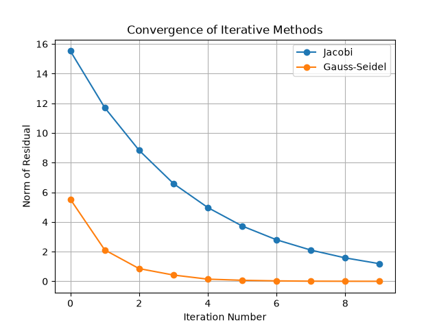
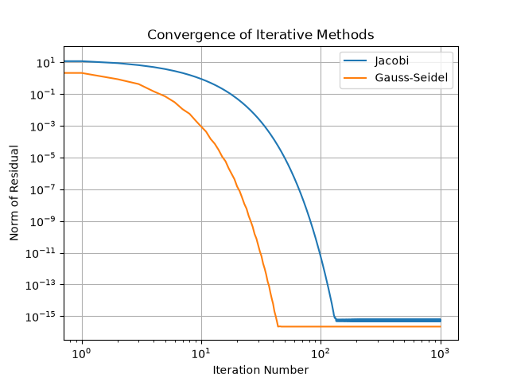

::: {.content-hidden unless-meta="solutions"}
# Solutions {.unnumbered}

:::

::: {.content-hidden when-meta="solutions"}

|              |                                              |
| ------------ | -------------------------------------------- | 
| Due Date     | Thu, Nov 12                                  | 
| Turn in link | Gradescope [PDF](https://moodle.swarthmore.edu/mod/lti/view.php?id=837809) and [Code](https://moodle.swarthmore.edu/mod/lti/view.php?id=837808)  | 
| URL          | `emadmasroor.github.io/E21-F26/Homework/HW9` |


[What to turn in]{.underline}

Combine all written HW into one PDF file.

| Problem | Format                                  |
| ------- | --------------------------------------- |
| 1.1     | PDF                                     |
| 1.2     | Python function named `eliminate_pivot` |
| 2       | Python function named `Jacobi`          |
| 3.1     | Python function named `GaussSeidel`     |
| 3.2     | PDF                                     |
| 4       | Python code for generating plots        |
| 4       | PDF of (graphs and short text)          |

                              

**Changelog:**

- Slight modification to requirements of part 2 of 1.1.3, added Monday 4:30 PM.


:::

# Pivoting

## By hand

Consider the matrix 
$$A = \begin{bmatrix} 
0 & 2 & 5 & -1 \\ 
2 & 1 & 3 & 0 \\ 
-2 & -1 & 4 & 1 \\ 
3 & 7 & -1 & 2 \\ 
\end{bmatrix}$$

If this matrix is decomposed into $L$ and $U$ following Doolittle's factorization, determine the upper triangular matrix $U$, showing **all** intermediate stages of the matrix in the Gaussian elimination procedure and describing what each step accomplishes.

::: {.content-visible when-meta="solutions"}
::: {.callout-tip}
## Solution

1. Starting work on column 1. Swap rows 1 and 2

$$
\begin{bmatrix}
2 & 1 & 3 & 0 \\ 
0 & 2 & 5 & -1 \\ 
-2 & -1 & 4 & 1 \\ 
3 & 7 & -1 & 2 \\ 
\end{bmatrix}
$$

2. No need to eliminate $A_{21}$. Eliminating $A_{31}$:

$$
\begin{bmatrix}
2 & 1 & 3 & 0 \\ 
0 & 2 & 5 & -1 \\ 
0 & 0 & 7 & 1 \\
3 & 7 & -1 & 2 \\ 
\end{bmatrix}
$$

3. Eliminating $A_{41}$: 

$$
\begin{bmatrix}
2 & 1 & 3 & 0 \\ 
0 & 2 & 5 & -1 \\ 
0 & 0 & 7 & 1 \\
0 & 5.5 & -5.5 & 2 \\ 
\end{bmatrix}
$$

4. Starting work on column 2. Swap rows 2 and 4:

$$
\begin{bmatrix}
2 & 1 & 3 & 0 \\ 
0 & 5.5 & -5.5 & 2 \\ 
0 & 0 & 7 & 1 \\
0 & 2 & 5 & -1 \\ 
\end{bmatrix}
$$

5. No need to eliminate $A_{32}$. Eliminating $A_{42}$:

$$
\begin{bmatrix}
2 & 1 & 3 & 0 \\ 
0 & 5.5 & -5.5 & 2 \\ 
0 & 0 & 7 & 1 \\
0 & 0 & 7 & -1.727 \\ 
\end{bmatrix}
$$

6. Starting work on column 3. No swapping necessary. Eliminating $A_{43}$:

$$
\begin{bmatrix}
2 & 1 & 3 & 0 \\ 
0 & 5.5 & -5.5 & 2 \\ 
0 & 0 & 7 & 1 \\
0 & 0 & 0 & -2.727 \\ 
\end{bmatrix}
$$

Therefore, the final result is
$$
\begin{bmatrix}
2 & 1 & 3 & 0 \\ 
0 & 5.5 & -5.5 & 2 \\ 
0 & 0 & 7 & 1 \\
0 & 0 & 0 & -2.727 \\ 
\end{bmatrix}
$$

:::
:::

## Python program for pivoting

Write a Python function named `eliminate_pivot` that takes as input a single matrix and performs Gaussian elimination with pivoting on that matrix.

::: {.content-visible unless-meta="solutions"}
Using the array defined here

```{.python}
A = np.array([[4  ,2   ,5   ,-1 ,0   ],
              [-3 ,1   ,0   ,9  ,0.1 ],
              [3.2,3   ,-4.3,6  ,-2  ],
              [0.5,1   ,5.1 ,.3 ,-7.3],
              [9.3,-1.4,4   ,2.1,6.0 ]
              ],dtype=np.float64)
```

your procedure should be numerically equal, or approximately equal, to the following:

```{.python}
array([[ 9.30e+00, -1.40e+00,  4.00e+00,  2.10e+00,  6.00e+00],
       [ 0.00e+00,  2.60e+00,  3.28e+00, -1.90e+00, -2.58e+00],
       [ 0.00e+00,  0.00e+00, -1.01e+01,  7.82e+00, -6.12e-01],
       [ 0.00e+00,  0.00e+00,  0.00e+00,  1.05e+01,  2.54e+00],
       [ 0.00e+00,  0.00e+00,  4.44e-16,  0.00e+00, -7.67e+00]])
```
:::

::: {.content-visible when-meta="solutions"}
::: {.callout-tip}
## Solution

```{.python}
def eliminate_pivot(A):
    n = len(A)
    scale_rows = np.zeros(n)
    for k in range(0,n-1):
        # Determine the scale factor of each row
        for i in range(n):
            scale_rows[i] = max(abs(A[i,:]))
        # Re-calculate relative sizes.
        relative_sizes = abs(A[k:,k])/scale_rows[k:]
        
        # Look for the best row
        best_row = np.argmax(relative_sizes)
        
        if best_row+k != k:
            A = swap_rows(A,k,best_row+k)
        
        # Gauss elimination
        for i in range(k+1,n):
            # Row i = Row i - multiplier * Row k
            A[i,:] = A[i,:] - (A[i,k]/A[k,k])*A[k,:]
    return A
```
:::
:::

# The Jacobi Algorithm

Jacobi with `while` loop

In [lecture](../Lec17/#algorithm-for-jacobis-method), we have seen an algorithm for Jacobi's method that carries out `n_steps` iterations in a `for` loop. Write a Python function named `Jacobi` that instead makes use of a `while` loop, terminating the iterations when the norm of the residual is less than `tol`.

Your function should take as input the following quantities in order: $A$, the system matrix; $b$, the right-hand-side vector; $x^{(0)}$, the first guess for $x$, and `tol`, a tolerance parameter that is typically set to a very small number such as $10^{-6}$. The function should return the most recent vector $x^{(k)}$.

::: {.callout-tip}
You can use `b - numpy.dot(A,x)` to calculate the vector $b - Ax$.
:::

::: {.content-visible when-meta="solutions"}
::: {.callout-tip}
## Solution

```{.python}
def Jacobi(A,b,x0,tol):
    normres = 1 # Start with a dummy value
    xold = x0
    xnew = np.zeros(np.shape(xold))
    while normres > tol:
        for j in range(len(xold)):
            total = 0
            for i in range(len(xold)):
                if i != j:
                    total += A[j,i] * xold[i]
            xnew[j] = (1/(A[j,j])) * (b[j] - total)
        # Calculate residual
        residual = b - np.dot(A,xnew)
        normres = norm(residual)
        
        print(xnew," and |res| = ",normres)
        xold = xnew.copy()
    return xnew
```
:::
:::

:::: {.content-visible unless-meta="solutions"}
:::: {.callout-tip}
You may wish to check your code on the following matrix and right-hand side:

```{.python}
A = np.array([[4   ,1 ,2  ],
              [-1/2,3 ,3/2],
              [0   ,2 ,4  ]],dtype=np.float64)
b = np.array([1,
              2,
              1],dtype=np.float64)
```

According to my solution, calling the function on this $A$ and $b$ with an initial guess of `[1, 1, 1]` and a tolerance parameter of `1e-6` gives:

```{.python}
>>> Jacobi(A,b,np.array([1,1,1],dtype=np.float64),1e-6)
array([ 0.12499984,  0.7499996 , -0.12499963])
```

and for a different set of inputs, we get

```{.python}
>>> Jacobi(A,b,np.array([0,0,0],dtype=np.float64),1e-3)
array([ 0.1249076 ,  0.74977215, -0.12478681])
```

::::
::::

# Gauss-Seidel 

As we saw in [lecture 17](../Lec17/#the-gauss-seidel-approach), the Gauss-Seidel algorithm modifies the Jacobi algorithm so that it makes use of the new $x$ values as they are computed. The first row's update is based entirely on the old values; the second row's update is based on the old values for $x_3$, $x_4$, ..., $x_n$, but it makes use of the newly-computed value for $x_{1}$; the third row's update is based on the old values for $x_4$, $x_5$, ..., $x_n$, but it makes use of the newly-computed value for $x_{1}$ and $x_2$.


## Python code

Write a Python function named `GaussSeidel` that carries out a specified number of iterations of the Gauss-Seidel algorithm. 

Your function should take as input the following quantities in order: $A$, the system matrix; $b$, the right-hand-side vector; $x^{(0)}$, the first guess for $x$, and $n$, the number of iterations. The function should return the most recent vector $x^{(k)}$.


## Gauss-Seidel vs Jacobi 

You will solve the same equation $Ax=b$ iteratively using the two iterative methods, Gauss-Seidel and Jacobi. You are welcome to use a computer to help you with this problem, but your answers should be written out by hand.

Solve the system of equations represented by the augmented matrix

$$
\left[
\begin{array}{ccc|c}
6 & 3 & 1 & 1 \\
2 & 7 & 4 & 0 \\
5 & 1 & 8 & 0
\end{array}
\right]
$$

starting with the guess $x_1 = 1, x_2 = 0, x_3 = 2$ using:

1. Two iterations of the Gauss-Seidel algorithm, and
2. Two iterations of the Jacobi algorithm.

For each iteration, show all your work, and also calculate and write down the norm of the residual vector at the end of each iteration.


::: {.content-visible when-meta="solutions"}
::: {.callout-tip}
## Solution

**Gauss-Seidel**, using the new values of $x$ as soon as they are available.

$x^{(0)} = [1, 0, 2]$.

$$
\begin{align}
x^{(1)}_1 &= \frac{1}{6} \left( 1 - 3 \times 0 - 1 \times 2\right) = -\frac{1}{6} \approx -0.167 \\
x^{(1)}_2 &= \frac{1}{7} \left( 0- 2 \times \left( -\frac{1}{6} \right) - 4 \times 2 \right) = -\frac{23}{21} \approx -1.095 \\
x^{(1)}_3 &= \frac{1}{8} \left( 0 - 5 \times \left( -\frac{1}{6}\right) - 1 \times \left( -\frac{23}{21}\right) \right) = \frac{81}{336} \approx 0.241
\end{align}
$$

At this stage, $x^{(1)} = [-0.1667, -1.095, 0.2410]$ and the residual vector is $$b - Ax = \begin{bmatrix} 1 \\ 0 \\ 0 \end{bmatrix} - \begin{bmatrix} 6 & 3 & 1 \\ 2 & 7 & 4 \\ 5 & 1 & 8 \end{bmatrix} \begin{bmatrix} -0.1667 \\ -1.095 \\ 0.2410 \end{bmatrix} =  \begin{bmatrix} 5.0446 \\ 7.0357 \\ 0 \end{bmatrix}$$

and the norm of this vector is $\boxed{8.65}$.

Then, we do this again:

$$
\begin{align}
x^{(2)}_1 &= \frac{1}{6} \left( 1 - 3 \times \left( -\frac{23}{21}\right) - 1 \times \left( \frac{81}{336} \right) \right) \approx 0.674 \\
x^{(2)}_2 &= \frac{1}{7} \left( 0- 2 \times \left( 0.674 \right) - 4 \times \left( \frac{81}{336} \right) \right) \approx -0.3303 \\
x^{(2)}_3 &= \frac{1}{8} \left( 0 - 5 \times \left( 0.674 \right) - 1 \times \left( -0.3303 \right) \right) \approx -0.3800
\end{align}
$$

At this stage, $x^{(2)} = [ 0.674, -0.3303, -0.3800]$ and the residual vector is $$b - Ax = \begin{bmatrix} 1 \\ 0 \\ 0 \end{bmatrix} - \begin{bmatrix} 6 & 3 & 1 \\ 2 & 7 & 4 \\ 5 & 1 & 8 \end{bmatrix} \begin{bmatrix} 0.674 \\ -0.3303 \\ -0.3800 \end{bmatrix} =  \begin{bmatrix} -1.673 \\ 2.484 \\ \approx 0 \end{bmatrix}$$

and the norm of this vector is $\boxed{2.995}$.

**Jacobi**, avoids using newly-calculated values of $x$ as soon as they are available, and instead waits for the new iteration before it updates.

$x^{(0)} = [1, 0, 2]$.

$$
\begin{align}
x^{(1)}_1 &= \frac{1}{6} \left( 1 - 3 \times 0 - 1 \times 2\right) = -\frac{1}{6} \approx -0.167 \\
x^{(1)}_2 &= \frac{1}{7} \left( 0- 2 \times 1 - 4 \times 2 \right) = -\frac{10}{7} \approx -1.428 \\
x^{(1)}_3 &= \frac{1}{8} \left( 0 - 5 \times 1 - 1 \times 0 \right) = -\frac{5}{8} = -0.625
\end{align}
$$

At this stage, $x^{(1)} = [-0.167, -1.428, -0.625]$ and the residual vector is $$b - Ax = \begin{bmatrix} 1 \\ 0 \\ 0 \end{bmatrix} - \begin{bmatrix} 6 & 3 & 1 \\ 2 & 7 & 4 \\ 5 & 1 & 8 \end{bmatrix} \begin{bmatrix} -0.167 \\ -1.428 \\ -0.625 \end{bmatrix} =  \begin{bmatrix} 6.910 \\ 12.833 \\ 7.261 \end{bmatrix}$$

and the norm of this vector is $\boxed{16.28}$.

Then, we do this again:

$$
\begin{align}
x^{(2)}_1 &= \frac{1}{6} \left( 1 - 3 \times \left( - \frac{10}{7} \right) - 1 \times  \left( - \frac{5}{8} \right) \right) \approx 0.985 \\
x^{(2)}_2 &= \frac{1}{7} \left( 0- 2 \times \left( -\frac{1}{6} \right) - 4 \times \left( - \frac{5}{8} \right) \right) \approx 0.4047 \\
x^{(2)}_3 &= \frac{1}{8} \left( 0 - 5 \times \left( -\frac{1}{6} \right) - 1 \times \left( -\frac{10}{7}\right) \right) \approx 0.2827
\end{align}
$$

At this stage, $x^{(2)} = [0.985, 0.4047, 0.2827]$ and the residual vector is $$b - Ax = \begin{bmatrix} 1 \\ 0 \\ 0 \end{bmatrix} - \begin{bmatrix} 6 & 3 & 1 \\ 2 & 7 & 4 \\ 5 & 1 & 8 \end{bmatrix} \begin{bmatrix} 0.985 \\ 0.4047 \\ 0.2827 \end{bmatrix} =  \begin{bmatrix} -6.407 \\ -5.934 \\ -7.592 \end{bmatrix}$$

and the norm of this vector is $\boxed{11.57}$.
:::
:::


# Convergence of Iterative Methods

The norm of the residual vector after each iteration gives us information about how close to the true solution a numerical method gets after $n$ iterations. In this problem, you will examine this for a simple 3x3 system (which could easily be solved exactly by direct methods) to illustrate the convergence properties of the Jacobi and Gauss-Seidel algorithms.

In practice, engineers need to solve systems of equations that have thousands or millions of rows, and the speed with which a numerical method can get close to the right answer becomes extremely important.

For the system represented by the augmented matrix 
$$
\left[
\begin{array}{ccc|c}
6 & 3 & 1 & 1 \\
2 & 7 & 4 & 0 \\
5 & 1 & 8 & 0
\end{array}
\right],
$$

starting from the guess $[1,0,2]$,

1. Make a plot of the norm of the residual vector after 10 iterations of the Gauss-Seidel method and of the Jacobi method.
2. Make a plot of the norm of the residual vector after 1,000 iterations of the two methods on a log-log scale. Use `matplotlib.pyplot.xscale("log")` and `matplotlib.pyplot.yscale("log")`.
3. Describe and explain what these graphs tell us. You may wish to look at lecture 8.

You must make your plots in `matplotlib` and include the code with your submission.


::: {.content-visible when-meta="solutions"}
::: {.callout-tip}
## Solution

You can download the below as a single file [here](HW9reshist.py).

For this problem, both `Jacobi` and `GaussSeidel` were defined to take as argument the number of iterations.

Jacobi function:

```{.python}
def Jacobi(A,b,x0,n):
    rhist = np.zeros(n)
    xold = x0
    xnew = np.zeros(np.shape(xold))
    for k in range(n):
        for j in range(len(xold)):
            total = 0
            for i in range(len(xold)):
                if i != j:
                    total += A[j,i] * xold[i]
            xnew[j] = (1/(A[j,j])) * (b[j] - total)
        # Calculate residual
        residual = b - np.dot(A,xnew)
        # Find norm and store
        normres = norm(residual)
        rhist[k] = normres
        
        xold = xnew.copy()
    return rhist
```

Gauss-Seidel function:

```{.python}
def GaussSeidel(A,b,x0,n):
    
    rhist = np.zeros(n)
    x = x0
    for k in range(n):
        for j in range(len(x)):
            total = 0
            for i in range(len(x)):
                if i != j:
                    total += A[j,i] * x[i]
            x[j] = (1/(A[j,j])) * (b[j] - total)
        # Calculate residual
        residual = b - np.dot(A,x)
        # Find norm and store
        normres = norm(residual)
        rhist[k] = normres
    return rhist
```

Matrix definitions and import statements:
```{.python}
import numpy as np
from numpy.linalg import norm
import matplotlib.pyplot as plt

A = np.array([[6,3,1],
               [2,7,4],
               [5,1,8]],dtype=np.float64)
b = np.array([1,
               0,
               0],dtype=np.float64)

A2 = A.copy()
```


Plotting procedure:

```{.python}
hist_J = Jacobi(A,b,np.array([1,1,1],dtype=np.float64),1000)
hist_G = GaussSeidel(A2,b,np.array([1,1,1],dtype=np.float64),1000)

# Figure 1

plt.plot(np.transpose([hist_J[:10], hist_G[:10]]),'o-',label=['Jacobi','Gauss-Seidel'])
plt.grid(True)
plt.legend()
plt.xlabel("Iteration Number")
plt.ylabel("Norm of Residual")
plt.title("Convergence of Iterative Methods")
plt.savefig("Jacobi-Gauss-1.png")
plt.close()

# Figure 2
plt.plot(np.transpose([hist_J, hist_G]),'-',label=['Jacobi','Gauss-Seidel'])
plt.grid(True)
plt.legend()
plt.xscale("log")
plt.yscale("log")
plt.xlabel("Iteration Number")
plt.ylabel("Norm of Residual")
plt.title("Convergence of Iterative Methods")
plt.savefig("Jacobi-Gauss-1.png")
```

The resulting graphs are shown below.

::: {.columns}
::: {.column width="45%"}

:::
::: {.column width="5%"}
:::
::: {.column width="45%"}

:::

:::

**Description and explanation**

The graphs show that both methods rapidly reduce the residual to nearly zero, but Gauss-Seidel is faster at this than Jacobi. On a log-log scale, the behavior follows a straight line at large $n$, which means that there is exponential decay of the norm of the residual once about 10 iterations have passed for G-S and once about 50 iterations have passed for Jacobi. Eventually, both methods bring the norm of the residual down to a number that is effectively zero, close to machine epsilon for 64-bit floating point numbers as shown in [lecture 8](../../Lectures/Lec8/#machine-epsilon).

:::
:::


