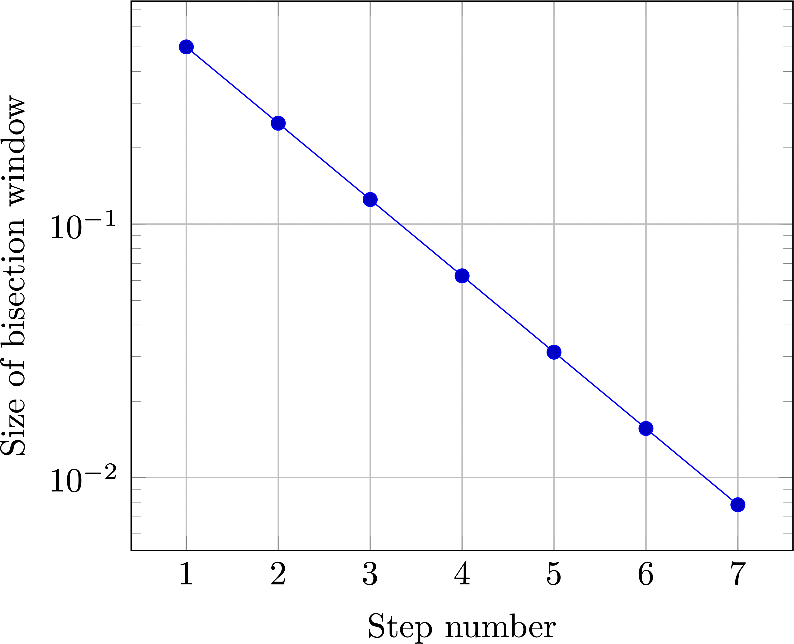

### Numerical Methods in Engineering

1. Turn engineering problems into mathematical problems
2. Turn mathematical problems into computational problems
3. Tell a computer how to solve the computational problems

::: {layout-ncol=2}
[Using]{.emph} numerical methods

[Developing]{.emph} numerical methods
:::

### Root-finding

::: {.centering}
Main idea: Solve $f(x)=0$.
:::

Recall mathematical terminology:

- A **root** of a function $f(x)$ is a value of $x$ at which $f(x) = 0$.
- A **function** is a unique mapping (or 'formula') that assigns a unique value of $f(x)$ for any given value of $x$.
    - The inverse mapping is not necessarily unique; two values of $x$ can have the same value of $f(x)$.
- Roots vs. solutions: The **root** of $f(x)$ is the **solution** to the _equation_ $f(x) = 0$

### Finding Roots analytically

i.e., using mathematical analysis.

[Q. Find the root(s) of $f(x) = x^2+x-6$]{.inclass}

::: {.content-hidden unless-meta="uncover"}

$f(x) = x^2 +3x - 2x - 6$

$= (x + 3)(x-2)$

This equals zero when $x = -3$ or $x=2$

The roots of $x^2 + 3x - 2x - 6$ are $\boxed{x=-3}$ and $\boxed{x=2}$.

:::

### When analytical root-finding fails

[Mathematical analysis can sometimes fail us engineers, even for very simple equations. For example, the equation]{.fragment}

[$$\frac{x}{2}-1 = \sin x$$]{.fragment}

[is difficult to solve exactly]{.fragment}

### Graphical Techniques {.nostretch}

for solving $\sin x = 0.5$

:::: {.r-stack}


::: {.fragment}

```{.tikz width="6in"}
%%| additionalPackages: \usepackage{pgfplots}

\begin{tikzpicture}
\begin{axis}[
    domain=0:2*pi,
    samples=200,
    ymin=-1.2, ymax=1.2,
    grid=major,
  ]
    \addplot[blue, thick] {sin(deg(x))};
    \addlegendentry{$\sin x$};
  \end{axis}
\end{tikzpicture}
```

:::

::: {.fragment}

```{.tikz width="6in"}
%%| additionalPackages: \usepackage{pgfplots}

\begin{tikzpicture}
\begin{axis}[
    domain=0:2*pi,
    samples=200,
    ymin=-1.2, ymax=1.2,
    grid=major,
  ]
    \addplot[blue, thick] {sin(deg(x))};
    \addlegendentry{$\sin x$};
    \addplot[red, thick] {0.5};
  \end{axis}
\end{tikzpicture}
```

:::

::: {.fragment}

```{.tikz width="6in"}
%%| additionalPackages: \usepackage{pgfplots}

\begin{tikzpicture}
\begin{axis}[
    domain=0:2*pi,
    samples=200,
    ymin=-1.2, ymax=1.2,
    grid=major,
  ]
    \addplot[blue, thick] {sin(deg(x))};
    \addlegendentry{$\sin x$};
    \addplot[red, thick] {0.5};
    \addplot coordinates {(0.52359,0.5)};
  \end{axis}
\end{tikzpicture}
```

:::

::: {.fragment}

```{.tikz width="6in"}
%%| additionalPackages: \usepackage{pgfplots}

\begin{tikzpicture}
\begin{axis}[
    domain=0:2*pi,
    samples=200,
    ymin=-1.2, ymax=1.2,
    grid=major,
    extra x ticks={0.52359},
    extra x tick style={grid style={black},
        tick label style={
            rotate=0,anchor=south west}},
    extra x tick label={0.52359}
  ]
    \addplot[blue, thick] {sin(deg(x))};
    \addlegendentry{$\sin x$};
    \addplot[red, thick] {0.5};
    \addplot coordinates {(0.52359,0.5)};
  \end{axis}
\end{tikzpicture}
```

:::

::::

### Graphical Techniques for more functions

Find a root of the function $$f(x) = 4 \sin x - 4 + x$$

:::: {.r-stack}

::: {.fragment}
```{.tikz width="6in"}
%%| additionalPackages: \usepackage{pgfplots}

\begin{tikzpicture}
\begin{axis}[
    domain=0:2*pi,
    samples=200,
    ymin=-1.2, ymax=1.2,
    grid=major,
  ]
    \addplot[blue, thin] {sin(deg(x))};
    \addlegendentry{$\sin x$};
  \end{axis}
\end{tikzpicture}
```
:::

::: {.fragment}
```{.tikz width="6in"}
%%| additionalPackages: \usepackage{pgfplots}

\begin{tikzpicture}
\begin{axis}[
    domain=0:2*pi,
    samples=200,
    ymin=-1.2, ymax=1.2,
    grid=major,
  ]
    \addplot[blue, thin] {sin(deg(x))};
    \addlegendentry{$\sin x$};
    \addplot[red, thin] {1-0.25*x)};
    \addlegendentry{$1 - x/4$};
  \end{axis}
\end{tikzpicture}
```
:::

::: {.fragment}
```{.tikz width="6in"}
%%| additionalPackages: \usepackage{pgfplots}

\begin{tikzpicture}
\begin{axis}[
    domain=0:2*pi,
    samples=200,
    ymin=-1.2, ymax=1.2,
    grid=major,
    extra x ticks={2.84997},
    extra y ticks={0.2875},
    extra tick style={grid style={black},
        tick label style={
            rotate=0,anchor=south west}},
    extra x tick label={2.8499}
  ]
    \addplot[blue, thin] {sin(deg(x))};
    \addlegendentry{$\sin x$};
    \addplot[red, thin] {1-0.25*x)};
    \addlegendentry{$1 - x/4$};
    \addplot coordinates {(2.84997,0.287507)};
    %\addplot coordinates {(0.5,-0.5)} node {d};
  \end{axis}
\end{tikzpicture}
```
:::

::: {.fragment}
```{.tikz width="6in"}
%%| additionalPackages: \usepackage{pgfplots}

\begin{tikzpicture}
\begin{axis}[
    domain=0:2*pi,
    samples=200,
    ymin=-1.2, ymax=1.2,
    grid=major,
    extra x ticks={2.84997},
    extra tick style={grid style={black},
        tick label style={
            rotate=0,anchor=south west}},
    extra x tick label={2.8499}
  ]
    \addplot[blue, thin] {sin(deg(x))};
    \addlegendentry{$\sin x$};
    \addplot[red, thin] {1-0.25*x)};
    \addlegendentry{$1 - x/4$};
    \addplot[brown, thick] {4*sin(deg(x)) - 4 + x};
    \addlegendentry{$4 \sin x - 4 + x$};
    \addplot[magenta, thick] {0)};
    \addplot coordinates {(2.84997,0.287507)};
    \addplot coordinates {(2.84997,0)};
  \end{axis}
\end{tikzpicture}
```
:::

::::

### Graphical Solution of equations

Find the solutions to the following equations using the provided paper:

1. $\sin x = 0.7$
2. $\sin x = 0.72$
3. $\sin x - 0.7x = 0$
4. $2 (\sin x + 1) = 0$
5. $\sin x - x^2 + 1 = 0$


### Finding Roots with a computer

We want to find a root for $$f(x) = x^3 - 10x^2 + 5.$$

**Options:**

1. Try out many different values of $x$ indiscriminately.
2. Try out many different values of $x$ **systematically** (in order)
3. Try out many different values of $x$ **adaptively** --- learn from each try

### An Incremental Search Algorithm for $f(x) = x^3 - 10x^2 + 5$

- Let's select a $\Delta x$ with which to search for solutions. Say, $\Delta x = 0.1$
- Start from $x=0$ and move up in increments of $\Delta x$
- The value of $x$ for which $f(x) \approx 0$ will be our root!
- [Write a Python script to print the value of $f(x)$ for $x=0, 0.1, 0.2, ..., 1.0$]{.inclass}

::: {.content-hidden unless-meta="uncover"}
::: {.fragment}
```{.python}
import numpy as np

def f1(x):
    return x**3 - 10* x**2 + 5

x = np.linspace(0,1,11)
for value in x:
    print(f"At x = {value:.3f}, f(x) = {f1(value):.3f}")
```
:::
:::


::: {.fragment}
::: {.callout-tip}
## Vectorized code

To apply the function `f1` to the array `x`, we can also do `f1(x)` directly
:::
:::

### Identifying the value closest to zero

`min` vs. `argmin`

- The `numpy` function `min` finds the minimum value of an array.
- The `numpy` function `argmin` finds the **index of** the minimum value of an array.
- Recall that `abs()` in Python means 'absolute value of'

::: {.content-hidden unless-meta="uncover"}
::: {.fragment}
```{.python}
import numpy as np

def f1(x):
    return x**3 - 10* x**2 + 5

# Array of x-values 0, 0.1, 0.2, ..., 1.0
x = np.linspace(0,1,11)

# Array of f(x) values f(0), f(0.1), ..., f(1.0)
y = f1(x)

# Index of f(x) closest to zero
loczero = np.argmin(abs(y))

# Locate that value of x
answer = x[loczero]

print("Our best estimate of the root of f(x) is")
print(f"x = {answer:.1f}")
```
:::
:::

### A better approach ...

Let's look closely at the result of our incremental search.

```{.python}
import numpy as np

def f1(x):
    return x**3 - 10* x**2 + 5

x = np.linspace(0,1,11)
for value in x:
    print(f"At x = {value:.3f}, f(x) = {f1(value):.3f}")
```

```{.python code-line-numbers="8-9"}
At x = 0.000, f(x) = 5.000
At x = 0.100, f(x) = 4.901
At x = 0.200, f(x) = 4.608
At x = 0.300, f(x) = 4.127
At x = 0.400, f(x) = 3.464
At x = 0.500, f(x) = 2.625
At x = 0.600, f(x) = 1.616
At x = 0.700, f(x) = 0.443
At x = 0.800, f(x) = -0.888
At x = 0.900, f(x) = -2.371
At x = 1.000, f(x) = -4.000
```

Idea:

- [Sign change in $f(x)$ occurs at root of $f(x)$]{.emph}
- `numpy` has a function `sign()` 

### Bisection Algorithm for $f(x) = x^3 - 10x^2 + 5$ 

The bisection algorithm works by successively **bisecting** a search space to determine where a sign change in $f(x)$ occurs.

::: {.fragment}
```{.python code-line-numbers="3-4"}
...
At x = 0.600, f(x) = 1.616
At x = 0.700, f(x) = 0.443
At x = 0.800, f(x) = -0.888
At x = 0.900, f(x) = -2.371
...
```
:::

[We know that $f(x) = 0$ occurs for $\boxed{0.7 < x < 0.8}$]{.fragment}

[Use Python/Numpy to find out whether the root is in the **left half** of the given interval or its **right half**.]{.inclass .fragment}

[We have learned that $f(x)$ changes sign between $x = 0.7$ and $x=0.75$.]{.fragment}

[Conclude that the root is located in the range $\boxed{0.7 < x < 0.75}$]{.fragment}

::: {.fragment}
```{.tikz width="6in"}
%%| additionalPackages: \usepackage{pgfplots}
\begin{tikzpicture}[scale=2] 
% Draw the main axis with arrowheads 
\draw[thick] (-1.8, 0) -- (1.8, 0); 
% Draw tick marks for integers from -2 to 2 
\foreach \x in {-1, 0, 1} 
{ \draw (\x, 2pt) -- (\x, -2pt); 
\node[anchor=north, yshift=-2pt] at (\x, 0) {}; 
} 
\draw (-1,-8pt) node[anchor=north] at (-1,0) {$x_L$};
\draw (-1,-8pt) node[anchor=north] at (1,0) {$x_R$};
\draw (-1,-8pt) node[anchor=north] at (0,0) {$x_M$};

\draw[red] (-1,-8pt) node[anchor=north] at (-1,0.5) {$f(x_L) > 0$};
\draw[blue] (-1,-8pt) node[anchor=north] at (1,0.5) {$f(x_R) < 0$};
\draw[blue] (-1,-8pt) node[anchor=north] at (0,0.5) {$f(x_R) < 0$};
\end{tikzpicture}
```
:::


### Introducing the idea of 'tolerance' {.smaller}

- In numerical methods, the word 'tolerance' is used to denote the **window within which you know a desired value**.
- We first learned that $f(x)=0$ somewhere in the range $x \in (0.7, 0.8)$. The root is known with a tolerance of `0.1`.
- Next, we saw that $f(x)=0$ somewhere in the range $x \in (0.7, 0.75)$. The root is now known with a tolerance of `0.05`.
- The smaller the tolerance, the better your knowledge.
- Reducing tolerance
    - A numerical method usually has a **target** tolerance. "Good enough!"
    - Cannot reduce tolerance indefinitely --- floating-point precision limitations such as machine epsilon / gap size eventually crop up
    - 64-bit floats --- good enough for engineering satisfaction but not good enough for mathematical satisfaction.
- While loops and tolerance
    - A typical way to write numerical methods is to enclose one's algorithm within a block such as `while something > target_tolerance`
    - Keeps running as long as target tolerance is not reached
    - Terminates once target tolerance is reached.


### An algorithm for bisection 

[Write a Python program that performs bisection **three** times]{.inclass}

::: {.content-hidden unless-meta="uncover"}
[At the end of this process, we know that the root is located somewhere in the interval $$x \in \boxed{(0.725, 0.7375)}$$]{.fragment}

- We can choose to state this as $x_{\text{root}} = 0.73125 \pm 0.00625$

:::

### Convergence rates {.scrollable}

- At each subsequent bisection step, the bisection window is halved.

::: {.fragment}
```{.tikz width="6in"}
%%| additionalPackages: \usepackage{pgfplots}
\begin{tikzpicture}
\begin{axis}[
    domain=0:7,
    samples=8,
    grid=major,
    xlabel={Step number},
    ylabel={Size of bisection window},
]
\addplot {1/(2^\x)};
\end{axis}
\end{tikzpicture}
```
:::

::: {.fragment}
{fig-width="6in"}
:::
