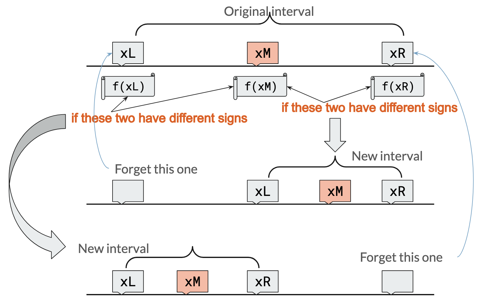
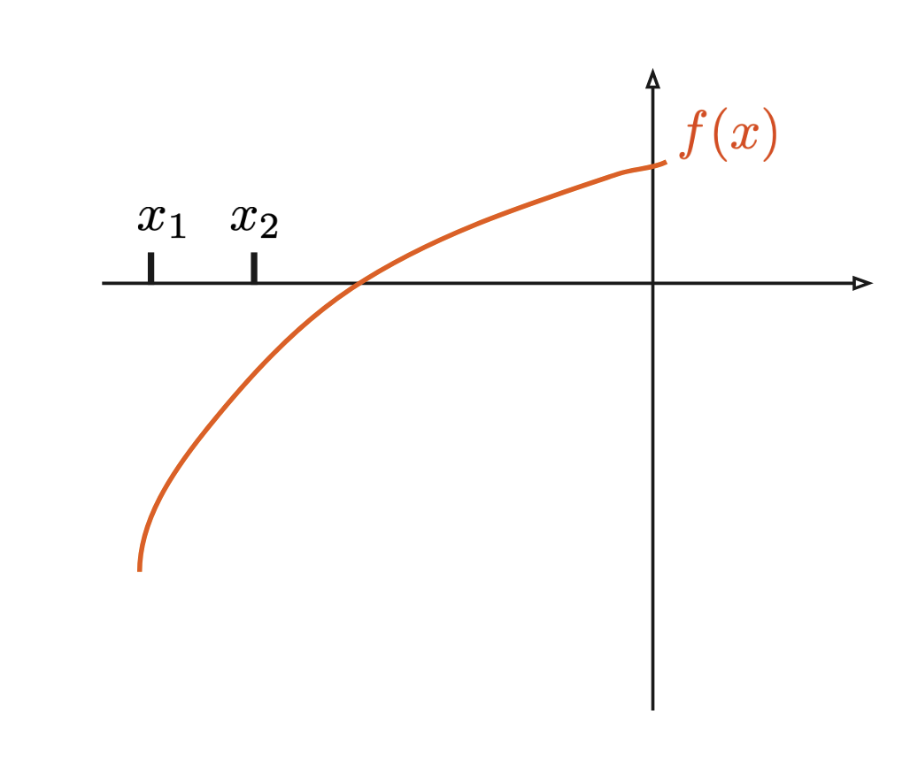
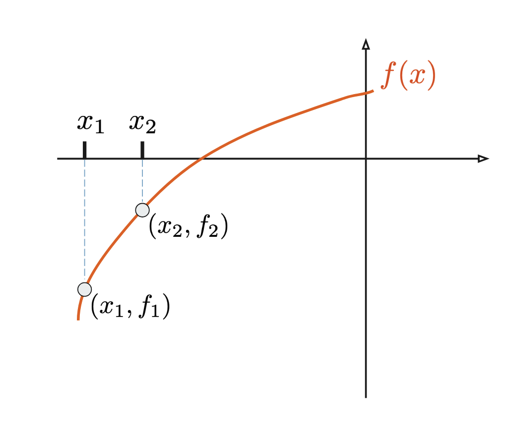
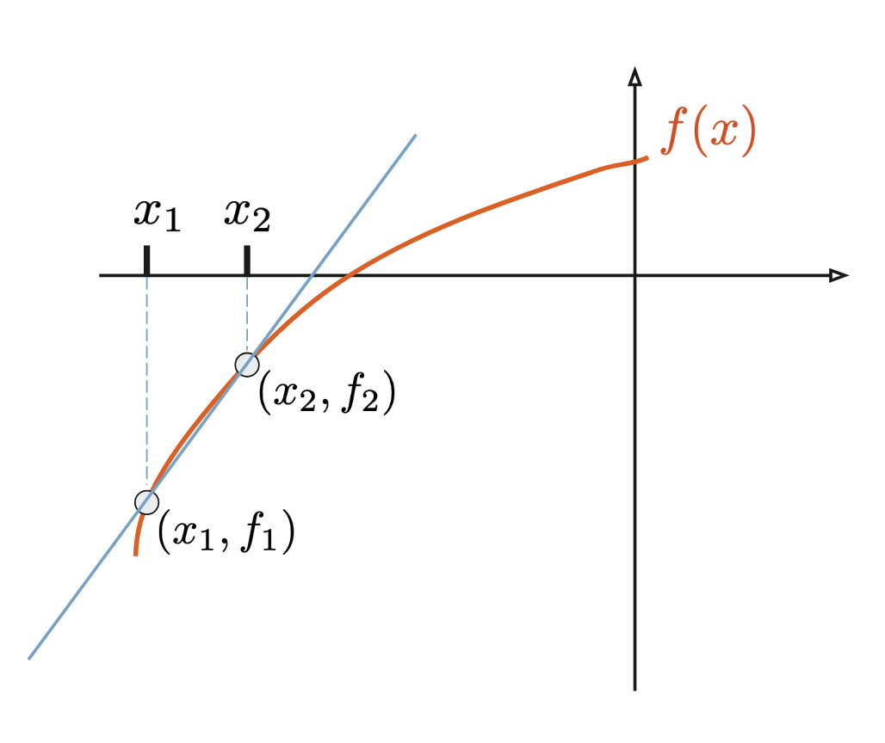
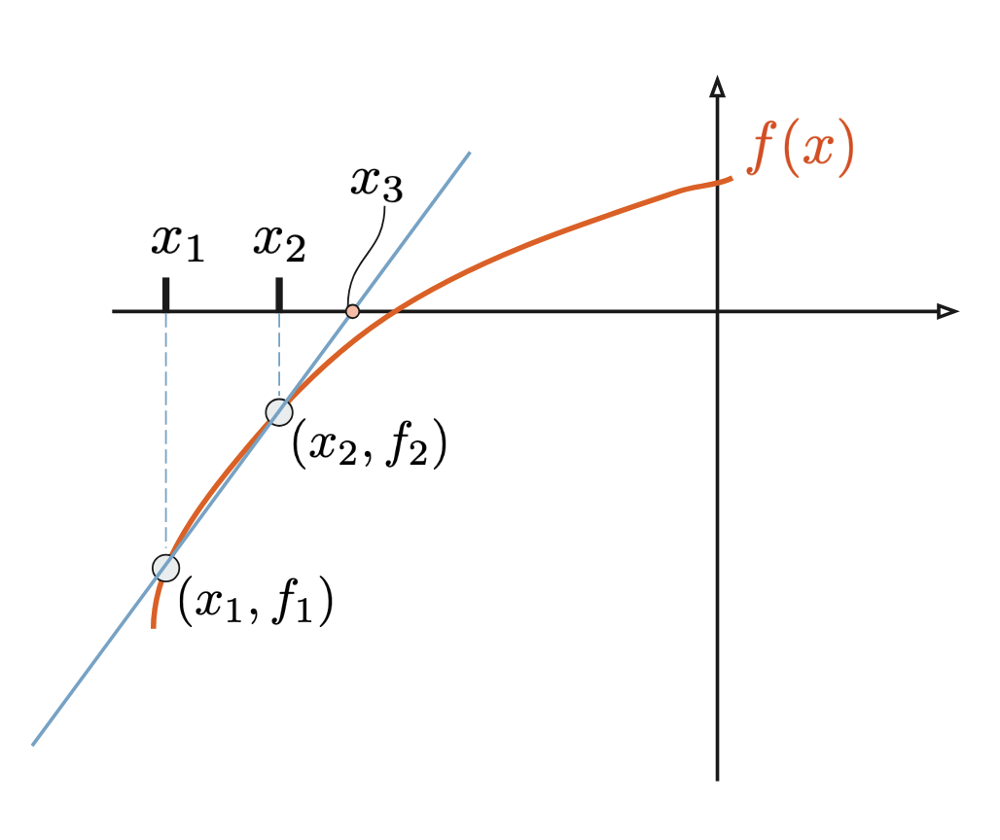
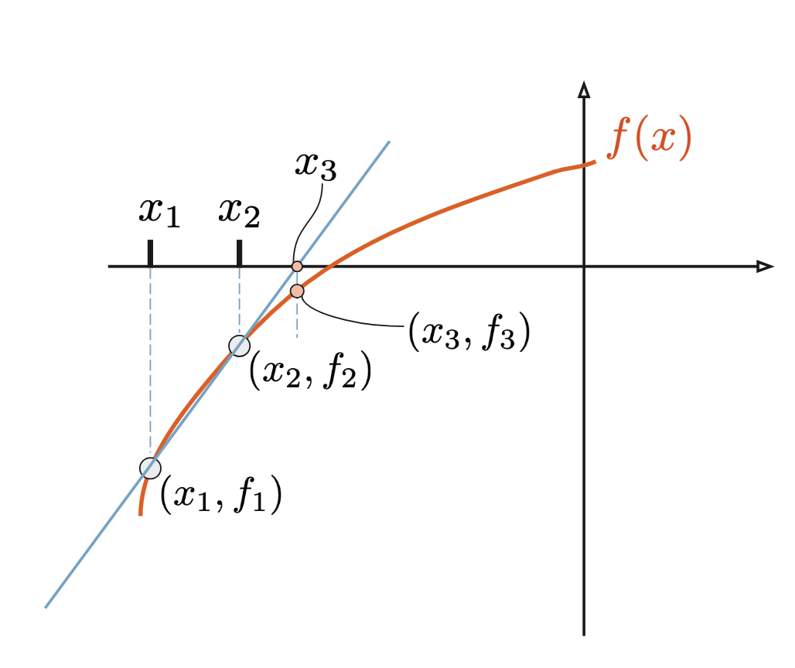

### Bisection Method



### Convergence rates {.scrollable}

At each subsequent bisection step, the bisection window is halved.

```{.tikz width="6in"}
%%| additionalPackages: \usepackage{pgfplots}
\begin{tikzpicture}
\begin{axis}[
    domain=0:7,
    samples=8,
    grid=major,
    xlabel={Step number},
    ylabel={Size of bisection window},
]
\addplot {1/(2^\x)};
\end{axis}
\end{tikzpicture}
```

{width="6in"}

### General approach to root-finding

In all root-finding approaches, we:

- start with a guess of where the root might be,
- work **iteratively**, repeatedly applying the same formula many times
    - the number of iterations it takes to arrive at a solution is an important measure of how good an approach is.
    - in practice, this is either a `while` or `for` loop.
- hopefully **converge** to _one_ root.

### The Secant Method

::::: {.r-stack}

:::{.fragment}
```{.tikz width="6in"}
%%| additionalPackages: \usepackage{pgfplots}
\pgfmathdeclarefunction{f}{1}{%
  \pgfmathparse{#1^3 - 10* #1^2 +5}%
}
\begin{tikzpicture}
\begin{axis}[
    legend pos=south west,
    domain=-2:11,
    samples=200,
    xmin=-1, xmax=13,
    ymin=-160,ymax=90,
    %grid=major,
    axis x line=middle,
    axis y line=middle,
    ticks=none,
    %extra x ticks={2.84997},
    %extra tick style={grid style={black},
    %    tick label style={
    %        rotate=0,anchor=south west}},
    %extra x tick label={2.8499}
  ]
    \addplot[blue, thick] {f(x)};
    \addplot[mark=*] coordinates {(8,{f(8)})};
    \addplot[mark=*] coordinates {(9,{f(9)})};
  \end{axis}
\end{tikzpicture}
```
:::

:::{.fragment}
```{.tikz width="6in"}
%%| additionalPackages: \usepackage{pgfplots}
\pgfmathdeclarefunction{f}{1}{%
  \pgfmathparse{#1^3 - 10* #1^2 +5}%
}
\begin{tikzpicture}
\begin{axis}[
    legend pos=south west,
    domain=-2:11,
    samples=200,
    xmin=-1, xmax=13,
    ymin=-160,ymax=90,
    %grid=major,
    axis x line=middle,
    axis y line=middle,
    ticks=none,
    %extra x ticks={2.84997},
    %extra tick style={grid style={black},
    %    tick label style={
    %        rotate=0,anchor=south west}},
    %extra x tick label={2.8499}
  ]
    \addplot[blue, thick] {f(x)};
    \addplot[mark=*] coordinates {(8,{f(8)})};
    \addplot[mark=*] coordinates {(9,{f(9)})};
    \addplot[domain=4:12] {47*x-499};
    \addplot[mark=*,color=brown] coordinates {(499/47,0)};

  \end{axis}
\end{tikzpicture}
```
:::


:::{.fragment}
```{.tikz width="6in"}
%%| additionalPackages: \usepackage{pgfplots}
\pgfmathdeclarefunction{f}{1}{%
  \pgfmathparse{#1^3 - 10* #1^2 +5}%
}
\begin{tikzpicture}
\begin{axis}[
    legend pos=south west,
    domain=-2:11,
    samples=200,
    xmin=-1, xmax=13,
    ymin=-160,ymax=90,
    %grid=major,
    axis x line=middle,
    axis y line=middle,
    ticks=none,
    %extra x ticks={2.84997},
    %extra tick style={grid style={black},
    %    tick label style={
    %        rotate=0,anchor=south west}},
    %extra x tick label={2.8499}
  ]
    \addplot[blue, thick] {f(x)};
    \addplot[mark=*] coordinates {(8,{f(8)})};
    \addplot[mark=*] coordinates {(9,{f(9)})};
    \addplot[domain=4:12] {47*x-499};
    \addplot[mark=*,color=brown] coordinates {(499/47,0)};
    \addplot coordinates {(499/47,{f(499/47)})};
    \addplot[color=gray,dashed] coordinates {(499/47,0) (499/47,{f(499/47)})};
  \end{axis}
\end{tikzpicture}
```
:::

:::{.fragment}
```{.tikz width="6in"}
%%| additionalPackages: \usepackage{pgfplots}
\pgfmathdeclarefunction{f}{1}{%
  \pgfmathparse{#1^3 - 10* #1^2 +5}%
}
\begin{tikzpicture}
\begin{axis}[
    legend pos=south west,
    domain=-2:11,
    samples=200,
    xmin=-1, xmax=13,
    ymin=-160,ymax=90,
    %grid=major,
    axis x line=middle,
    axis y line=middle,
    ticks=none,
    %extra x ticks={2.84997},
    %extra tick style={grid style={black},
    %    tick label style={
    %        rotate=0,anchor=south west}},
    %extra x tick label={2.8499}
  ]
    \addplot[blue, thick] {f(x)};
    \addplot[mark=*] coordinates {(8,{f(8)})};
    \addplot[mark=*] coordinates {(9,{f(9)})};
    \addplot[domain=4:12] {47*x-499};
    \addplot[mark=*,color=brown] coordinates {(499/47,0)};
    \addplot coordinates {(499/47,{f(499/47)})};
    \addplot[color=gray,dashed] coordinates {(499/47,0) (499/47,{f(499/47)})};
    \addplot[black, thin,domain=4:12] {93.1041*x-913.937};
  \end{axis}
\end{tikzpicture}
```
:::

:::{.fragment}
```{.tikz width="6in"}
%%| additionalPackages: \usepackage{pgfplots}
\pgfmathdeclarefunction{f}{1}{%
  \pgfmathparse{#1^3 - 10* #1^2 +5}%
}
\begin{tikzpicture}
\begin{axis}[
    legend pos=south west,
    domain=-2:11,
    samples=200,
    xmin=-1, xmax=13,
    ymin=-160,ymax=90,
    %grid=major,
    axis x line=middle,
    axis y line=middle,
    ticks=none,
    %extra x ticks={2.84997},
    %extra tick style={grid style={black},
    %    tick label style={
    %        rotate=0,anchor=south west}},
    %extra x tick label={2.8499}
  ]
    \addplot[blue, thick] {f(x)};
    \addplot[mark=*] coordinates {(8,{f(8)})};
    \addplot[mark=*] coordinates {(9,{f(9)})};
    \addplot[domain=4:12] {47*x-499};
    \addplot[mark=*,color=brown] coordinates {(499/47,0)};
    \addplot coordinates {(499/47,{f(499/47)})};
    \addplot[color=gray,dashed] coordinates {(499/47,0) (499/47,{f(499/47)})};
    \addplot[black, thin,domain=4:12] {93.1041*x-913.937};
    \addplot[mark=*, mark size=1pt] coordinates {(913.937/93.1041,0)};
  \end{axis}
\end{tikzpicture}
```
:::

:::{.fragment}
```{.tikz width="6in"}
%%| additionalPackages: \usepackage{pgfplots}
\pgfmathdeclarefunction{f}{1}{%
  \pgfmathparse{#1^3 - 10* #1^2 +5}%
}
\begin{tikzpicture}
\begin{axis}[
    legend pos=south west,
    domain=-2:11,
    samples=200,
    xmin=-1, xmax=13,
    ymin=-160,ymax=90,
    %grid=major,
    axis x line=middle,
    axis y line=middle,
    ticks=none,
    %extra x ticks={2.84997},
    %extra tick style={grid style={black},
    %    tick label style={
    %        rotate=0,anchor=south west}},
    %extra x tick label={2.8499}
  ]
    \addplot[blue, thick] {f(x)};
    \addplot[mark=*] coordinates {(8,{f(8)})};
    \node [coordinate,pin={[xshift=0pt,yshift=0pt]right:{$(x_2,f(x_2))$}}] at (axis cs:8,{f(8)}) {};
    \addplot[mark=*] coordinates {(9,{f(9)})};
    \node [coordinate,pin={[xshift=0pt,yshift=0pt]left:{$(x_1,f(x_1))$}}] at (axis cs:9,{f(9)}) {};
    \addplot[domain=4:12] {47*x-499};
    \addplot[mark=*,color=brown] coordinates {(499/47,0)};
    \node [coordinate,pin={[xshift=-20pt,yshift=0pt]below right:{$(x_3,0)$}}] at (axis cs:499/47,0) {};
    \addplot coordinates {(499/47,{f(499/47)})};
    \node [coordinate,pin=left:{$(x_3,f(x_3))$}] at (axis cs:499/47,{f(499/47)}) {};
    \addplot[color=gray,dashed] coordinates {(499/47,0) (499/47,{f(499/47)})};
    \addplot[black, thin,domain=4:12] {93.1041*x-913.937};
    \addplot[mark=*, mark size=1pt] coordinates {(913.937/93.1041,0)};
    \node [coordinate,pin=above left:{Line crosses at $x=x_4$}] at (axis cs:913.937/93.1041,0) {}; 
  \end{axis}
\end{tikzpicture}
```
:::

:::{.fragment}
```{.tikz width="6in"}
%%| additionalPackages: \usepackage{pgfplots}
\pgfmathdeclarefunction{f}{1}{%
  \pgfmathparse{#1^3 - 10* #1^2 +5}%
}
\begin{tikzpicture}
\begin{axis}[
    legend pos=south west,
    domain=-2:11,
    samples=200,
    xmin=-1, xmax=13,
    ymin=-160,ymax=90,
    %grid=major,
    axis x line=middle,
    axis y line=middle,
    ticks=none,
    %extra x ticks={2.84997},
    %extra tick style={grid style={black},
    %    tick label style={
    %        rotate=0,anchor=south west}},
    %extra x tick label={2.8499}
  ]
    \addplot[blue, thick] {f(x)};
    \addplot[mark=*] coordinates {(8,{f(8)})};
    \node [coordinate,pin={[xshift=0pt,yshift=0pt]right:{$(x_2,f(x_2))$}}] at (axis cs:8,{f(8)}) {};
    \addplot[mark=*] coordinates {(9,{f(9)})};
    \node [coordinate,pin={[xshift=0pt,yshift=0pt]left:{$(x_1,f(x_1))$}}] at (axis cs:9,{f(9)}) {};
    \addplot[domain=4:12] {47*x-499};
    \addplot[mark=*,color=brown] coordinates {(499/47,0)};
    \node [coordinate,pin={[xshift=-20pt,yshift=0pt]below right:{$(x_3,0)$}}] at (axis cs:499/47,0) {};
    \addplot coordinates {(499/47,{f(499/47)})};
    \node [coordinate,pin=left:{$(x_3,f(x_3))$}] at (axis cs:499/47,{f(499/47)}) {};
    \addplot[color=gray,dashed] coordinates {(499/47,0) (499/47,{f(499/47)})};
    \addplot[black, thin,domain=4:12] {93.1041*x-913.937};
    \addplot[mark=*, mark size=1pt] coordinates {(913.937/93.1041,0)};
    \node [coordinate,pin=above left:{Line crosses at $x=x_4$}] at (axis cs:913.937/93.1041,0) {}; 
    \addplot[only marks, mark=*,color=red,mark size=1.5pt] coordinates {(913.937/93.1041,{f(913.937/93.1041)})};
    \node [coordinate,pin=left:{$(x_4,f(x_4))$}] at (axis cs:913.937/93.1041,{f(913.937/93.1041)}) {};
  \end{axis}
\end{tikzpicture}
```
:::

:::{.fragment}
```{.tikz width="6in"}
%%| additionalPackages: \usepackage{pgfplots}
\pgfmathdeclarefunction{f}{1}{%
  \pgfmathparse{#1^3 - 10* #1^2 +5}%
}
\begin{tikzpicture}
\begin{axis}[
    legend pos=south west,
    domain=-2:11,
    samples=200,
    xmin=-1, xmax=13,
    ymin=-160,ymax=90,
    %grid=major,
    axis x line=middle,
    axis y line=middle,
    ticks=none,
    %extra x ticks={2.84997},
    %extra tick style={grid style={black},
    %    tick label style={
    %        rotate=0,anchor=south west}},
    %extra x tick label={2.8499}
  ]
    \addplot[blue, thick] {f(x)};
    \addplot[mark=*] coordinates {(8,{f(8)})};
    \node [coordinate,pin={[xshift=0pt,yshift=0pt]right:{$(x_2,f(x_2))$}}] at (axis cs:8,{f(8)}) {};
    \addplot[mark=*] coordinates {(9,{f(9)})};
    \node [coordinate,pin={[xshift=0pt,yshift=0pt]left:{$(x_1,f(x_1))$}}] at (axis cs:9,{f(9)}) {};
    \addplot[domain=4:12] {47*x-499};
    \addplot[mark=*,color=brown] coordinates {(499/47,0)};
    \node [coordinate,pin={[xshift=-20pt,yshift=0pt]below right:{$(x_3,0)$}}] at (axis cs:499/47,0) {};
    \addplot coordinates {(499/47,{f(499/47)})};
    \node [coordinate,pin=left:{$(x_3,f(x_3))$}] at (axis cs:499/47,{f(499/47)}) {};
    \addplot[color=gray,dashed] coordinates {(499/47,0) (499/47,{f(499/47)})};
    \addplot[black, thin,domain=4:12] {93.1041*x-913.937};
    \addplot[mark=*, mark size=1pt] coordinates {(913.937/93.1041,0)};
    \node [coordinate,pin=above left:{Line crosses at $x=x_4$}] at (axis cs:913.937/93.1041,0) {}; 
    \addplot[only marks, mark=*,color=red,mark size=1.5pt] coordinates {(913.937/93.1041,{f(913.937/93.1041)})};
    \node [coordinate,pin=left:{$(x_4,f(x_4))$}] at (axis cs:913.937/93.1041,{f(913.937/93.1041)}) {};
    \draw[red, thick] (axis cs:8.5,{f(8.5)}) rectangle (axis cs:11.5,85);
  \end{axis}
\end{tikzpicture}
```
:::

:::::

### Secant Method --- Zoomed in

::::: {.r-stack}

:::{.fragment}
```{.tikz width="6in"}
%%| additionalPackages: \usepackage{pgfplots}
\pgfmathdeclarefunction{f}{1}{%
  \pgfmathparse{#1^3 - 10* #1^2 +5}%
}
\begin{tikzpicture}
\begin{axis}[
    legend pos=north west,
    domain=-2:11,
    samples=200,
    xmin=8.5, xmax=11.5,
    ymin={f(8.5)},ymax=85,
    %grid=major,
    axis x line=middle,
    axis y line=none,
    ticks=none,
  ]
    \addplot[blue, thick] {f(x)};
    \addplot[mark=*,gray,forget plot] coordinates {(8,{f(8)})};
    \node [coordinate,pin={[xshift=0pt,yshift=0pt]right:{$(x_2,f(x_2))$}}] at (axis cs:8,{f(8)}) {};
    \addplot[mark=*,forget plot, mark size=1pt] coordinates {(9,{f(9)})};
    \node [coordinate,pin={[xshift=0pt,yshift=0pt]right:{$(x_1,f(x_1))$}}] at (axis cs:9,{f(9)}) {};
    \addplot[domain=4:12,color=gray,forget plot] {47*x-499};
    \addplot[only marks, mark=*,color=brown,forget plot] coordinates {(499/47,0)};
    \node [coordinate,pin={[xshift=-14pt,yshift=5pt]below right:{$(x_3,0)$}}] at (axis cs:499/47,0) {};
    \addplot[only marks, mark=*,color=magenta] coordinates {(499/47,{f(499/47)})};
    \node [coordinate,pin=left:{$(x_3,f(x_3))$}] at (axis cs:499/47,{f(499/47)}) {};
    \addplot[color=gray,dashed,forget plot] coordinates {(499/47,0) (499/47,{f(499/47)})};
    \addplot[black, thin,domain=4:12,forget plot] {93.1041*x-913.937};
    \addplot[only marks,mark=*, mark size=1pt] coordinates {(913.937/93.1041,0)};
    \node [coordinate,pin=above left:{$(x_4,0)$}] at (axis cs:913.937/93.1041,0) {}; 
    \addplot[only marks, mark=*,color=red,mark size=1.5pt] coordinates {(913.937/93.1041,{f(913.937/93.1041)})};
    \node [coordinate,pin=left:{$(x_4,f(x_4))$}] at (axis cs:913.937/93.1041,{f(913.937/93.1041)}) {};
    \addplot[color=gray,forget plot] coordinates {(913.937/93.1041,0) (913.937/93.1041,{f(913.937/93.1041)})};
  \end{axis}
\end{tikzpicture}
```
:::

:::{.fragment}
```{.tikz width="6in"}
%%| additionalPackages: \usepackage{pgfplots}
\pgfmathdeclarefunction{f}{1}{%
  \pgfmathparse{#1^3 - 10* #1^2 +5}%
}
\begin{tikzpicture}
\begin{axis}[
    legend pos=north west,
    domain=-2:11,
    samples=200,
    xmin=8.5, xmax=11.5,
    ymin={f(8.5)},ymax=85,
    %grid=major,
    axis x line=middle,
    axis y line=none,
    ticks=none,
  ]
    \addplot[blue, thick] {f(x)};
    \addplot[mark=*,gray,forget plot] coordinates {(8,{f(8)})};
    \node [coordinate,pin={[xshift=0pt,yshift=0pt]right:{$(x_2,f(x_2))$}}] at (axis cs:8,{f(8)}) {};
    \addplot[mark=*,forget plot, mark size=1pt] coordinates {(9,{f(9)})};
    \node [coordinate,pin={[xshift=0pt,yshift=0pt]right:{$(x_1,f(x_1))$}}] at (axis cs:9,{f(9)}) {};
    \addplot[domain=4:12,color=gray,forget plot] {47*x-499};
    \addplot[only marks, mark=*,color=brown,forget plot] coordinates {(499/47,0)};
    \node [coordinate,pin={[xshift=-14pt,yshift=5pt]below right:{$(x_3,0)$}}] at (axis cs:499/47,0) {};
    \addplot[only marks, mark=*,color=magenta] coordinates {(499/47,{f(499/47)})};
    \node [coordinate,pin=left:{$(x_3,f(x_3))$}] at (axis cs:499/47,{f(499/47)}) {};
    \addplot[color=gray,dashed,forget plot] coordinates {(499/47,0) (499/47,{f(499/47)})};
    \addplot[black, thin,domain=4:12,forget plot] {93.1041*x-913.937};
    \addplot[only marks,mark=*, mark size=1pt] coordinates {(913.937/93.1041,0)};
    \node [coordinate,pin=above left:{$(x_4,0)$}] at (axis cs:913.937/93.1041,0) {}; 
    \addplot[only marks, mark=*,color=red,mark size=1.5pt] coordinates {(913.937/93.1041,{f(913.937/93.1041)})};
    \node [coordinate,pin=left:{$(x_4,f(x_4))$}] at (axis cs:913.937/93.1041,{f(913.937/93.1041)}) {};
    \addplot[color=gray,forget plot] coordinates {(913.937/93.1041,0) (913.937/93.1041,{f(913.937/93.1041)})};
    \addplot[black, thick, domain=9:11] {108.967*x-1082.36};
  \end{axis}
\end{tikzpicture}
```
:::

:::{.fragment}
```{.tikz width="6in"}
%%| additionalPackages: \usepackage{pgfplots}
\pgfmathdeclarefunction{f}{1}{%
  \pgfmathparse{#1^3 - 10* #1^2 +5}%
}
\begin{tikzpicture}
\begin{axis}[
    legend pos=north west,
    domain=-2:11,
    samples=200,
    xmin=8.5, xmax=11.5,
    ymin={f(8.5)},ymax=85,
    %grid=major,
    axis x line=middle,
    axis y line=none,
    ticks=none,
  ]
    \addplot[blue, thick] {f(x)};
    \addplot[mark=*,gray,forget plot] coordinates {(8,{f(8)})};
    \node [coordinate,pin={[xshift=0pt,yshift=0pt]right:{$(x_2,f(x_2))$}}] at (axis cs:8,{f(8)}) {};
    \addplot[mark=*,forget plot, mark size=1pt] coordinates {(9,{f(9)})};
    \node [coordinate,pin={[xshift=0pt,yshift=0pt]right:{$(x_1,f(x_1))$}}] at (axis cs:9,{f(9)}) {};
    \addplot[domain=4:12,color=gray,forget plot] {47*x-499};
    \addplot[only marks, mark=*,color=brown,forget plot] coordinates {(499/47,0)};
    \node [coordinate,pin={[xshift=-14pt,yshift=5pt]below right:{$(x_3,0)$}}] at (axis cs:499/47,0) {};
    \addplot[only marks, mark=*,color=magenta] coordinates {(499/47,{f(499/47)})};
    \node [coordinate,pin=left:{$(x_3,f(x_3))$}] at (axis cs:499/47,{f(499/47)}) {};
    \addplot[color=gray,dashed,forget plot] coordinates {(499/47,0) (499/47,{f(499/47)})};
    \addplot[black, thin,domain=4:12,forget plot] {93.1041*x-913.937};
    \addplot[only marks,mark=*, mark size=1pt] coordinates {(913.937/93.1041,0)};
    \node [coordinate,pin=above left:{$(x_4,0)$}] at (axis cs:913.937/93.1041,0) {}; 
    \addplot[only marks, mark=*,color=red,mark size=1.5pt] coordinates {(913.937/93.1041,{f(913.937/93.1041)})};
    \node [coordinate,pin=left:{$(x_4,f(x_4))$}] at (axis cs:913.937/93.1041,{f(913.937/93.1041)}) {};
    \addplot[color=gray,forget plot] coordinates {(913.937/93.1041,0) (913.937/93.1041,{f(913.937/93.1041)})};
    \addplot[black, thick, domain=9:11] {108.967*x-1082.36};
    \node [coordinate,pin=above:{$(x_5,0)$}] at (axis cs:9.93286,0) {}; 
    \addplot[color=green,only marks,mark=*, mark size=1.5pt] coordinates {(9.93286,0)};
    \addplot[color=red,only marks,mark=*, mark size=1pt] coordinates {(9.93286,{f(9.93286)})};
    \node [coordinate,pin={[xshift=0pt,yshift=-20pt]below right:{$(x_5,f(x_5))$}}] at (axis cs:9.93286,{f(9.93286)}) {}; 
  \end{axis}
\end{tikzpicture}
```
:::

:::{.fragment}
```{.tikz width="6in"}
%%| additionalPackages: \usepackage{pgfplots}
\pgfmathdeclarefunction{f}{1}{%
  \pgfmathparse{#1^3 - 10* #1^2 +5}%
}
\begin{tikzpicture}
\begin{axis}[
    legend pos=north west,
    domain=-2:11,
    samples=200,
    xmin=8.5, xmax=11.5,
    ymin={f(8.5)},ymax=85,
    %grid=major,
    axis x line=middle,
    axis y line=none,
    ticks=none,
  ]
    \addplot[blue, thick] {f(x)};
    \addplot[mark=*,gray,forget plot] coordinates {(8,{f(8)})};
    \node [coordinate,pin={[xshift=0pt,yshift=0pt]right:{$(x_2,f(x_2))$}}] at (axis cs:8,{f(8)}) {};
    \addplot[mark=*,forget plot, mark size=1pt] coordinates {(9,{f(9)})};
    \node [coordinate,pin={[xshift=0pt,yshift=0pt]right:{$(x_1,f(x_1))$}}] at (axis cs:9,{f(9)}) {};
    \addplot[domain=4:12,color=gray,forget plot] {47*x-499};
    \addplot[only marks, mark=*,color=brown,forget plot] coordinates {(499/47,0)};
    \node [coordinate,pin={[xshift=-14pt,yshift=5pt]below right:{$(x_3,0)$}}] at (axis cs:499/47,0) {};
    \addplot[only marks, mark=*,color=magenta] coordinates {(499/47,{f(499/47)})};
    \node [coordinate,pin=left:{$(x_3,f(x_3))$}] at (axis cs:499/47,{f(499/47)}) {};
    \addplot[color=gray,dashed,forget plot] coordinates {(499/47,0) (499/47,{f(499/47)})};
    \addplot[black, thin,domain=4:12,forget plot] {93.1041*x-913.937};
    \addplot[only marks,mark=*, mark size=1pt] coordinates {(913.937/93.1041,0)};
    \node [coordinate,pin=above left:{$(x_4,0)$}] at (axis cs:913.937/93.1041,0) {}; 
    \addplot[only marks, mark=*,color=red,mark size=1.5pt] coordinates {(913.937/93.1041,{f(913.937/93.1041)})};
    \node [coordinate,pin=left:{$(x_4,f(x_4))$}] at (axis cs:913.937/93.1041,{f(913.937/93.1041)}) {};
    \addplot[color=gray,forget plot] coordinates {(913.937/93.1041,0) (913.937/93.1041,{f(913.937/93.1041)})};
    \addplot[black, thick, domain=9:11] {108.967*x-1082.36};
    \node [coordinate,pin=above:{$(x_5,0)$}] at (axis cs:9.93286,0) {}; 
    \addplot[color=green,only marks,mark=*, mark size=1.5pt] coordinates {(9.93286,0)};
    \addplot[color=red,only marks,mark=*, mark size=1pt] coordinates {(9.93286,{f(9.93286)})};
    \node [coordinate,pin={[xshift=0pt,yshift=-20pt]below right:{$(x_5,f(x_5))$}}] at (axis cs:9.93286,{f(9.93286)}) {}; 
    \draw[red, thick] (axis cs:9.7,{f(9.7)}) rectangle (axis cs:10.1,{f(10.1)});
  \end{axis}
\end{tikzpicture}
```
:::

::::

### Secant Method --- Zoomed in again

::::{.r-stack}

:::{.fragment}
```{.tikz width="6in"}
%%| additionalPackages: \usepackage{pgfplots}
\pgfmathdeclarefunction{f}{1}{%
  \pgfmathparse{#1^3 - 10* #1^2 +5}%
}

\begin{tikzpicture}
\begin{axis}[
    legend pos=north west,
    domain=-2:11,
    samples=200,
    xmin=9.7, xmax=10.1,
    ymin={f(9.7)},ymax={f(10.1)},
    %grid=major,
    axis x line=middle,
    axis y line=none,
    ticks=none,
  ]
    \addplot[blue, thick] {f(x)};
    \addplot[mark=*,gray,forget plot] coordinates {(8,{f(8)})};
    \node [coordinate,pin={[xshift=0pt,yshift=0pt]right:{$(x_2,f(x_2))$}}] at (axis cs:8,{f(8)}) {};
    \addplot[mark=*,color=gray,forget plot] coordinates {(9,{f(9)})};
    \addplot[only marks, mark=*,color=brown,forget plot] coordinates {(499/47,0)};
    \node [coordinate,pin={[xshift=-14pt,yshift=5pt]below right:{$(x_3,0)$}}] at (axis cs:499/47,0) {};
    \addplot[only marks, mark=*,color=magenta] coordinates {(499/47,{f(499/47)})};
    \node [coordinate,pin=left:{$(x_3,f(x_3))$}] at (axis cs:499/47,{f(499/47)}) {};
    \addplot[color=gray,dashed,forget plot] coordinates {(499/47,0) (499/47,{f(499/47)})};
    \addplot[gray, thin,domain=8.7:12,forget plot] {93.1041*x-913.937};
    \addplot[only marks,mark=*, mark size=1pt] coordinates {(913.937/93.1041,0)};
    \addplot[only marks, mark=*,color=red,mark size=1.5pt] coordinates {(913.937/93.1041,{f(913.937/93.1041)})};
    \node [coordinate,pin={[xshift=5pt,yshift=0pt]left:{$(x_4,f(x_4))$}}] at (axis cs:913.937/93.1041,{f(913.937/93.1041)}) {};
    \addplot[color=gray,dashed,forget plot] coordinates {(913.937/93.1041,0) (913.937/93.1041,{f(913.937/93.1041)})};
    \addplot[gray, thick, domain=9:11] {108.967*x-1082.36};
    \addplot[only marks,mark=*, mark size=1.5pt,color=green] coordinates {(9.93286,0)};
    \addplot[color=red,only marks,mark=*, mark size=1pt] coordinates {(9.93286,{f(9.93286)})};
    \node [coordinate,pin={[xshift=10pt,yshift=-20pt]below:{$(x_5,f(x_5))$}}] at (axis cs:9.93286,{f(9.93286)}) {}; 
  \end{axis}
\end{tikzpicture}
```
:::

:::{.fragment}
```{.tikz width="6in"}
%%| additionalPackages: \usepackage{pgfplots}
\pgfmathdeclarefunction{f}{1}{%
  \pgfmathparse{#1^3 - 10* #1^2 +5}%
}

\begin{tikzpicture}
\begin{axis}[
    legend pos=north west,
    domain=-2:11,
    samples=200,
    xmin=9.7, xmax=10.1,
    ymin={f(9.7)},ymax={f(10.1)},
    %grid=major,
    axis x line=middle,
    axis y line=none,
    ticks=none,
  ]
    \addplot[blue, thick] {f(x)};
    \addplot[mark=*,gray,forget plot] coordinates {(8,{f(8)})};
    \node [coordinate,pin={[xshift=0pt,yshift=0pt]right:{$(x_2,f(x_2))$}}] at (axis cs:8,{f(8)}) {};
    \addplot[mark=*,color=gray,forget plot] coordinates {(9,{f(9)})};
    \addplot[only marks, mark=*,color=brown,forget plot] coordinates {(499/47,0)};
    \node [coordinate,pin={[xshift=-14pt,yshift=5pt]below right:{$(x_3,0)$}}] at (axis cs:499/47,0) {};
    \addplot[only marks, mark=*,color=magenta] coordinates {(499/47,{f(499/47)})};
    \node [coordinate,pin=left:{$(x_3,f(x_3))$}] at (axis cs:499/47,{f(499/47)}) {};
    \addplot[color=gray,dashed,forget plot] coordinates {(499/47,0) (499/47,{f(499/47)})};
    \addplot[gray, thin,domain=8.7:12,forget plot] {93.1041*x-913.937};
    \addplot[only marks,mark=*, mark size=1pt] coordinates {(913.937/93.1041,0)};
    \addplot[only marks, mark=*,color=red,mark size=1.5pt] coordinates {(913.937/93.1041,{f(913.937/93.1041)})};
    \node [coordinate,pin={[xshift=5pt,yshift=0pt]left:{$(x_4,f(x_4))$}}] at (axis cs:913.937/93.1041,{f(913.937/93.1041)}) {};
    \addplot[color=gray,dashed,forget plot] coordinates {(913.937/93.1041,0) (913.937/93.1041,{f(913.937/93.1041)})};
    \addplot[gray, thick, domain=9:11] {108.967*x-1082.36};
    \addplot[only marks,mark=*, mark size=1.5pt,color=green] coordinates {(9.93286,0)};
    \addplot[color=red,only marks,mark=*, mark size=1pt] coordinates {(9.93286,{f(9.93286)})};
    \node [coordinate,pin={[xshift=10pt,yshift=-20pt]below:{$(x_5,f(x_5))$}}] at (axis cs:9.93286,{f(9.93286)}) {}; 
    \addplot[red, thick, dashed, domain=9:11] {95.0336*x-945.579};
  \end{axis}
\end{tikzpicture}
```
:::

:::{.fragment}
```{.tikz width="6in"}
%%| additionalPackages: \usepackage{pgfplots}
\pgfmathdeclarefunction{f}{1}{%
  \pgfmathparse{#1^3 - 10* #1^2 +5}%
}

\begin{tikzpicture}
\begin{axis}[
    legend pos=north west,
    domain=-2:11,
    samples=200,
    xmin=9.7, xmax=10.1,
    ymin={f(9.7)},ymax={f(10.1)},
    %grid=major,
    axis x line=middle,
    axis y line=none,
    ticks=none,
  ]
    \addplot[blue, thick] {f(x)};
    \addplot[mark=*,gray,forget plot] coordinates {(8,{f(8)})};
    \node [coordinate,pin={[xshift=0pt,yshift=0pt]right:{$(x_2,f(x_2))$}}] at (axis cs:8,{f(8)}) {};
    \addplot[mark=*,color=gray,forget plot] coordinates {(9,{f(9)})};
    \addplot[only marks, mark=*,color=brown,forget plot] coordinates {(499/47,0)};
    \node [coordinate,pin={[xshift=-14pt,yshift=5pt]below right:{$(x_3,0)$}}] at (axis cs:499/47,0) {};
    \addplot[only marks, mark=*,color=magenta] coordinates {(499/47,{f(499/47)})};
    \node [coordinate,pin=left:{$(x_3,f(x_3))$}] at (axis cs:499/47,{f(499/47)}) {};
    \addplot[color=gray,dashed,forget plot] coordinates {(499/47,0) (499/47,{f(499/47)})};
    \addplot[gray, thin,domain=8.7:12,forget plot] {93.1041*x-913.937};
    \addplot[only marks,mark=*, mark size=1pt] coordinates {(913.937/93.1041,0)};
    \addplot[only marks, mark=*,color=red,mark size=1.5pt] coordinates {(913.937/93.1041,{f(913.937/93.1041)})};
    \node [coordinate,pin={[xshift=5pt,yshift=0pt]left:{$(x_4,f(x_4))$}}] at (axis cs:913.937/93.1041,{f(913.937/93.1041)}) {};
    \addplot[color=gray,dashed,forget plot] coordinates {(913.937/93.1041,0) (913.937/93.1041,{f(913.937/93.1041)})};
    \addplot[gray, thick, domain=9:11] {108.967*x-1082.36};
    \addplot[only marks,mark=*, mark size=1.5pt,color=green] coordinates {(9.93286,0)};
    \addplot[color=red,only marks,mark=*, mark size=1pt] coordinates {(9.93286,{f(9.93286)})};
    \node [coordinate,pin={[xshift=10pt,yshift=-20pt]below:{$(x_5,f(x_5))$}}] at (axis cs:9.93286,{f(9.93286)}) {}; 
    \addplot[color=gray,forget plot] coordinates {(9.93286,0) (9.93286,{f(9.93286)})};
    \addplot[red, thick, dashed, domain=9:11] {95.0336*x-945.579};
    \addplot[only marks,mark=*, mark size=1.5pt] coordinates {(9.9495,0)};
    \node [coordinate,pin=above left:{Line crosses at $(x_6,0)$}] at (axis cs:9.9495,0) {}; 
    \addplot[red,only marks,mark=*, mark size=0.7pt] coordinates {(9.9495,{f(9.9495)})};
    \node [coordinate,pin=below right:{$(x_6,f(x_6))$}] at (axis cs:9.9495,{f(9.9495)}) {}; 
    
  \end{axis}
\end{tikzpicture}
```
:::

::::

### Summary of Secant Method

:::: {.columns}

::: {.column width="50%"}
[Start with two estimates of the root.]{.fragment data-fragment-index="1"}

[Evaluate the function at both $x_1$ and $x_2$]{.fragment data-fragment-index="2"}

[Draw a straight line between the two points. This is an estimate of the function’s behavior.]{.fragment data-fragment-index="3"}

[Locate the point $(x_3,0)$ where this line crosses the x-axis. Call this $x_3$.]{.fragment data-fragment-index="4"}

[Let $(x_3,f_3)$ be a new point. Forget about $(x_1,f_1)$.]{.fragment data-fragment-index="5"}

[Repeat the process above, using the points $(x_2,f_2)$ and $(x_3,f_3)$]{.fragment data-fragment-index="6"}

:::

::: {.column width="45%"}

::: {.r-stack}
{.fragment .absolute top=200 right=0 width="350" height="300" data-fragment-index="1"}
{.fragment .absolute top=200 right=0 width="350" height="300" data-fragment-index="2"}
{.fragment .absolute top=200 right=0 width="350" height="300" data-fragment-index="3"}
{.fragment .absolute top=200 right=0 width="350" height="300" data-fragment-index="4"}
{.fragment .absolute top=200 right=0 width="350" height="300" data-fragment-index="5"}

:::

:::

::::

### Writing a program for the Secant method

```{.python}
from numpy import linspace
def f(x):
    return -(x+1.5)*(x+2.5)

x1 = -2
x2 = -1

fx1 = f(x1)
fx2 = f(x2)

# Find equation of straight line
# thru (x1,fx1) and (x2,fx2)

m = (fx2-fx1)/(x2-x1)

print(f"Slope of the line btwn 2 points is {m}")

# To find y-intercept, use one of the points
# y = mx + c
# fx1 = m*x1 + c
# c = fx1 - m*x1
c = fx1 - m*x1

# equation of straight line is y = mx + c

# Now find the point where this line intscts
# the x-axis

# y = mx + c
# 0 = m*x_intercept + c
# x_intercept = - c/m
x_int = -c/m

print(f"The line intersects x-axis at {x_int}")
```

### Newton's Method

::::{.r-stack}

:::{.fragment}
```{.tikz width="6in"}
%%| additionalPackages: \usepackage{pgfplots}
\pgfmathdeclarefunction{f}{1}{%
  \pgfmathparse{#1^3 - 10* #1^2 +5}%
}
\pgfmathdeclarefunction{fp}{1}{%
  \pgfmathparse{3*#1^2 - 20* #1}%
}
\begin{tikzpicture}
\begin{axis}[
    domain=-2:13.5,
    samples=200,
    xmin=-2, xmax=13.5,
    ymin=-160,ymax=300,
    %grid=major,
    axis x line=middle,
    axis y line=middle,
    ticks=none,
  ]
    \addplot[blue, thick] {f(x)};
    \addplot[mark=*] coordinates {(8,{f(8)})};
    
  \end{axis}
\end{tikzpicture}
```
:::

:::{.fragment}
```{.tikz width="6in"}
%%| additionalPackages: \usepackage{pgfplots}
\pgfmathdeclarefunction{f}{1}{%
  \pgfmathparse{#1^3 - 10* #1^2 +5}%
}
\pgfmathdeclarefunction{fp}{1}{%
  \pgfmathparse{3*#1^2 - 20* #1}%
}
\begin{tikzpicture}
\begin{axis}[
    domain=-2:13.5,
    samples=200,
    xmin=-2, xmax=13.5,
    ymin=-160,ymax=300,
    %grid=major,
    axis x line=middle,
    axis y line=middle,
    ticks=none,
  ]
    \addplot[blue, thick] {f(x)};
    \addplot[mark=*] coordinates {(8,{f(8)})};
    \addplot[red] {fp(8)*x + f(8)-(fp(8)*8)};
    \addplot[mark=*,color=red,mark size=1pt] coordinates {(379/32,0)};
    
  \end{axis}
\end{tikzpicture}
```
:::

:::{.fragment}
```{.tikz width="6in"}
%%| additionalPackages: \usepackage{pgfplots}
\pgfmathdeclarefunction{f}{1}{%
  \pgfmathparse{#1^3 - 10* #1^2 +5}%
}
\pgfmathdeclarefunction{fp}{1}{%
  \pgfmathparse{3*#1^2 - 20* #1}%
}
\begin{tikzpicture}
\begin{axis}[
    domain=-2:13.5,
    samples=200,
    xmin=-2, xmax=13.5,
    ymin=-160,ymax=300,
    %grid=major,
    axis x line=middle,
    axis y line=middle,
    ticks=none,
  ]
    \addplot[blue, thick] {f(x)};
    \addplot[mark=*] coordinates {(8,{f(8)})};
    \addplot[red] {fp(8)*x + f(8)-(fp(8)*8)};
    \addplot[mark=*,color=red,mark size=1pt] coordinates {(379/32,0)};
    \addplot[dashed,color=red,thin] coordinates {(379/32,0) (379/32,{f(379/32)})};
    \addplot[mark=*,color=red] coordinates {(379/32,{f(379/32)})};
    %\addplot[white] {fp(8)*x + f(8)-(fp(8)*8)};
    
  \end{axis}
\end{tikzpicture}
```
:::

:::{.fragment}
```{.tikz width="6in"}
%%| additionalPackages: \usepackage{pgfplots}
\pgfmathdeclarefunction{f}{1}{%
  \pgfmathparse{#1^3 - 10* #1^2 +5}%
}
\pgfmathdeclarefunction{fp}{1}{%
  \pgfmathparse{3*#1^2 - 20* #1}%
}
\begin{tikzpicture}
\begin{axis}[
    domain=-2:13.5,
    samples=200,
    xmin=-2, xmax=13.5,
    ymin=-160,ymax=300,
    %grid=major,
    axis x line=middle,
    axis y line=middle,
    ticks=none,
  ]
    \addplot[blue, thick] {f(x)};
    \addplot[mark=*] coordinates {(8,{f(8)})};
    \addplot[red] {fp(8)*x + f(8)-(fp(8)*8)};
    \addplot[mark=*,color=red,mark size=1pt] coordinates {(379/32,0)};
    \addplot[dashed,color=red,thin] coordinates {(379/32,0) (379/32,{f(379/32)})};
    \addplot[mark=*,color=red] coordinates {(379/32,{f(379/32)})};
    \addplot[color=brown,thin] {183.948*x-1915};
    %\addplot[white] {fp(8)*x + f(8)-(fp(8)*8)};
    \addplot[mark=*,color=red,mark size=1pt] coordinates {(1915/183.948,0)};

  \end{axis}
\end{tikzpicture}
```
:::

:::{.fragment}
```{.tikz width="6in"}
%%| additionalPackages: \usepackage{pgfplots}
\pgfmathdeclarefunction{f}{1}{%
  \pgfmathparse{#1^3 - 10* #1^2 +5}%
}
\pgfmathdeclarefunction{fp}{1}{%
  \pgfmathparse{3*#1^2 - 20* #1}%
}
\begin{tikzpicture}
\begin{axis}[
    domain=-2:13.5,
    samples=200,
    xmin=-2, xmax=13.5,
    ymin=-160,ymax=300,
    %grid=major,
    axis x line=middle,
    axis y line=middle,
    ticks=none,
  ]
    \addplot[blue, thick] {f(x)};
    \addplot[mark=*] coordinates {(8,{f(8)})};
    \addplot[red] {fp(8)*x + f(8)-(fp(8)*8)};
    \addplot[mark=*,color=red,mark size=1pt] coordinates {(379/32,0)};
    \addplot[dashed,color=red,thin] coordinates {(379/32,0) (379/32,{f(379/32)})};
    \addplot[mark=*,color=red] coordinates {(379/32,{f(379/32)})};
    \addplot[color=brown,thin] {183.948*x-1915};
    %\addplot[white] {fp(8)*x + f(8)-(fp(8)*8)};
    \addplot[mark=*,color=red,mark size=1pt] coordinates {(1915/183.948,0)};
    \addplot[dashed,color=red,thin] coordinates {(1915/183.948,0) (1915/183.948,{f(1915/183.948)})};
    \addplot[mark=*,color=red, mark size=1pt] coordinates {(1915/183.948,{f(1915/183.948)})};
    
  \end{axis}
\end{tikzpicture}
```
:::


::::

### Summary of Newton's Method

:::: {.columns}

::: {.column width="50%"}
[Evaluate the function at your first guess.]{.fragment data-fragment-index="1"}

[Make a straight line tangent to $(x_1,f_1)$]{.fragment data-fragment-index="2"}

[Find location where this line intersects x-axis. This is the 2nd guess, call it $x_2$.]{.fragment data-fragment-index="3"}

[Repeat.]{.fragment data-fragment-index="4"}


:::

::: {.column width="45%"}

::: {.r-stack}
{.fragment .absolute top=200 right=0 width="350" height="300" data-fragment-index="1"}
{.fragment .absolute top=200 right=0 width="350" height="300" data-fragment-index="2"}
{.fragment .absolute top=200 right=0 width="350" height="300" data-fragment-index="3"}
{.fragment .absolute top=200 right=0 width="350" height="300" data-fragment-index="4"}

:::

:::

::::

### Comparing Newton's method with Secant method

- Newton's method for finding roots of $f(x)$ requires that you know $f'(x)$ already.
- Secant method requires starting with two points instead of one.
- If two points very close to each other are chosen for the Secant method, the two methods are nearly identical

### Equations for Newton's method {.smaller}

:::: {.columns}

::: {.column width="50%"}

[Derive an equation for $x_{n+1}$ given $x_n$]{.inclass}

::: {.content-hidden unless-meta="uncover"}

[Equation of the tangent line is $y = mx+c$,]{.fragment}

[where $m = f'(x_n)$. So we get $$y = f'(x_n) x + c$$]{.fragment}

[and $c$ can be found by substituting a known point into the equation:]{.fragment}

[$\underbrace{f(x_n)}_{\text{y coordinate}} = f'(x_n) \underbrace{x_n}_{\text{x coordinate}} + c \implies c = f(x_n) - f'(x_n) x_n$.]{.fragment}

:::

:::

::: {.column width="45%"}
```{.tikz width="6in"}
%%| additionalPackages: \usepackage{pgfplots}
\pgfmathdeclarefunction{f}{1}{%
  \pgfmathparse{#1^3 - 10* #1^2 +5}%
}
\pgfmathdeclarefunction{fp}{1}{%
  \pgfmathparse{3*#1^2 - 20* #1}%
}
\begin{tikzpicture}
\begin{axis}[
    domain=-2:13.5,
    samples=200,
    xmin=-2, xmax=13.5,
    ymin=-160,ymax=300,
    %grid=major,
    axis x line=middle,
    axis y line=middle,
    ticks=none,
  ]
    \addplot[blue, thick] {f(x)};
    \addplot[mark=*] coordinates {(8,{f(8)})};
    \node [coordinate,pin={[xshift=10pt,yshift=0pt]above left:{$(x_n,f(x_n))$}}] at (axis cs:8,{f(8)}) {};
    \addplot[red] {fp(8)*x + f(8)-(fp(8)*8)};
    \addplot[mark=*,color=red,mark size=1pt] coordinates {(379/32,0)};
    \node [coordinate,pin={[xshift=0pt,yshift=0pt]below:{$(x_{n+1},0)$}}] at (axis cs:379/32,0) {};
    \addplot[dashed,color=red,thin] coordinates {(379/32,0) (379/32,{f(379/32)})};
    \addplot[mark=*,color=red] coordinates {(379/32,{f(379/32)})};
    \node [coordinate,pin={[xshift=0pt,yshift=0pt]left:{$(x_{n+1},f(x_{n+1}))$}}] at (axis cs:379/32,{f(379/32)}) {};
    
  \end{axis}
\end{tikzpicture}
```
:::

::::

::: {.content-hidden unless-meta="uncover"}

[Thus, the equation of the straight line is $\displaystyle{\color{red}{y}} = \overbrace{f'(x_n)}^{m} {\color{red}{x}} + \overbrace{f(x_n) - f'(x_n) x_n}^{c}$]{.fragment}

[The intersection of this line with the $x$ axis occurs when $y=0$, i.e.:]{.fragment}

[$0 =f'(x_n) {\color{red}{x}} + f(x_n) - f'(x_n) x_n$]{.fragment}

[Recognizing that the unknown ${\color{red}{x}}$ is $x_{n+1}$, we get $$f'(x_n) x_n - f(x_n)= f'(x_n) {\color{red}{x}} \implies \frac{f'(x_n) x_n - f(x_n)}{f'(x_n)} = {\color{red}{x}}$$]{.fragment}

[$$\implies \boxed{x_{n+1} = x_n - \frac{f(x_n)}{f'(x_n)}}$$]{.fragment}

:::

### Writing a program for Newton's method

### Pitfalls of Root Finding

If a root-finding program does not find a solution, it could be because:

1. the equation $f(x)=0$ has no solution
2. a solution exists but the program wasn't able to find it
3. a solution is found but it's not the desired solution
4. too many iterations are needed to arrive at the solution

[A well-executed numerical method can solve problems 2-4 but cannot solve problem 1.]{.fragment}

### Example --- Finding the wrong root

:::: {.columns}

::: {.column width="50%"}
Suppose an equation is known to have multiple solutions, but only one of them is physically meaningful. A root-finding program will not necessarily find the solution we care about.
:::

::: {.column width="50%"}

```{.tikz width="6in"}
%%| additionalPackages: \usepackage{pgfplots}
\pgfmathdeclarefunction{f}{1}{%
  \pgfmathparse{#1^3 - 10* #1^2 +5}%
}
\pgfmathdeclarefunction{fp}{1}{%
  \pgfmathparse{3*#1^2 - 20* #1}%
}
\begin{tikzpicture}
\begin{axis}[
    domain=-2:10.5,
    samples=200,
    xmin=-2, xmax=13.5,
    ymin=-160,ymax=100,
    xlabel={$x$},
    ylabel={$f(x)$},
    %grid=major,
    axis x line=middle,
    axis y line=middle,
    xtick=\empty,ytick=\empty,
    extra x ticks={8},
    extra x tick style={major tick length=5pt, tick label style={font=\normalsize}},
    extra x tick labels={guess}
  ]
    \addplot[blue, thick] {f(x)};
    \addplot[mark=*] coordinates {(8,{f(8)})};
    \addplot[red] {fp(8)*x + f(8)-(fp(8)*8)};
    \addplot[dashed,color=red,thin] coordinates {(8,0) (8,{f(8)})};
    \node [coordinate,pin={[draw=red,xshift=10pt,yshift=0pt]above left:{Program finds}}] at (axis cs:9.94949,0) {};
    \node [coordinate,pin={[draw=green,xshift=10pt,yshift=30pt]above right:{Desired Root}}] at (axis cs:0.734604,0) {};
  \end{axis}
\end{tikzpicture}
```
:::

::::

### Example --- Stuck in a flat place

:::: {.columns}

::: {.column width="50%"}
In the neighborhood of zero-slope points, these methods run into problems.
:::

::: {.column width="50%"}

```{.tikz width="6in"}
%%| additionalPackages: \usepackage{pgfplots}
\pgfmathdeclarefunction{f}{1}{%
  \pgfmathparse{#1^3 - 10* #1^2 +5}%
}
\pgfmathdeclarefunction{fp}{1}{%
  \pgfmathparse{3*#1^2 - 20* #1}%
}
\begin{tikzpicture}
\begin{axis}[
    domain=-2:10,
    samples=200,
    xmin=-2, xmax=13.5,
    ymin=-160,ymax=20,
    xlabel={$x$},
    %grid=major,
    axis x line=middle,
    axis y line=middle,
    xtick=\empty,ytick=\empty,
%    extra x ticks={8,1},
%    extra x tick style={major tick length=5pt, tick label style={font=\normalsize}},
%    extra x tick labels={guess,1}
  ]
    \addplot[blue, thick] {f(x)};
    \addplot[only marks, mark=*,mark size=1pt] coordinates {(6.67+0.5,{f(6.67+0.5)}) (6.67-0.5,{f(6.67-0.5)})};
    \addplot[red,domain=4:10] {{f(6.67-0.5)}};
    \addplot[mark=*] coordinates {(0,{f(0)})};
    \addplot[red,domain=-2:2] {{f(0)}};
    
  \end{axis}
\end{tikzpicture}
```
:::

::::

