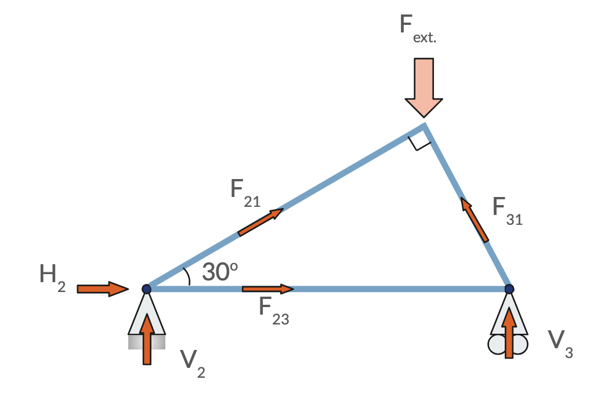

### Systems of Linear Equations


Linear systems of the form $$\boldsymbol{A} \boldsymbol{x} = \boldsymbol{b}$$ are extremely common in engineering.

$$
\begin{bmatrix}
A_{11} & A_{12} & A_{13} \\
A_{21} & A_{22} & A_{23} \\
A_{31} & A_{32} & A_{33} \\
A_{41} & A_{42} & A_{43} \\
A_{51} & A_{52} & A_{53}
\end{bmatrix}
\begin{bmatrix}
x_1 \\
x_2 \\
x_3
\end{bmatrix}
=
\begin{bmatrix}
b_1 \\
b_2 \\
b_3 \\
b_4 \\
b_5
\end{bmatrix}
$$

$$
\begin{aligned}
A_{11}x_1 + A_{12}x_2 + A_{13}x_3 &= b_1 \\
A_{21}x_1 + A_{22}x_2 + A_{23}x_3 &= b_2 \\
A_{31}x_1 + A_{32}x_2 + A_{33}x_3 &= b_3 \\
A_{41}x_1 + A_{42}x_2 + A_{43}x_3 &= b_4 \\
A_{51}x_1 + A_{52}x_2 + A_{53}x_3 &= b_5
\end{aligned}
$$

### Motivating Example from E6

:::: {.columns}
::: {.column width="60%"}
[Find the reaction forces $H_2$, $V_2$ and $V_3$ and all internal forces]{.inclass}

::: {.content-visible when-meta="uncover"}
[$\sum F_x = 0$ at 1,2,3]{.fragment}  
[$\sum F_y = 0$ at 1,2,3]{.fragment}

::::::{.fragment}
```{.tikz}
\begin{tikzpicture}
  % Central node
  \fill (0,0) circle (3pt);

  % H2 force (incoming from left)
  \draw[->, thick] (-1.8,0) -- (-0.2,0);
  \node[left] at (-1.8,0) {$H_2$};

  % V2 force (incoming from bottom)
  \draw[->, thick] (0,-1.8) -- (0,-0.2);
  \node[right] at (0.1,-1) {$V_2$};

  % F23 force (outgoing to right)
  \draw[->, thick] (0.2,0) -- (1.8,0);
  \node[right] at (1.8,0) {$F_{23}$};

  % F21 force (outgoing at 30 degrees)
  \draw[->, thick] (30:0.2) -- (30:1.8);
  \node[above right] at (30:1.8) {$F_{21}$};

  % 30 degree angle arc and text
  \draw (0.8,0) arc (0:30:0.8);
  \node at (15:1.2) {$30^\circ$};
\end{tikzpicture}
```
::::::

::::: {.content-visible when-meta="uncover"}
:::: {.fragment style="font-size: 65%;"}
Horizontal force balance for joint 2:

$$
\begin{array}{r c r c r c r c r c r c l}
  1 H_2 & + & 0 V_2 & + & 0 V_3 & + & (\cos 30^\circ) F_{21} & + & 1 F_{23} & + & 0 F_{31} & = & \begin{Bmatrix} \text{external horiz.} \\ \text{force at 2} \end{Bmatrix}
\end{array}
$$

::::

:::: {.fragment style="font-size: 65%;"}
Vertical force balance for joint 1:

$$
\begin{array}{r c r c r c r c r c r c l}
  0 H_2 & + & 0 V_2 & + & 0 V_3 & + & (\sin 30^\circ) F_{21} & + & 0 F_{23} & + & (\sin 60^\circ) F_{31} & = & \begin{Bmatrix} \text{external vert.} \\ \text{force at 1} \end{Bmatrix}
\end{array}
$$

::::

:::: {.fragment style="font-size: 65%;"}
Force balance for other joints:

$$
\begin{array}{r c r c r c r c r c r c l}
  \square H_2 & + & \square V_2 & + & \square V_3 & + & \square F_{21} & + & \square F_{23} & + & \square F_{31} & = & \dots \text{External Force}
\end{array}
$$

::::


:::

:::
::::
::: {.column width="35%"}
{#fig-FBD1}
:::

:::::

### Assembling a matrix-vector equation

- The matrix $\boldsymbol{A}$ multiplies a [vector of unknown quantities]{.underline} $\boldsymbol{x}$ and equals a r[ight-hand-side vector]{.underline} $\boldsymbol{b}$

:::: {.columns}
::: {.column style="font-size: 65%; width: 60%"}
$$
\begin{bmatrix}
1 & 0 & 0 & \cos 30^\circ & 1 & 0 \\
\vdots & \vdots & \vdots & \vdots & \vdots & \vdots \\
\vdots & \vdots & \vdots & \vdots & \vdots & \vdots \\
0 & 0 & 0 & \sin 30^\circ & 0 & \sin 60^\circ \\
\vdots & \vdots & \vdots & \vdots & \vdots & \vdots \\
\vdots & \vdots & \vdots & \vdots & \vdots & \vdots \\
\end{bmatrix}
\begin{bmatrix}
H_2 \\
V_2 \\
V_3 \\
F_{21} \\
F_{23} \\
F_{31}
\end{bmatrix}
=
\begin{bmatrix}
0 \\
\dots \\
\dots \\
F_{1,\text{ext}} \\
\dots \\
\dots
\end{bmatrix}
$$
:::
::: {.column width="5%"}
:::
::: {.column width="30%"}
:::

::::

- Six equations for six unknowns (if the problem is well-posed)

### Motivating Example from E11

:::: {.columns}
::: {.column style="font-size: 100%; width: 55%;"}

[Find the currents in this circuit.]{.inclass}

::: {.content-hidden unless-meta="uncover"}
::: {.fragment}
1) Sum of currents at node A
$$0 + 1I_1 + 1I_2 - 1I_3 = 0$$
:::

::: {.fragment}
2) Loop 2:
$$+5 - 4I_1 + 0I_2 - 3I_3 = 0$$
:::

::: {.fragment}
3) Loop 3:
$$+6 + 0I_1 - 5I_2 - 3I_3 = 0$$
:::
:::

:::

::: {.column width="40%"}

```{.tikz}
%%| additionalPackages: \usepackage{amsmath}
\begin{tikzpicture}[line width=1pt]
  % --- Bottom & Top Wires ---
  \draw (0,0) -- (8,0);

  % --- Left Branch (+5V source & wires) ---
  \draw (0,0) -- (0,1.85);
  \draw (0,2.15) -- (0,4);
  % Battery plates
  \draw (-0.35,2.15) -- (0.35,2.15);                  % Top plate (+)
  \draw[line width=2.5pt] (-0.18,1.85) -- (0.18,1.85); % Bottom plate (-)
  \node[left=4pt] at (-0.35,2) {$+5\text{V}$};

  % --- Top-Left Resistor (4 Ohm) ---
  \draw (0,4) -- (1.4,4);
  \draw[fill=white] (1.4,3.8) rectangle (2.6,4.2);
  \node[above=2pt] at (2,4.4) {$4\,\Omega$};
  \draw (2.6,4) -- (4,4);

  % --- Middle Branch (3 Ohm resistor) ---
  \draw (4,4) -- (4,2.6);
  \draw[fill=white] (3.8,1.4) rectangle (4.2,2.6);
  \node[left=3pt] at (3.6,2) {$3\,\Omega$};
  \draw (4,1.4) -- (4,0);

  % --- Top-Right Resistor (5 Ohm) ---
  \draw (4,4) -- (5.4,4);
  \draw[fill=white] (5.4,3.8) rectangle (6.6,4.2);
  \node[above=2pt] at (6,4.4) {$5\,\Omega$};
  \draw (6.6,4) -- (8,4);

  % --- Right Branch (+6V source & wires) ---
  \draw (8,0) -- (8,1.85);
  \draw (8,2.15) -- (8,4);
  % Battery plates
  \draw (7.65,2.15) -- (8.35,2.15);                   % Top plate (+)
  \draw[line width=2.5pt] (7.82,1.85) -- (8.18,1.85); % Bottom plate (-)
  \node[left=4pt] at (7.65,2) {$+6\text{V}$};

  % --- Junction Dots ---
  \fill (4,4) circle (2.5pt);
  \fill (4,0) circle (2.5pt);
\end{tikzpicture}
```

:::
::::

### Solving sysems of the form $A x = b$

- Equivalent to [inverting the system matrix $A$]{.underline} because $Ax = b \implies x = A^{-1}b$
- The same $A^{-1}$ can be used with multiple right-hand side vectors.
  - $Ax = b$ and $Ax = c$ have solutions: $x = A^{-1}b$ and $x = A^{-1}c$ respectively.
- Requires number of equations to equal number of unknowns.
  - If unknowns > equations: probably need additional physical constraints
  - If equations > unknowns: problem is _overdetermined_
  - Cannot double-count two equations that express the same information in different ways. 
  - The above is equivalent to saying _the equations need to be linearly independent_.

### Gaussian Elimination followed by substitution

:::: {.columns}
:::{.column width="30%" }
$$\phantom{+}2x_1 + 3x_2 = 4$${#eq-one}
$$-\phantom{2}x_1 + 2x_2 = 5$${#eq-two}
:::
::::

- Idea: replace (2) with an equation that only has $x_2$, not $x_1$
- Procedure: Find a linear combination of eqs. (1) and (2) that has $0x_1$.

[e.g.]{.fragment}

[$(1) + 2 \times (2) \rightarrow \text{ new } (2)$]{.fragment}

[The new equation is $\boxed{0 x_1 + 7 x_2 = 14}$ $(2^*)$]{.fragment}

### Resulting equations after Gaussian elimination

:::: {.columns}
:::{.column width="30%"}
Original equations:
$$\phantom{+}2x_1 + 3x_2 = 4$$
$$-\phantom{2}x_1 + 2x_2 = 5$$
:::
:::{.column width="30%"}
Equivalent equations:
$$\phantom{+}2x_1 + 3x_2 = 4$${#eq-three}
$$\phantom{-}0x_1 + 7x_2 = 14$${#eq-four}
:::
:::{.column width="30%"}
:::
::::

- (3) and (4) are easy to solve for $x_1$ and $x_2$.
- First solve for $x_2$ using @eq-four
- Then substitute value of $x_2$ into @eq-three. Now, @eq-three has only one unknown
- Solve @eq-three for $x_1$.

[Gaussian **elimination** followed by **substitution** $\rightarrow$ solution!]{.emph}

### Process of Gaussian Elimination {.scrollable}

::: {.fragment}
Start with $\boldsymbol{A} \boldsymbol{x} = \boldsymbol{b}$

$$
\begin{bmatrix}
A_{11} & A_{12} & A_{13} \\
A_{21} & A_{22} & A_{23} \\
A_{31} & A_{32} & A_{33}
\end{bmatrix}
\begin{bmatrix}
x_1 \\
x_2 \\
x_3
\end{bmatrix}
=
\begin{bmatrix}
b_1 \\
b_2 \\
b_3
\end{bmatrix}
$$
:::

::: {.fragment}

Construct a so-called _augmented_ matrix with one extra column, the r.h.s. of the equation.

$$
\left[\begin{array}{ccc|c}
A_{11} & A_{12} & A_{13} & b_1 \\
A_{21} & A_{22} & A_{23} & b_2 \\
A_{31} & A_{32} & A_{33} & b_3
\end{array}\right]
\quad
$$

:::

::: {.fragment}

Perform **row operations** until an augmented matrix of the following form survives. 

- This is known as the _row echelon_ form.

$$
\left[\begin{array}{ccc|c}
A^*_{11} & A^*_{12} & A^*_{13} & b^*_1 \\
0 & A^*_{22} & A^*_{23} & b^*_2 \\
0 & 0 & A^*_{33} & b^*_3
\end{array}\right]
\quad
$$

:::

::: {.fragment}

Recognize that the above is shorthand for the following equation:

$$
\begin{aligned}
A_{11}^* x_1 + A_{12}^* x_2 + A_{13}^* x_3 &= b^*_1 \\
\phantom{A_{21}x_1 +} A^*_{22}x_2 + A^*_{23}x_3 &= b^*_2 \\
\phantom{A_{31}x_1 + A_{32}x_2 +} A_{33}^* x_3 &= b^*_3 \\
\end{aligned}
$$

:::

::: {.fragment}

Solve, starting from the last.

$$
\begin{aligned}
A_{11}^* x_1 + A_{12}^* x_2 + A_{13}^* x_3 &= b^*_1 \\
\phantom{A_{21}x_1 +} A^*_{22}x_2 + A^*_{23}x_3 &= b^*_2 \\
\phantom{A_{31}x_1 + A_{32}x_2 +} A_{33}^* x_3 &= b^*_3 \\
\end{aligned}
$$

[$$x_3 = \frac{b_3^*}{A_{33}}^*$$]{.fragment}
[$$x_2 = \frac{b_2^* - A_{23}^* x_3}{A_{22}^*}$$]{.fragment}
[$$x_1 = \frac{b_1^* - A_{13}^* x_3 - A_{12}^* x_2}{A_{11}^*}$$]{.fragment}


:::

### What are _row operations_ ?

1. Swap row $m$ with row $n$
2. Multiply a row by a non-zero constant
3. Add one row to another


