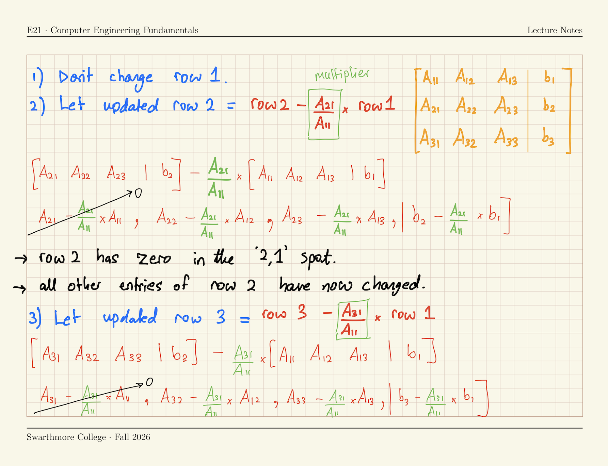
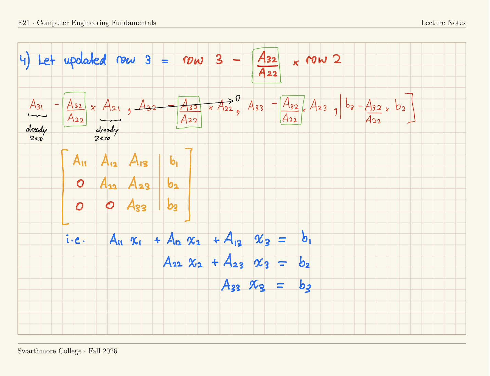

### Algorithm for Gaussian Elimination

::: {.content-visible when-meta="uncover"}
::: {.fragment}

{width="90%" fig-align="center"}

:::
:::

### Algorithm for Gaussian Elimination

::: {.content-visible when-meta="uncover"}
::: {.fragment}

{width="90%" fig-align="center"}

:::
:::


### Algorithm for backward substitution

::: {.columns}
::: {.column width="45%; font-size: 80%;"}
$$
\left[\begin{array}{ccc|c}
A^*_{11} & A^*_{12} & A^*_{13} & b^*_1 \\
0 & A^*_{22} & A^*_{23} & b^*_2 \\
0 & 0 & A^*_{33} & b^*_3
\end{array}\right]
$$

[$$x_3 = \frac{b_3^*}{A_{33}^*}$$]{.fragment}
[$$x_2 = \frac{b_2^* - A_{23}^* x_3}{A_{22}^*}$$]{.fragment}
[$$x_1 = \frac{b_1^* - A_{13}^* x_3 - A_{12}^* x_2}{A_{11}^*}$$]{.fragment}

:::
::: {.column width="45%; font-size: 80%;"}
[$$\boxed{x_k = \frac{1}{A^*_{kk}} \left( b^*_k - \sum^n_{j = k +1} \left[ A^*_{kj} x_j \right] \right)}$$]{.fragment}

- The symbol $\sum^n_{j = k +1}$ means [sum over the term inside square brackets using index $j$ from $j = k+1$ to $j = n$ (inclusive)]{.emph}

- The $*$ reminds us that backward substitution is performed on the row-reduced augmented matrix $A^* | b^*$, not the originally given problem $A | b$.
:::
:::

### Gaussian Elimination by hand

[Simplify the given problem to row-reduced form]{.inclass}

::: {.columns}
::: {.column width="45%; font-size: 60%;"}
Solve $Ax = b$ where 
$$
A =\begin{bmatrix}
2 & 1 & -1 & 0\\
1 & 1 & 2 & 0\\
-1 & 2 & 1 & 1\\
6 & 1 & 1 & -2
\end{bmatrix}, \quad b = \begin{bmatrix} 1 \\ -1 \\ 0 \\ 2 \end{bmatrix}.
$$
:::

::: {.column width="45%; font-size: 60%;"}
By first obtaining a row-echelon form
$$
\left[
\begin{array}{cccc|c}
A_{11} & A_{12} & A_{13} & A_{14} & b_1\\
0 & A_{22} & A_{23} & A_{24} & b_2 \\
0 & 0 & A_{33} & A_{34} & b_3 \\
0 & 0 & 0 & A_{44} & b_4
\end{array}
\right]
$$
:::
:::

::: {.content-hidden unless-meta="uncover"}

::: {.fragment}
The solution is $$\displaystyle \left[
\begin{array}{cccc|c}
{2} & {1} & {-1} & {0} & {1}\\
{0} & {0.5} & {2.5} & {0} & {-1.5} \\
{0} & {0} & {-12} & {1} & {8} \\
{0} & {0} & {0} & {-5/6}& {7/3}
\end{array}
\right]$$
:::

:::

### Gaussian Elimination in Python

[Copy into your Python workspace]{.inclass}

::: {.columns}
::: {.column width="50%"}

```{.python}
A = np.array([[2,1,-1,0],
               [1,1,2,0],
               [-1,2,1,1],
               [6,1,1,-2]],
              dtype=np.float64)
b1 = np.array([[1],[-1],[0],[2]],
              dtype=np.float64)
```
:::
:::

[Write one line of code for **each** step of Gaussian elimination]{.inclass}


::: {.content-visible when-meta="uncover"}
::: {.fragment}

```{.python style="width: 60%;"}
# Line-by-line Gaussian elimination

A[1,:] = A[1,:] - (A[1,0]/A[0,0]) * A[0,:] #<1>
A[2,:] = A[2,:] - (A[2,0]/A[0,0]) * A[0,:] #<2>
A[3,:] = A[3,:] - (A[3,0]/A[0,0]) * A[0,:] #<3>

A[2,:] = A[2,:] - (A[2,1]/A[1,1]) * A[1,:] #<4>
A[3,:] = A[3,:] - (A[3,1]/A[1,1]) * A[1,:] #<5>

A[3,:] = A[3,:] - (A[3,2]/A[2,2]) * A[2,:] #<6>
```

1. $\text{Row 2} = \text{Row 2} - \frac{A_{21}}{A_{11}} \times \text{Row 1}$;
2. $\text{Row 3} = \text{Row 3} - \frac{A_{31}}{A_{11}} \times \text{Row 1}$
3. $\text{Row 4} = \text{Row 4} - \frac{A_{41}}{A_{11}} \times \text{Row 1}$
4. $\text{Row 3} = \text{Row 3} - \frac{A_{32}}{A_{22}} \times \text{Row 2}$
5. $\text{Row 4} = \text{Row 4} - \frac{A_{42}}{A_{22}} \times \text{Row 2}$
6. $\text{Row 4} = \text{Row 4} - \frac{A_{43}}{A_{33}} \times \text{Row 3}$

:::
:::

### Further look inside the Gaussian Elimination algorithm

::: {.content-visible when-meta="uncover"}
```{.python style="width: 60%;"}
# Line-by-line Gaussian elimination

A[1,:] = A[1,:] - (A[1,0]/A[0,0]) * A[0,:] #<1>
A[2,:] = A[2,:] - (A[2,0]/A[0,0]) * A[0,:] #<2>
A[3,:] = A[3,:] - (A[3,0]/A[0,0]) * A[0,:] #<3>

A[2,:] = A[2,:] - (A[2,1]/A[1,1]) * A[1,:] #<4>
A[3,:] = A[3,:] - (A[3,1]/A[1,1]) * A[1,:] #<5>

A[3,:] = A[3,:] - (A[3,2]/A[2,2]) * A[2,:] #<6>
```

1. Eliminates $A_{21}$;
2. Eliminates $A_{31}$;
3. Eliminates $A_{41}$;
4. Eliminates $A_{32}$;
5. Eliminates $A_{42}$;
6. Eliminates $A_{43}$;

:::

:::: {.r-stack}
::: {.fragment style="background-color: white; display: inline-block; padding: 10px;"}
Original Matrix

$$
\begin{bmatrix}
2 & 1 & -1 & 0 \\
1 & 1 & 2 & 0 \\
-1 & 2 & 1 & 1 \\
6 & 1 & 1 & -2
\end{bmatrix}
$$
:::

::: {.fragment style="background-color: white; display: inline-block; padding: 10px;"}
Step 1

$$
\begin{bmatrix}
2 & 1 & -1 & 0 \\
0 & 1/2 & 5/2 & 0 \\
-1 & 2 & 1 & 1 \\
6 & 1 & 1 & -2
\end{bmatrix}
$$
:::

::: {.fragment style="background-color: white; display: inline-block; padding: 10px;"}
Step 2

$$
\begin{bmatrix}
2 & 1 & -1 & 0 \\
0 & 1/2 & 5/2 & 0 \\
0 & 5/2 & 1/2 & 1 \\
6 & 1 & 1 & -2
\end{bmatrix}
$$
:::

::: {.fragment style="background-color: white; display: inline-block; padding: 10px;"}
Step 3

$$
\begin{bmatrix}
2 & 1 & -1 & 0 \\
0 & 1/2 & 5/2 & 0 \\
0 & 5/2 & 1/2 & 1 \\
0 & -2 & 4 & -2
\end{bmatrix}
$$
:::


::: {.fragment style="background-color: white; display: inline-block; padding: 10px;"}
Step 4

$$
\begin{bmatrix}
2 & 1 & -1 & 0 \\
0 & 1/2 & 5/2 & 0 \\
0 & 0 & -12 & 1 \\
0 & -2 & 4 & -2
\end{bmatrix}
$$
:::

::: {.fragment style="background-color: white; display: inline-block; padding: 10px;"}
Step 5

$$
\begin{bmatrix}
2 & 1 & -1 & 0 \\
0 & 1/2 & 5/2 & 0 \\
0 & 0 & -12 & 1 \\
0 & 0 & 14 & -2
\end{bmatrix}
$$
:::

::: {.fragment style="background-color: white; display: inline-block; padding: 10px;"}
Step 6

$$
\begin{bmatrix}
2 & 1 & -1 & 0 \\
0 & \frac{1}{2} & \frac{5}{2} & 0 \\
0 & 0 & -12 & 1 \\
0 & 0 & 0 & -\frac{5}{6}
\end{bmatrix}
$$
:::
::::


### The LU Decomposition Method

Any square matrix $A$ can be written as the product of an **upper triangular matrix** and a **lower traingular matrix**, which we call $U$ and $L$ respectively.

[$A = L U$]{.fragment}

[$Ax = b \implies  L U x = b$]{.fragment}

[Let $Ux = y$. Then, $L y = b$]{.fragment}

[Why do this?]{.fragment}

- The two equations $Ly = b$ and $Ux = y$ are easy to solve!

$$L = \begin{bmatrix}
L_{11} & 0 & 0 \\
L_{21} & L_{22} & 0 \\
L_{31} & L_{32} & L_{33}
\end{bmatrix}, U = \begin{bmatrix}
U_{11} & U_{12} & U_{13} \\
0 & U_{22} & U_{23} \\
0 & 0 & U_{33}
\end{bmatrix}$$

### Doolittle's Decomposition

- The $L$ and $U$ for a given matrix $A$ are not unique.
- There are different approaches to finding $L$ and $U$ **uniquely**
- One approach is [Doolittle's Decomposition]{.underline}:
  - Let $L_{11}$, $L_{22}$, $L_{33}$ etc. all be equal to 1.
  - Now, $L$ and $U$ are unique for any $A$
  - For any given square $A$, there exist unique
    $$L = \begin{bmatrix}
    1 & 0 & 0 \\
    L_{21} & 1 & 0 \\
    L_{31} & L_{32} & 1
    \end{bmatrix}, U = \begin{bmatrix}
    U_{11} & U_{12} & U_{13} \\
    0 & U_{22} & U_{23} \\
    0 & 0 & U_{33}
    \end{bmatrix}$$
    such that $A = LU$
- How do we find $L$ and $U$ ?

### Doolittle's Decomposition & Gaussian Elimination {.smaller}

$$L = \begin{bmatrix}
1 & 0 & 0 \\
L_{21} & 1 & 0 \\
L_{31} & L_{32} & 1
\end{bmatrix}, U = \begin{bmatrix}
U_{11} & U_{12} & U_{13} \\
0 & U_{22} & U_{23} \\
0 & 0 & U_{33}
\end{bmatrix}$$

- $U$ is the row-echelon form of $A$, found by Gaussian elimination
- $L_{ij}$ is the 'multiplier' used to eliminate $A_{ij}$ in Gaussian elimination
- [Gaussian Elimination]{.underline} of the square matrix $A$ is equivalent to [finding Doolittle's $LU$ Decomposition]{.underline} of the square matrix $A$
  - Why? Perform Gaussian Elimination on the product $LU$:
    $$LU = 
    \left[\begin{array}{lll}
    U_{11} & U_{12} & U_{13} \\
    U_{11} L_{21} & U_{12} L_{21} + U_{22} & U_{13} L_{21} + U_{23} \\
    U_{11} L_{31} & U_{12} L_{31} + U_{22} L_{32} & U_{13} L_{31} + U_{23} L_{32} + U_{33}
    \end{array}\right]
    $$

### If you have $L$ and $U$, solve $Ax=b$ ...

1. Given the linear system of equations $Ax=b$,
2. Write $A$ as the product of $L$ and $U$, i.e. $LUx = b$.
3. Let $y = U x$.
4. Solve $L y = b$ for $y$ by _forward substitution_.
   $$\begin{bmatrix}
   1 & 0 & 0 \\
   L_{21} & 1 & 0 \\
   L_{31} & L_{32} & 1
   \end{bmatrix}\begin{bmatrix} 
    y_1 \\ 
    y_2 \\ 
    y_3 
    \end{bmatrix} =
    \begin{bmatrix} 
    b_1 \\ 
    b_2 \\ 
    b_3 
    \end{bmatrix}$$
5. Solve $Ux=y$ for $x$ by _backward substitution_.
    $$\begin{bmatrix}
    U_{11} & U_{12} & U_{13} \\
    0 & U_{22} & U_{23} \\
    0 & 0 & U_{33}
    \end{bmatrix}\begin{bmatrix} 
    x_1 \\ 
    x_2 \\ 
    x_3 
    \end{bmatrix} =
    \begin{bmatrix} 
    y_1 \\ 
    y_2 \\ 
    y_3 
    \end{bmatrix}$$

### Banded Matrices

In engineering, we often encounter **banded** matrices

::: {style="font-size: 80%;"}
$$\begin{bmatrix}
A_{11} & A_{12} & 0 & 0 & 0 & 0 \\
A_{21} & A_{22} & A_{23} & 0 & 0 & 0 \\
0 & A_{32} & A_{33} & A_{34} & 0 & 0 \\
0 & 0 & A_{43} & A_{44} & A_{45} & 0 \\
0 & 0 & 0 & A_{54} & A_{55} & A_{56} \\
0 & 0 & 0 & 0 & A_{65} & A_{66}
\end{bmatrix}$$
:::

- A **tridiagonal** matrix has 3 bands surrounding the diagonal.
- Specialized solvers can be used for these; don't waste operations on the zeros!
- The $LU$ Decomposition of a banded matrix _preserves the banded structure_. e.g.,
  
  ::: {style="font-size: 60%"}
  $$L = \begin{bmatrix}
  L_{11} & 0 & 0 & 0 & 0 & 0 \\
  L_{21} & L_{22} & 0 & 0 & 0 & 0 \\
  0 & L_{32} & L_{33} & 0 & 0 & 0 \\
  0 & 0 & L_{43} & L_{44} & 0 & 0 \\
  0 & 0 & 0 & L_{54} & L_{55} & 0 \\
  0 & 0 & 0 & 0 & L_{65} & L_{66}
  \end{bmatrix}, U = \begin{bmatrix}
  U_{11} & U_{12} & 0 & 0 & 0 & 0 \\
  0 & U_{22} & U_{23} & 0 & 0 & 0 \\
  0 & 0 & U_{33} & U_{34} & 0 & 0 \\
  0 & 0 & 0 & U_{44} & U_{45} & 0 \\
  0 & 0 & 0 & 0 & U_{55} & U_{56} \\
  0 & 0 & 0 & 0 & 0 & U_{66}
  \end{bmatrix}$$
  :::

### LU Decomposition of Tridiagonal matrices {.smaller}

Solve $Ax=b$ using LU Decomposition when 

:::: {style="position: relative; width: fit-content; margin-left: auto; margin-right: auto;"}

::: {style="font-size: 60%;"}
$$A = \begin{bmatrix}
d_1 & e_1 & 0 & 0 & \cdots & 0 \\
c_1 & d_2 & e_2 & 0 & \cdots & 0 \\
0 & c_2 & d_3 & e_3 & \cdots & 0 \\
0 & 0 & c_3 & d_4 & \cdots & 0 \\
\vdots & \vdots & \vdots & \vdots & \ddots & \vdots \\
0 & 0 & \cdots & 0 & c_{n-1} & d_n
\end{bmatrix}\, 
c = \begin{bmatrix} c_1 \\ c_2 \\ \vdots \\ c_{n-1} \end{bmatrix}\,
d = \begin{bmatrix} d_1 \\ d_2 \\ \vdots \\ d_n \end{bmatrix}\,
e = \begin{bmatrix} e_1 \\ e_2 \\ \vdots \\ e_{n-1} \end{bmatrix}$$
:::

::: {style="position: absolute; left: 9%; top: 17%; width: 40%; height: 15%; border: 1px solid red; pointer-events: none;"}
:::

::::

[Gaussian Elimination of second row of $A$:]{.fragment}

[$$\boxed{\text{Row k} = \text{Row k} - \frac{A_{21}}{A_{11}} \times \text{Row }(k-1)}$$]{.fragment}

[Write down a formula for $c_1$, $d_2$ and $e_2$ under one step of Gaussian elimination, in terms of all other $c$'s, $d$'s and $e$'s.]{.inclass .fragment}

::: {.content-visible when-meta="uncover"}
[$$
\begin{align}
\text{New } c_1 &= c_1 - \frac{c_1}{d_1} \times d_1 \implies c_1 = 0 \\
\text{New } d_2 &= d_2 - \frac{c_1}{d_1} \times e_1 \implies d_2 = d_2 - \frac{c_1}{d_1} e_1 \\
\text{New } e_2 &= e_2 - \frac{c_1}{d_1} \times 0 \implies e_2 = e_2
\end{align}
$$]{.fragment}

- $c_1$ is **eliminated**, $d_2$ changes, and $e_2$ doesn't change.
- The **multiplier** for Row 2 was $\left(c_1/d_1\right)$
:::

### Comtinued {.smaller}

The $LU$ Decomposition of $A$ is therefore

::: {style="font-size: 80%;"}
$$L = \begin{bmatrix}
1 & 0 & 0 & 0 & \cdots & 0 \\
\lambda_1 & 1 & 0 & 0 & \cdots & 0 \\
0 & \lambda_2 & 1 & 0 & \cdots & 0 \\
0 & 0 & \lambda_3 & 1 & \cdots & 0 \\
\vdots & \vdots & \vdots & \vdots & \ddots & \vdots \\
0 & 0 & \cdots & 0 & \lambda_{n-1} & 1
\end{bmatrix}, \quad U = \begin{bmatrix}
d_1^* & e_1 & 0 & 0 & \cdots & 0 \\
0 & d_2^* & e_2 & 0 & \cdots & 0 \\
0 & 0 & d_3^* & e_3 & \cdots & 0 \\
0 & 0 & 0 & d_4^* & \cdots & 0 \\
\vdots & \vdots & \vdots & \vdots & \ddots & \vdots \\
0 & 0 & \cdots & 0 & 0 & d_n^*
\end{bmatrix}$$
:::

- where $\lambda_k$ is the multiplier used to eliminate $c_k$,
- the $*$ indicates that the terms have been (possibly) updated from their original values


[Recall that $LUx = b$ can be solved in two steps:]{.fragment}

:::: {.columns}
::: {.column style="font-size: 70%; width: 45%"}

1. Forward substitution of $Ly = b$

   $\left[\begin{array}{cccccc|c}
1 & 0 & 0 & 0 & \cdots & 0 & b_1 \\
\lambda_1 & 1 & 0 & 0 & \cdots & 0 & b_2 \\
0 & \lambda_2 & 1 & 0 & \cdots & 0 & b_3 \\
0 & 0 & \lambda_3 & 1 & \cdots & 0 & b_4 \\
\vdots & \vdots & \vdots & \vdots & \cdots & \vdots & \vdots \\
0 & 0 & \cdots & 0 & \lambda_{n-1} & 1 & b_n
\end{array}\right]$

:::
::: {.column style="font-size: 70%; width: 45%"}

2. Backward substitution of $Ux = y$

   $\left[\begin{array}{cccccc|c}
d_1^* & e_1 & 0 & \cdots & 0 & 0 & y_1 \\
0 & d_2^* & e_2 & \cdots & 0 & 0 & y_2 \\
0 & 0 & d_3^* & \cdots & 0 & 0 & y_3 \\
\vdots & \vdots & \vdots & & \vdots & \vdots & \vdots \\
0 & 0 & 0 & \cdots & d_{n-1}^* & e_{n-1} & y_{n-1} \\
0 & 0 & 0 & \cdots & 0 & d_n^* & y_n
\end{array}\right]$

:::
::::


