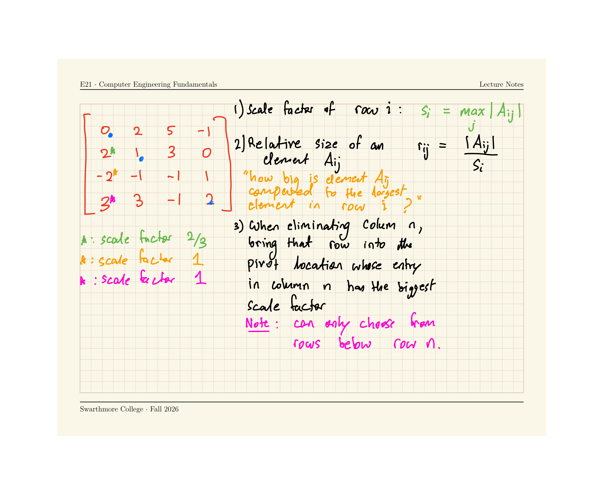

### Divergence and Convergence {.smaller .scrollable}

::: {.columns}
::: {.column width=45%}
```{python}
import numpy as np
import matplotlib.pyplot as plt

np.set_printoptions(4)
A = np.array([[-1 ,3  ,2 ],
              [4  ,5/2,-1],
              [0  ,3  ,1 ]],dtype=np.float64)
b = np.array([1,2,1],dtype=np.float64)

x1 = np.array([1,1,1],dtype=np.float64)
x2 = np.zeros(3)

n_steps = 6
history = np.zeros((n_steps+1,3))
history[0,:] = x1

for i in range(n_steps):
    x2[0] = 1/(A[0,0]) * (b[0] - A[0,1] * x1[1] - A[0,2] * x1[2])
    x2[1] = 1/(A[1,1]) * (b[1] - A[1,0] * x1[0] - A[1,2] * x1[2])
    x2[2] = 1/(A[2,2]) * (b[2] - A[2,0] * x1[0] - A[2,1] * x1[1])

    print(x2)
    x1 = x2.copy()
    history[i+1,:] = x2

plt.plot(history,'o-',label=['$x_1$','$x_2$','$x_3$'])
plt.grid(True)
plt.legend()
plt.show()
```
:::
::: {.column width=5%}
:::
::: {.column width=45%}
```{python}
import numpy as np
import matplotlib.pyplot as plt

np.set_printoptions(4)
A = np.array([[4   ,1  ,2  ],
              [-1/2,3  ,3/2],
              [0   ,2  ,4  ]],dtype=np.float64)
b = np.array([1,2,1],dtype=np.float64)

x1 = np.array([1,1,1],dtype=np.float64)
x2 = np.zeros(3)

n_steps = 6
history = np.zeros((n_steps+1,3))
history[0,:] = x1

for i in range(n_steps):
    x2[0] = 1/(A[0,0]) * (b[0] - A[0,1] * x1[1] - A[0,2] * x1[2])
    x2[1] = 1/(A[1,1]) * (b[1] - A[1,0] * x1[0] - A[1,2] * x1[2])
    x2[2] = 1/(A[2,2]) * (b[2] - A[2,0] * x1[0] - A[2,1] * x1[1])

    print(x2)
    x1 = x2.copy()
    history[i+1,:] = x2

plt.plot(history,'o-',label=['$x_1$','$x_2$','$x_3$'])
plt.grid(True)
plt.legend()
plt.show()
```
:::
:::

### Tolerance, Residual, Norm

- An iterative numerical algorithm for $Ax=b$ can be terminated when the sequence $$x^{(0)} \rightarrow x^{(1)} \rightarrow x^{(2)} \rightarrow ... \rightarrow x^{(k)}$$ sufficiently converges
- Under certain conditions, this is guaranteed to happen.
- Typically, we use `while` loops to implement this:  
  **Pseudo-code:**  
  ```
  while norm(residual) > tolerance:
    carry out 1 iteration of numerical method
    calculate residual
  ```

### Convergence Guarantees

Jacobi and Gauss-Seidel methods are guaranteed to converge to a solution of $Ax=b$ $under either of the following conditions:

1. The matrix $A$ is diagonally dominant, or
2. The matrix $A$ is symmetric ($A_{ij} = A_{ji}$ for all $i$ and $j$) and positive definite (all eigenvalues are positive)

### But does a solution to $Ax=b$ even exist?

- Convergence guarantees are of no use to us if the system of equations $Ax=b$ **has** no solution.
- When does $Ax=b$ have no unique solution? [[Worksheet](worksheet)]{.inclass}

### Four equivalent statements about solvability of $Ax=b$ {.scrollable}

The following four statements are equivalent, and any one of them implies all the others.

1. There is a unique solution $x$ for the equation $Ax=b$  
   Statement 1 does not hold if:  
    - If more than one different vectors $x$ satisfy the equation $Ax=b$, then statement 1 does not hold.
    - If no vector $x$ satisfies the equation $Ax=b$, then statement 1 does not hold
2. The matrix $A$ is not singular  
   - A **singular** matrix is bad --- it represents equations that cannot be solved.
3. The determinant of $A$ is not equal to zero
   - For 2x2 matrices, the determinant of $A = \begin{bmatrix} a & b \\ c & d \end{bmatrix}$ is $\det A = |ad-bc|$
4. $A$ is invertible, i.e., the matrix $A^{-1}$ exists such that $A A^{-1} = I$
5. The rows of $A$ are linearly independent
   - i.e., the indvidual scalar equations in $Ax=b$ are not multiples of each other
   - and no row is a linear combination of the other rows

### Pivoting (in direct methods)

- Python's `numpy` package contains `numpy.linalg.solve(A,b)` which pretty much always works **if** a uniques solution to $Ax=b$ exists
- Direct methods with pivoting!

**The need for pivoting**

- Consider the two matrices
$$
A = \begin{bmatrix}
0 & -1 & 1 \\
-1 & 2 & -1 \\
2 & -1 & 0 
\end{bmatrix}, \quad 
B = \begin{bmatrix}
2 & -1 & 0  \\
-1 & 2 & -1 \\
0 & -1 & 1 
\end{bmatrix}
$$

### Pivoting Procedure {.scrollable}

1. Calculate a scale factor for each row: $\displaystyle s_i \equiv \max_{j} |A_{ij}|$
2. Define the **relative size of an element** $A_{ij}$ as $r_{ij} \equiv \frac{|A_{ij}|}{s_i}.$ This measures how big element $A_{ij}$ is relative to the other elements [in its row]{.underline}. 
3. In the Gaussian elimination procedure, before you start eliminating the entries of column $k$, check the relative size of all elments in column $k$ below the diagonal, i.e., determine $\displaystyle r_{pk} = \max_j (r_{jk}), \quad j \ge k$
4. Swap rows $k$ and $p$




### Well-conditioned and ill-conditioned matrices

The condition number of a matrix is defined as the product of the **norm** of the matrix and the norm of its inverse:

[$$\text{cond } A = || A || \cdot || A^{-1}||$$]{.fragment}

[Note: When computing $|| A ||$ for a matrix we will use the **Frobenius norm**: $$|| A || \equiv \sqrt{\sum_{i=1}^{N} \sum_{j=1}^N A_{ij}^2}.$$]{.fragment}


::: {.fragment}

```{.python}
>>> a = np.array([[4,2],[2,-1]])
>>> np.linalg.norm(a)*np.linalg.norm(np.linalg.inv(a))
np.float64(3.125)
>>> np.linalg.cond(a)
np.float64(2.763085794518659)
>>> np.linalg.cond(a, 'fro')
np.float64(3.125)
```
:::

::: {.fragment}
[Ill-conditioned matrices lead to error accumulation]{.emph}
:::

### Identifying Ill-conditioned matrices

| Description | Criterion |
|------------------|-----------|
| Well conditioned | $\text{cond}(A) \approx 1$ |
| Ill conditioned | $\text{cond}(A) \gg 1$ |
| Singular | $\text{cond}(A) \rightarrow \infty$ |

[**Heuristic**:]{.fragment}

[[If a matrix is ill-conditioned, its determinant (or the determinant of its inverse) is very small.]{.emph}]{.fragment}

[But what does 'small' mean?]{.fragment}

::: {.fragment}
A matrix's determinant is very small if 
$$\det A \ll ||A||$$
:::


