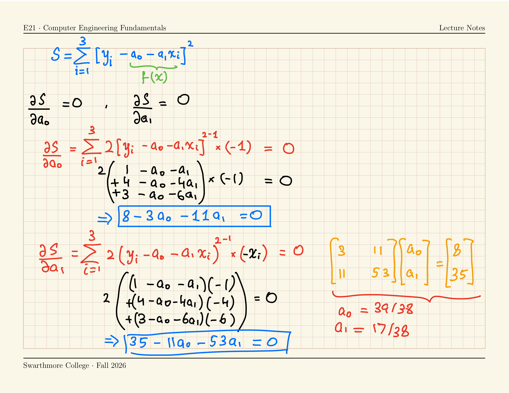
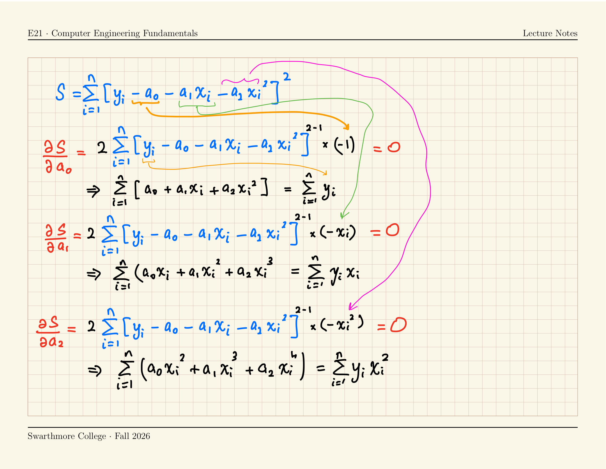
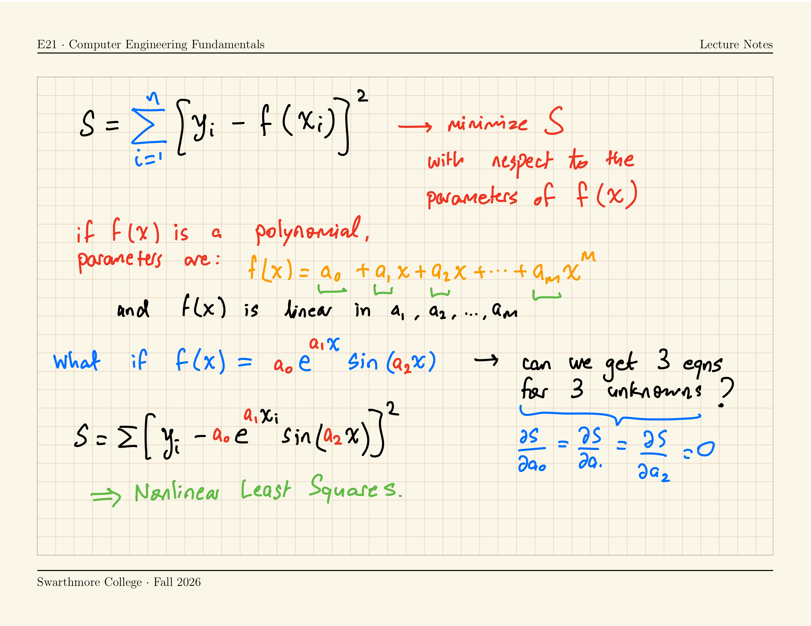
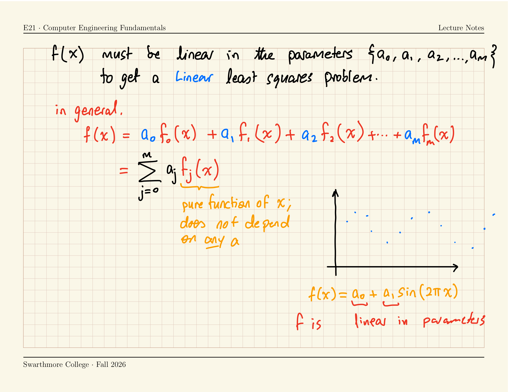

### Linear & Nonlinear Interpolation

Fitting a polynomial of degree $n$ to a set of $n+1$ points is an example of **linear** interpolation.

::: {.r-fit-text}
::: {.centering}

::: {layout-ncol=2}
Interpolate the polynomial
$$y = a_0 + a_1 x + a_2 x^2 + ... a_n x^n $$
to the points $\{ x_0, y_0 \}, \{ x_1, y_1 \}, \{ x_2, y_2 \}, ... , \{ x_n, y_n \}$
by solving an equation for the parameters $\{ a_0, a_1, a_2, ..., a_n \}$

$$
{\begin{bmatrix}
x_0^0 & x_0^1 & x_0^2 & \cdots & x_0^n \\
x_1^0 & x_1^1 & x_1^2 & \cdots & x_1^n \\
\vdots & \vdots & \vdots & \ddots & \vdots \\
x_n^0 & x_n^1 & x_n^2 & \cdots & x_n^n
\end{bmatrix}}
\begin{bmatrix}
a_0 \\
a_1 \\
\vdots \\
a_n
\end{bmatrix}
=
\begin{bmatrix}
y_0 \\
y_1 \\
\vdots \\
y_n
\end{bmatrix}
$$
:::
:::
:::

[What's _nonlinear_ interpolation ?]{.inclass .fragment}

::: {.content-visible when-meta="uncover"}
[Nonlinear interpolation is when the interpolating function depends nonlinearly on the looked-for parameters.]{.emph .fragment}
:::

### An example of nonlinear interpolation

Interpolate the points $\{ 0.5, 0.6191\}, \{ 1, 0.24612\}, \{ 2, -0.0277\}$ to the curve $\boxed{y(x) = a e^{-b x} \sin (c x)}$.

::: {.r-stack}
::: {.fragment}
```{.tikz width="6in"}
%%| additionalPackages: \usepackage{pgfplots}

\begin{tikzpicture}
  \begin{axis}[
    xmin=-0.1, xmax=4,
    ymin=-0.2, ymax=1,
    axis lines=middle,
    title={},
    xlabel={$x$},
    ylabel={$y$},
    grid=both,
    grid style={line width=0.1pt, draw=gray!20},
    major grid style={line width=0.2pt, draw=gray!40},
    samples=200,
    domain=-1:5
  ]

    % Points
    \addplot[only marks, mark=*, mark size=2.5pt, red] coordinates {
      (0.5, 0.6191 )
      (1, 0.24612)
      (2, -0.0277)
    };
  \end{axis}
\end{tikzpicture}
```
:::
::: {.fragment}
```{.tikz width="6in"}
%%| additionalPackages: \usepackage{pgfplots}

\begin{tikzpicture}
  \begin{axis}[
    xmin=-0.1, xmax=4,
    ymin=-0.2, ymax=1,
    axis lines=middle,
    title={},
    xlabel={$x$},
    ylabel={$y$},
    grid=both,
    grid style={line width=0.1pt, draw=gray!20},
    major grid style={line width=0.2pt, draw=gray!40},
    samples=200,
    domain=-1:5
  ]
    % Polynomial Curve
    \addplot[thick, blue] {1 * exp(-x) *sin(deg(x))};
    \addlegendentry{$a = 1, b = 1, c = 1$}

    % Points
    \addplot[only marks, mark=*, mark size=2.5pt, red] coordinates {
      (0.5, 0.6191 )
      (1, 0.24612)
      (2, -0.0277)
    };
  \end{axis}
\end{tikzpicture}
```
:::
::: {.fragment}
```{.tikz width="6in"}
%%| additionalPackages: \usepackage{pgfplots}

\begin{tikzpicture}
  \begin{axis}[
    xmin=-0.1, xmax=4,
    ymin=-0.2, ymax=1,
    axis lines=middle,
    title={},
    xlabel={$x$},
    ylabel={$y$},
    grid=both,
    grid style={line width=0.1pt, draw=gray!20},
    major grid style={line width=0.2pt, draw=gray!40},
    samples=200,
    domain=-1:5
  ]
    % Polynomial Curve
    \addplot[thick, blue] {1 * exp(-x) *sin(deg(x))};
    \addlegendentry{$a = 1, b = 1, c = 1$}
    \addplot[thick, orange] {0.8 * exp(-0.5*x) *sin(deg(3*x))};
    \addlegendentry{$a = 0.8, b = 0.5, c = 3$}

    % Points
    \addplot[only marks, mark=*, mark size=2.5pt, red] coordinates {
      (0.5, 0.6191 )
      (1, 0.24612)
      (2, -0.0277)
    };
  \end{axis}
\end{tikzpicture}
```
:::
:::

[Write down the mathematical equations for this problem.]{.inclass .fragment}

### Equations for nonlinear interpolation

Interpolating $\{ 0.5, 0.6191\}, \{ 1.0, 0.24612\}, \{ 2.0, -0.0277\}$ to $\boxed{y(x) = a e^{-b x} \sin (c x)}$

[requires solving three equations for three unknowns]{.fragment}

[$$
\begin{align*}
\phantom{-}0.6191 &= a e^{-b \times 0.5} \sin (c \times 0.5) \\
\phantom{-}0.2461 &= a e^{-b \times 1.0} \sin (c \times 1.0) \\
-0.0277 &= a e^{-b \times 2.0} \sin (c \times 2.0) 
\end{align*}
$$]{.fragment}

::: {.fragment}
Notice that the interpolating function $y(x)$ [depends nonlinearly on]{.underline} the parameters $b$ and $c$.
:::

::: {.fragment}
i.e., an equation of this kind does **not** exist:

$$
{\begin{bmatrix}
A_{11} & A_{12} & A_{13} \\
A_{21} & A_{22} & A_{23} \\
A_{31} & A_{32} & A_{33}
\end{bmatrix}}
\begin{bmatrix}
a \\
b \\
c
\end{bmatrix}
=
\begin{bmatrix}
d_1 \\
d_2 \\
d_3
\end{bmatrix}
$$
:::

### Successful Interpolation with other-than-polynomial functions

::: {.nonincremental}
```{.tikz width="6in"}
%%| additionalPackages: \usepackage{pgfplots}

\begin{tikzpicture}
  \begin{axis}[
    xmin=-0.1, xmax=4,
    ymin=-0.2, ymax=1,
    axis lines=middle,
    title={},
    xlabel={$x$},
    ylabel={$y$},
    grid=both,
    grid style={line width=0.1pt, draw=gray!20},
    major grid style={line width=0.2pt, draw=gray!40},
    samples=200,
    domain=-1:5
  ]
    % Polynomial Curve
    \addplot[thick, orange] {2 * exp(-2*x) *sin(deg(2*x))};
    \addlegendentry{$y(x) = 2 e^{-2x} \sin 2x$}

    % Points
    \addplot[only marks, mark=*, mark size=2.5pt, red] coordinates {
      (0.5, 0.6191 )
      (1, 0.24612)
      (2, -0.0277)
    };
  \end{axis}
\end{tikzpicture}
```

- The function $y(x) = 2 e^{-2x} \sin 2x$ happens to pass through all three given points exactly.
:::

### The need for Curve Fitting

Consider the following data points and make

::: {.r-stack}
::: {.fragment}
```{.tikz width="6in"}
%%| additionalPackages: \usepackage{pgfplots}

\begin{tikzpicture}
  \begin{axis}[
    xmin=-0.2, xmax=7.2,
    ymin=0, ymax=60,
    axis lines=middle,
    title={},
    xlabel={$x$},
    ylabel={$y$},
    grid=none,
    grid style={line width=0.1pt, draw=gray!20},
    major grid style={line width=0.2pt, draw=gray!40},
    samples=200,
    domain=-0:7
  ]
    % Polynomial Curve
    \addplot[only marks, mark=*, mark size=2pt, black] coordinates {
      (0, 9.11886)
      (1, 4.98174)
      (2, 11.9647)
      (3, 17.3411)
      (4, 16.6198)
      (5, 33.5667)
      (6, 45.1629)
      (7, 53.5341)
    };
  \end{axis}
\end{tikzpicture}
```
:::
::: {.fragment}
```{.tikz width="6in"}
%%| additionalPackages: \usepackage{pgfplots}

\begin{tikzpicture}
  \begin{axis}[
    xmin=-0.2, xmax=7.2,
    ymin=0, ymax=60,
    axis lines=middle,
    title={},
    legend pos=north west,
    xlabel={$x$},
    ylabel={$y$},
    grid=none,
    grid style={line width=0.1pt, draw=gray!20},
    major grid style={line width=0.2pt, draw=gray!40},
    samples=200,
    domain=-0:7
  ]
    % Polynomial Curve
    \addplot[thick, blue] {9.11886 + 38.427*x - 113.535*x^2 + 109.357*x^3 - 47.8452*x^4 + 10.5514*x^5 - 1.14052*x^6 + 0.048023*x^7};
    \addlegendentry{Polynomial Interpolation};
    % Points
    \addplot[only marks, mark=*, mark size=2pt, black] coordinates {
      (0, 9.11886)
      (1, 4.98174)
      (2, 11.9647)
      (3, 17.3411)
      (4, 16.6198)
      (5, 33.5667)
      (6, 45.1629)
      (7, 53.5341)
    };
  \end{axis}
\end{tikzpicture}
```
:::
::: {.fragment}
```{.tikz width="6in"}
%%| additionalPackages: \usepackage{pgfplots}

\begin{tikzpicture}
  \begin{axis}[
    xmin=-0.2, xmax=7.2,
    ymin=0, ymax=60,
    axis lines=middle,
    title={},
    legend pos=north west,
    xlabel={$x$},
    ylabel={$y$},
    grid=none,
    grid style={line width=0.1pt, draw=gray!20},
    major grid style={line width=0.2pt, draw=gray!40},
    samples=200,
    domain=-0:7
  ]
    % Polynomial Curve
    \addplot[thick, blue] {9.11886 + 38.427*x - 113.535*x^2 + 109.357*x^3 - 47.8452*x^4 + 10.5514*x^5 - 1.14052*x^6 + 0.048023*x^7};
    \addlegendentry{Polynomial Interpolation};
    \addplot[thick, red] {7.637 - 0.7406 *x + 1.0852*x^2};
    \addlegendentry{Polynomial Curve fit};
    % Points
    \addplot[only marks, mark=*, mark size=2pt, black] coordinates {
      (0, 9.11886)
      (1, 4.98174)
      (2, 11.9647)
      (3, 17.3411)
      (4, 16.6198)
      (5, 33.5667)
      (6, 45.1629)
      (7, 53.5341)
    };
  \end{axis}
\end{tikzpicture}
```
:::
:::

- Polynomial interpolation follows the given data _exactly_
- But practically, we sometimes just want the _trend_
  - Curve fits are a mathematically-determined 'curve of best fit'


### Line of best fit

::: {.r-stack}
::: {.fragment}
```{.tikz width="6in"}
\begin{tikzpicture}[
    >=stealth,
    datapoint/.style={circle, draw=black, fill=gray!18, inner sep=2.2pt},
    residual/.style={<->, thin, shorten >=1.5pt, shorten <=1.5pt}
]
    % Linear fit parameters: f(x) = a0 + a1 * x
    \def\azero{1.0}
    \def\aone{0.4}

    % Axes
    \draw[->, semithick] (-0.4, 0) -- (9.5, 0);
    \draw[->, semithick] (0, -0.4) -- (0, 5.2);

    % Data points
    \node[datapoint] (P0) at (1.05, 0.80) {};
    \node[datapoint] (P1) at (2.30, 2.60) {};
    \node[datapoint] (P2) at (3.95, 1.45) {};
    \node[datapoint] (P3) at (4.75, 3.60) {};
    \node[datapoint] (P4) at (7.90, 3.35) {};

    % Point labels
    \node[below=2pt] at (P0) {$(x_0, y_0)$};
    \node[above left, xshift=10pt, yshift=1pt] at (P1) {$(x_1, y_1)$};
    \node[below=2pt] at (P2) {$(x_2, y_2)$};
    \node[above left, xshift=10pt, yshift=1pt] at (P3) {$(x_3, y_3)$};
    \node[below right, xshift=-10pt, yshift=-1pt] at (P4) {$(x_4, y_4)$};
\end{tikzpicture}
```
:::
::: {.fragment}
```{.tikz width="6in"}
\begin{tikzpicture}[
    >=stealth,
    datapoint/.style={circle, draw=black, fill=gray!18, inner sep=2.2pt},
    residual/.style={<->, thin, shorten >=1.5pt, shorten <=1.5pt}
]
    % Linear fit parameters: f(x) = a0 + a1 * x
    \def\azero{1.0}
    \def\aone{0.4}

    % Axes
    \draw[->, semithick] (-0.4, 0) -- (9.5, 0);
    \draw[->, semithick] (0, -0.4) -- (0, 5.2);

    % Fitted line (rendered in black instead of orange)
    \draw[very thick, black] (0.3, {\azero + \aone*0.3}) -- (9.3, {\azero + \aone*9.3});

    % Data points
    \node[datapoint] (P0) at (1.05, 0.80) {};
    \node[datapoint] (P1) at (2.30, 2.60) {};
    \node[datapoint] (P2) at (3.95, 1.45) {};
    \node[datapoint] (P3) at (4.75, 3.60) {};
    \node[datapoint] (P4) at (7.90, 3.35) {};

    % Point labels
    \node[below=2pt] at (P0) {$(x_0, y_0)$};
    \node[above left, xshift=10pt, yshift=1pt] at (P1) {$(x_1, y_1)$};
    \node[below=2pt] at (P2) {$(x_2, y_2)$};
    \node[above left, xshift=10pt, yshift=1pt] at (P3) {$(x_3, y_3)$};
    \node[below right, xshift=-10pt, yshift=-1pt] at (P4) {$(x_4, y_4)$};
\end{tikzpicture}
```
:::
::: {.fragment}
```{.tikz width="6in"}
\begin{tikzpicture}[
    >=stealth,
    datapoint/.style={circle, draw=black, fill=gray!18, inner sep=2.2pt},
    residual/.style={<->, thin, shorten >=1.5pt, shorten <=1.5pt}
]
    % Linear fit parameters: f(x) = a0 + a1 * x
    \def\azero{1.0}
    \def\aone{0.4}

    % Axes
    \draw[->, semithick] (-0.4, 0) -- (9.5, 0);
    \draw[->, semithick] (0, -0.4) -- (0, 5.2);

    % Fitted line (rendered in black instead of orange)
    \draw[very thick, black] (0.3, {\azero + \aone*0.3}) -- (9.3, {\azero + \aone*9.3});

    % Data points
    \node[datapoint] (P0) at (1.05, 0.80) {};
    \node[datapoint] (P1) at (2.30, 2.60) {};
    \node[datapoint] (P2) at (3.95, 1.45) {};
    \node[datapoint] (P3) at (4.75, 3.60) {};
    \node[datapoint] (P4) at (7.90, 3.35) {};

    % Point labels
    \node[below=2pt] at (P0) {$(x_0, y_0)$};
    \node[above left, xshift=10pt, yshift=1pt] at (P1) {$(x_1, y_1)$};
    \node[below=2pt] at (P2) {$(x_2, y_2)$};
    \node[above left, xshift=10pt, yshift=1pt] at (P3) {$(x_3, y_3)$};
    \node[below right, xshift=-10pt, yshift=-1pt] at (P4) {$(x_4, y_4)$};

    % Vertical residual arrows between data points and the fitted line
    \draw[residual] (P0) -- (1.05, {\azero + \aone*1.05});
    \draw[residual] (P1) -- (2.30, {\azero + \aone*2.30});
    \draw[residual] (P2) -- (3.95, {\azero + \aone*3.95});
    \draw[residual] (P3) -- (4.75, {\azero + \aone*4.75});
    \draw[residual] (P4) -- (7.90, {\azero + \aone*7.90});
\end{tikzpicture}
```
:::
:::

[**Goal:** Find a straight line that is _as close as possible_ to the data points]{.fragment}

::: {.r-fit-text}

1. Draw any straight line with equation $y = f(x)$
2. Measure the components of a 'residual vector' $r_i = y_i - f(x_i)$
   - vertical distance between a point and the line of best fit
3. Adjust the line until the **norm** of the residual vector is the smallest it will ever be.

[Goal: Find $f(x) = a_0 + a_1 x$ such that $\sum r_i^2$ is minimized.]{.emph .fragment}


["Minimize the sum of the squares of the residuals"]{.fragment}

:::

### Least Squares Fit

- A 'least squares fit' is much more general than straight lines or even polynomials.
- Potentially, any function can be fit to given data by minimizing the sum of the squares of the residuals

::: {.fragment}
```{.tikz width="6in"}
\begin{tikzpicture}[
    >=stealth,
    datapoint/.style={circle, draw=black, fill=gray!18, inner sep=2.2pt},
    residual/.style={<->, thin, shorten >=1.5pt, shorten <=1.5pt},
    declare function={
        f(\x) = 1.15 + 1.25*ln(\x);
    }
]
    % Axes
    \draw[->, semithick] (-0.4, 0) -- (9.5, 0);
    \draw[->, semithick] (0, -0.4) -- (0, 5.2);

    % Smooth logarithmic fitted curve
    \draw[very thick, black, domain=0.45:9.2, samples=120] plot (\x, {f(\x)});

    % Data points
    \node[datapoint] (P0) at (1.05, 0.80) {};
    \node[datapoint] (P1) at (2.30, 2.60) {};
    \node[datapoint] (P2) at (3.95, 1.45) {};
    \node[datapoint] (P3) at (4.75, 3.60) {};
    \node[datapoint] (P4) at (7.90, 3.35) {};

    % Point labels
    \node[below=2pt] at (P0) {$(x_0, y_0)$};
    \node[above left, xshift=10pt, yshift=1pt] at (P1) {$(x_1, y_1)$};
    \node[below=2pt] at (P2) {$(x_2, y_2)$};
    \node[above left, xshift=10pt, yshift=1pt] at (P3) {$(x_3, y_3)$};
    \node[below right, xshift=-10pt, yshift=-1pt] at (P4) {$(x_4, y_4)$};

    % Vertical residual arrows between data points and the curve
    \draw[residual] (P0) -- (1.05, {f(1.05)});
    \draw[residual] (P1) -- (2.30, {f(2.30)});
    \draw[residual] (P2) -- (3.95, {f(3.95)});
    \draw[residual] (P3) -- (4.75, {f(4.75)});
    \draw[residual] (P4) -- (7.90, {f(7.90)});
\end{tikzpicture}
```
:::

### Linear vs. nonlinear least squares

::: {.fragment}

- Consider some functions $f(x)$ that depend also on some parameters $\{ a_0, a_1, a_2, ... \}$:
  1. $f(x) = a_0 + a_1 \sin x$
  2. $f(x) = a_0 x - \log x$
  3. $f(x) = a_0 x - \log a_1 x$
  4. $f(x) = a_0 x + a_1 \log x$
  5. $f(x) = a_0 x + a_1 x^3 - a_2 x^5$
  5. $f(x) = a_0 \sin (a_1 x) + a_2$

[Which of these is **linear** in the parameters $a_i$ and which is **nonlinear** in the parameters $a_i$ ? ]{.inclass .fragment}

:::

### Linear vs. nonlinear least squares

::: {.content-visible when-meta="uncover"}
::: {.fragment}
::: {layout-ncol=2}
**Linear Least Squares**  
Function $f(x)$ depends linearly on the parameters $\{ a_0, a_1, a_2, ... \}$

**Nonlinear Least Squares**  
Function $f(x)$ depends [nonlinearly]{.underline} on **at least one** of the parameters $\{ a_0, a_1, a_2, ... \}$
:::
:::

- In both cases, $f(x)$ is allowed to be nonlinear in $x$.
:::

### Curve Fitting $n$ data points to $m$-degree polynomial

Find the parameters $\{ a_0, a_1, a_2, ..., a_m \}$ that **minimize** the so-called [objective function]{.underline} $\boxed{S = \sum_{i} [y_i - f(x_i)]^2}$,

[where $f(x) = a_0 + a_1 x + a_2 x^2 + ... + a_m x^m$]{.fragment}

[Note: the summation symbol refers to 'sum over all $n$ points']{.fragment}

[Idea: Take derivatives with respect to $a_0$, $a_1$, etc. and set them all to zero, to find $\{ a_0, a_1, a_2, ... ,a_m \}$]{.emph .fragment}


### Example: a line of best fit for three points

::: {.columns}

::: {.column width="45%"}
[Find the equation]{.inclass} of the straight line $y = a_0 + a_1 x$ that passes through the three points shown while minimizing $S$.

Hint: Write down two simultaneous equations for $a_0$ and $a_1$.
:::

::: {.column width="45%"}
```{.tikz width="6in"}
%%| additionalPackages: \usepackage{pgfplots}

\begin{tikzpicture}
  \begin{axis}[
    xmin=-0.2, xmax=7.2,
    ymin=0, ymax=5,
    axis lines=middle,
    title={},
    xlabel={$x$},
    ylabel={$y$},
    grid=both,
    grid style={line width=0.1pt, draw=gray!20},
    major grid style={line width=0.2pt, draw=gray!40},
    samples=200,
    domain=0:7
  ]
    % Polynomial Curve
    \addplot[thick, blue] {(39/38) + (17/38)*x};
    % Points
    \addplot[only marks, mark=*, mark size=2pt, black] coordinates {
      (1,1)
      (4,4)
      (6,3)
    };
  \end{axis}
\end{tikzpicture}
```
:::

:::

### Solving by hand



### A quadratic polynomial that best fits $n$ points {.scrollable}

:::: {.columns}

::: {.column width="50%"}
[Write down the system of equations]{.inclass} that must be solved to find the coefficients in $y(x) = a_0 + a_1 x + a_2 x^2$.

::: {.content-visible when-meta=uncover}
::: {.fragment}
::: {style="font-size: 55%;"}
$$
\begin{aligned}
\frac{\partial S}{\partial a_0} &= -2 \sum_{i} \left[ y_i - a_0 - a_1 x_i - a_2 x_i^2 \right] = 0 \\
&\implies \sum_{i} \left( a_0 + a_1 x_i + a_2 x_i^2 \right) = \sum_{i} y_i \\[1em]
\frac{\partial S}{\partial a_1} &= -2 \sum_{i} x_i \left[ y_i - a_0 - a_1 x_i - a_2 x_i^2 \right] = 0 \\
&\implies \sum_{i} \left( a_0 x_i + a_1 x_i^2 + a_2 x_i^3 \right) = \sum_{i} y_i x_i \\[1em]
\frac{\partial S}{\partial a_2} &= -2 \sum_{i} x_i^2 \left[ y_i - a_0 - a_1 x_i - a_2 x_i^2 \right] = 0 \\
&\implies \sum_{i} \left( a_0 x_i^2 + a_1 x_i^3 + a_2 x_i^4 \right) = \sum_{i} y_i x_i^2
\end{aligned}
$$
:::
:::
:::
:::

::: {.column width="50%"}

```{.tikz}
%%| additionalPackages: \usepackage{pgfplots}
\begin{tikzpicture}
  \begin{axis}[
    axis lines=middle,
    axis line style={->, >=stealth, thick},
    xmin=-0.4, xmax=8.5,
    ymin=-0.4, ymax=5.2,
    ticks=none,
    width=10cm,
    height=6.5cm,
    clip=false
  ]
    % Quadratic curve (in blue instead of orange)
    \addplot[
      domain=-0.2:7.9,
      samples=100,
      very thick,
      blue!75!black
    ] {0.115*(x - 2.2)^2 + 1.15};

    % Scatter data points
    \addplot[
      only marks,
      mark=*,
      mark size=3pt,
      mark options={fill=gray!15, draw=black, line width=0.8pt}
    ] coordinates {
      (0.25, 1.42)
      (1.50, 1.42)
      (2.30, 0.95)
      (3.20, 1.48)
      (4.15, 1.52)
      (4.90, 2.22)
      (5.85, 2.52)
      (6.40, 3.55)
      (7.30, 3.92)
    };
  \end{axis}
\end{tikzpicture}
```

[Take derivatives $\frac{\partial S}{\partial a_0}$, $\frac{\partial S}{\partial a_1}$ and $\frac{\partial S}{\partial a_2}$ and set equal to zero.]{.inclass}

::: {.r-fit-text}
$\displaystyle S=\sum_{i=1}^n [y_i - a_0 - a_1 x_i - a_2 x_i^2]^2$
:::
:::

::::

####  Derivation



### System of equations for fitting a quadratic polynomial (degree $m=2$)

$$
\begin{aligned}
\sum_{i} \left( {\color{red}{a_0}}{\color{green}{x_i^0}} + {\color{red}{a_1}}{\color{green}{x_i^1}} + {\color{red}{a_2}}{\color{green}{x_i^2}} \right) &= \sum_{i} {\color{green}{y_i}}{\color{green}{x_i^0}} \\
\sum_{i} \left( {\color{red}{a_0}}{\color{green}{x_i^1}} + {\color{red}{a_1}}{\color{green}{x_i^2}} + {\color{red}{a_2}}{\color{green}{x_i^3}} \right) &= \sum_{i} {\color{green}{y_i}}{\color{green}{x_i^1}} \\
\sum_{i} \left( {\color{red}{a_0}}{\color{green}{x_i^2}} + {\color{red}{a_1}}{\color{green}{x_i^3}} + {\color{red}{a_2}}{\color{green}{x_i^4}} \right) &= \sum_{i} {\color{green}{y_i}}{\color{green}{x_i^2}}
\end{aligned}
$$

$$
\begin{bmatrix}
\sum x_i^0 & \sum x_i^1 & \sum x_i^2 \\
\sum x_i^1 & \sum x_i^2 & \sum x_i^3 \\
\sum x_i^2 & \sum x_i^3 & \sum x_i^4
\end{bmatrix}
\begin{bmatrix}
a_0 \\
a_1 \\
a_2
\end{bmatrix}
=
\begin{bmatrix}
\sum y_i x_i^0 \\
\sum y_i x_i^1 \\
\sum y_i x_i^2
\end{bmatrix}
$$

Note: all sums are carried out over the $n$ data points.

### System of equations for fitting a polynomial of degree $m$ to a set of $n$ data points

$$
\begin{bmatrix}
\sum x_i^0 & \sum x_i^1 & \sum x_i^2 & \cdots & \sum x_i^m \\
\sum x_i^1 & \sum x_i^2 & \sum x_i^3 & \cdots & \sum x_i^{m+1} \\
\sum x_i^2 & \sum x_i^3 & \sum x_i^4 & \cdots & \sum x_i^{m+2} \\
\vdots & \vdots & \vdots & \ddots & \vdots \\
\sum x_i^m & \sum x_i^{m+1} & \sum x_i^{m+2} & \cdots & \sum x_i^{m+m}
\end{bmatrix}
\begin{bmatrix}
a_0 \\
a_1 \\
a_2 \\
\vdots \\
a_m
\end{bmatrix}
=
\begin{bmatrix}
\sum x_i^0 y_i \\
\sum x_i^1 y_i \\
\sum x_i^2 y_i \\
\vdots \\
\sum x_i^m y_i
\end{bmatrix}
$$

Note: all sums are carried out over the $n$ data points.

### Nonlinear Least Squares

Where $f(x)$ depends nonlinearly on at least one of the parameters $a_0,a_1,...,a_m$



### Linear Least Squares for functions other than polynomials

Where $f(x)$ is a linear combination of $m$ (possibly nonlinear) basis functions $f_j(x)$




