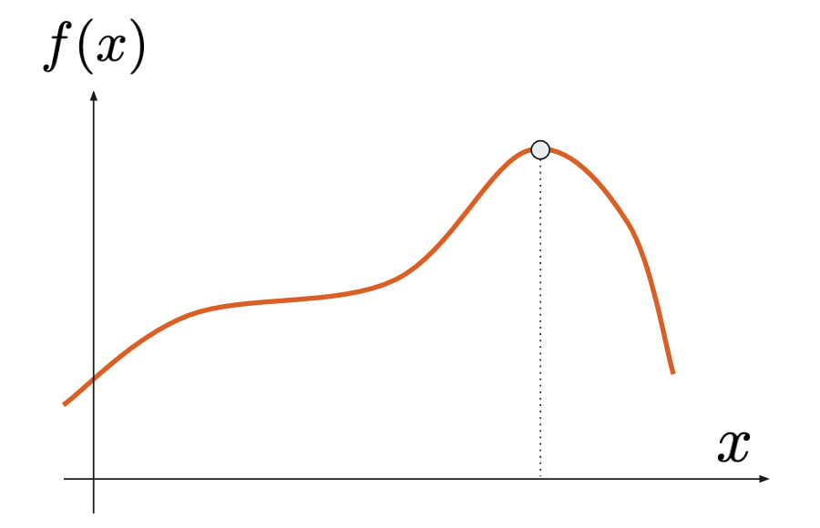

### New Topic

::: {.r-fit-text}
Optimization
:::

### Finding a minimum (or maximum) in design-variable space

- Suppose an engineering problem consists of specifying $n$ 'design variables'.
- Our goal might be to minimize (or maximize) an 'objective function'
  $$f(X_1,X_2,...,X_n): \mathbb{R}^n \rightarrow \mathbb{R}$$
- Find the set of variables $\{ X_1, X_2, ..., X_n  \}$ that minimizes $f$
  $$\nabla f = 0$$
  - where $\nabla \equiv \begin{bmatrix} \partial/\partial X_1 \\ \partial/\partial X_2 \\ \vdots \\ \partial / \partial X_n \end{bmatrix}$

### The relationship between optimization and root-finding

- The two are closely related at a conceptual level
- Minimizing (i.e., optimizing) $f(x)$ is the same thing as finding a root of $f'(x)$
- If the derivative of the objective function is available, you can search for the root of $f'(x)$ or you can search for an optimum of $f(x)$ --- the two are equivalent

### Expensiveness of functions

- In engineering, the 'objective function' is often an 'expensive' function to compute
- Optimization algorithms seek to [minimize the number of function calls]{.underline} to be efficient

### Single-variable optimization

#### Find $x$ that maximizes (or minimizes) $f(x)$



- Techniques:
  - Bracketing
  - Golden Section Search

### Global vs. Local

```{.tikz width="6in"}
%%| additionalPackages: \usepackage{pgfplots}

\begin{tikzpicture}
  \begin{axis}[
    xmin=-4, xmax=5,
    axis lines=middle,
    xlabel={$x$},
    ylabel={$f(x)$},
    yticklabels={},
    title={\phantom{hello, world}},
    grid=both,
    grid style={line width=0.1pt, draw=gray!20},
    major grid style={line width=0.2pt, draw=gray!40},
    samples=200,
    domain=-3:4,
    declare function = {
        f(\x) = (-10*\x^6 + 12*\x^5 + 105*\x^4 - 20*\x^3 - 180*\x^2)/100;
    }
  ]
    % Polynomial Curve
    \addplot[thick, blue] {f(x)};

    % Points
    \addplot[only marks, mark=*, mark size=2.5pt, green] coordinates {
      (-2, {f(-2)})
      (0, {f(0)})
    };
    \addplot[only marks, mark=*, mark size=2.5pt, red] coordinates {
      (3, {f(3)})
    };
  \end{axis}
\end{tikzpicture}
```

- Green points are local maxima
- Red is global maximum

### Bracketing

#### to find a maximum in $f(x)$

1. Pick some $x_0$
2. Increment $x_0 \rightarrow x_1 \rightarrow x_2 \rightarrow x_3 \rightarrow \dots$ in direction of increasing $f(x)$
   - Keep only the last two in memory
   - Increment strategies?
     - Constant increment $0.1, 0.2, 0.3, 0.4, ...$
     - Increasing increment $0.1, 0.2, 0.4, 0.8,...$
3. When $f(x_{n}) < f(x_{n-1})$, you have successfully **bracketed** the maximum between $x_{n-1}$ and $x_n$.

### Python function for bracketing

[Write a program that brackets a **minimum** of the following function]{.inclass}
$$f(x) = -10x^6 + 12x^5 + 105x^4 - 20x^3 - 180x^2$$
starting from $x=-4$ in a window $0.1$ wide.

### Golden Section Search {.smaller}

- Uses the properties of the Golden Ratio $$R = \frac{-1 + \sqrt{5}}{2} \approx 0.618...$$
- After a maximum has been isolated to be between $x=a$ and $x=b$, where $h=b-a$ is the window size
- Define the new points $$ \begin{aligned}x_1 &= b - Rh \\ x_2 &= a + Rh \end{aligned}$$


::: {.r-stack}
::: {.fragment}
```{.tikz}
%%| additionalPackages: \usetikzlibrary{arrows.meta, calc}

\begin{tikzpicture}[scale=2]
  % Golden ratio constant R = (sqrt(5) - 1) / 2
  \pgfmathsetmacro{\R}{(sqrt(5) - 1)/2}
  \def\ylow{-0.6} % Vertical level for the next iteration

  % Original interval [a, b] and Golden Section points
  \coordinate (a)  at (1.0, 0);
  \coordinate (b)  at (6.5, 0);
  \coordinate (x1) at ($(b)!\R!(a)$); % x_1 = b - R*(b - a)
  \coordinate (x2) at ($(a)!\R!(b)$); % x_2 = a + R*(b - a)

  % Candidate 1 (Red): [a_red, b_red] = [a, x_2]
  \coordinate (a_red)  at (a);
  \coordinate (b_red)  at (x2);
  \coordinate (x1_red) at ($(b_red)!\R!(a_red)$); % b_red - R*(b_red - a_red)
  \coordinate (x2_red) at ($(a_red)!\R!(b_red)$); % a_red + R*(b_red - a_red) = x_1

  % Candidate 2 (Blue): [a_blue, b_blue] = [x_1, b]
  \coordinate (a_blue)  at (x1);
  \coordinate (b_blue)  at (b);
  \coordinate (x1_blue) at ($(b_blue)!\R!(a_blue)$); % b_blue - R*(b_blue - a_blue) = x_2
  \coordinate (x2_blue) at ($(a_blue)!\R!(b_blue)$); % a_blue + R*(b_blue - a_blue)

  % Axes
  \draw[-{Triangle[length=7pt, width=5.5pt]}, line width=1.1pt]
    (-0.4, 0) -- (7.5, 0) node[right=4pt] {\Large $x$};
  \draw[-{Triangle[length=7pt, width=5.5pt]}, line width=1.1pt]
    (0, -1.5) -- (0, 1.65) node[above left=0pt] {\Large $f(x)$};

  % Faint horizontal line at the lower iteration level
  \draw[gray!45, line width=0.6pt] (0, \ylow) -- (7.2, \ylow);

  % Original brackets at a and b
  \draw[line width=1.2pt]
    ($(a)+(0.12, 0.24)$) -- ($(a)+(0, 0.24)$) -- ($(a)+(0, -0.24)$) -- ($(a)+(0.12, -0.24)$);
  \draw[line width=1.2pt]
    ($(b)+(-0.12, 0.24)$) -- ($(b)+(0, 0.24)$) -- ($(b)+(0, -0.24)$) -- ($(b)+(-0.12, -0.24)$);

  % Original interior ticks at x_1 and x_2
  \draw[line width=1.2pt] ($(x1)+(0, 0.24)$) -- ($(x1)+(0, -0.24)$);
  \draw[line width=1.2pt] ($(x2)+(0, 0.24)$) -- ($(x2)+(0, -0.24)$);

  % Original point labels
  \node[anchor=base] at ($(a)+(0, 0.45)$)  {\Large $a$};
  \node[anchor=base] at ($(x1)+(0, 0.45)$) {\Large $x_1$};
  \node[anchor=base] at ($(x2)+(0, 0.45)$) {\Large $x_2$};
  \node[anchor=base] at ($(b)+(0, 0.45)$)  {\Large $b$};

  % Interval width h indicator
  \draw[{Triangle[open, length=6pt, width=5pt]}-{Triangle[open, length=6pt, width=5pt]}, line width=0.9pt]
    ($(a)+(0, 1.15)$) -- ($(b)+(0, 1.15)$) node[midway, fill=white, inner sep=4pt] {\Large $h$};
\end{tikzpicture}
```
:::
::: {.fragment}
```{.tikz}
%%| additionalPackages: \usetikzlibrary{arrows.meta, calc}

\begin{tikzpicture}[scale=2]
  % Golden ratio constant R = (sqrt(5) - 1) / 2
  \pgfmathsetmacro{\R}{(sqrt(5) - 1)/2}
  \def\ylow{-0.6} % Vertical level for the next iteration

  % Original interval [a, b] and Golden Section points
  \coordinate (a)  at (1.0, 0);
  \coordinate (b)  at (6.5, 0);
  \coordinate (x1) at ($(b)!\R!(a)$); % x_1 = b - R*(b - a)
  \coordinate (x2) at ($(a)!\R!(b)$); % x_2 = a + R*(b - a)

  % Candidate 1 (Red): [a_red, b_red] = [a, x_2]
  \coordinate (a_red)  at (a);
  \coordinate (b_red)  at (x2);
  \coordinate (x1_red) at ($(b_red)!\R!(a_red)$); % b_red - R*(b_red - a_red)
  \coordinate (x2_red) at ($(a_red)!\R!(b_red)$); % a_red + R*(b_red - a_red) = x_1

  % Candidate 2 (Blue): [a_blue, b_blue] = [x_1, b]
  \coordinate (a_blue)  at (x1);
  \coordinate (b_blue)  at (b);
  \coordinate (x1_blue) at ($(b_blue)!\R!(a_blue)$); % b_blue - R*(b_blue - a_blue) = x_2
  \coordinate (x2_blue) at ($(a_blue)!\R!(b_blue)$); % a_blue + R*(b_blue - a_blue)

  % Axes
  \draw[-{Triangle[length=7pt, width=5.5pt]}, line width=1.1pt]
    (-0.4, 0) -- (7.5, 0) node[right=4pt] {\Large $x$};
  \draw[-{Triangle[length=7pt, width=5.5pt]}, line width=1.1pt]
    (0, -1.5) -- (0, 1.65) node[above left=0pt] {\Large $f(x)$};

  % Faint horizontal line at the lower iteration level
  \draw[gray!45, line width=0.6pt] (0, \ylow) -- (7.2, \ylow);

  % Original brackets at a and b
  \draw[line width=1.2pt]
    ($(a)+(0.12, 0.24)$) -- ($(a)+(0, 0.24)$) -- ($(a)+(0, -0.24)$) -- ($(a)+(0.12, -0.24)$);
  \draw[line width=1.2pt]
    ($(b)+(-0.12, 0.24)$) -- ($(b)+(0, 0.24)$) -- ($(b)+(0, -0.24)$) -- ($(b)+(-0.12, -0.24)$);

  % Original interior ticks at x_1 and x_2
  \draw[line width=1.2pt] ($(x1)+(0, 0.24)$) -- ($(x1)+(0, -0.24)$);
  \draw[line width=1.2pt] ($(x2)+(0, 0.24)$) -- ($(x2)+(0, -0.24)$);

  % Original point labels
  \node[anchor=base] at ($(a)+(0, 0.45)$)  {\Large $a$};
  \node[anchor=base] at ($(x1)+(0, 0.45)$) {\Large $x_1$};
  \node[anchor=base] at ($(x2)+(0, 0.45)$) {\Large $x_2$};
  \node[anchor=base] at ($(b)+(0, 0.45)$)  {\Large $b$};

  % New potential bracket (Red): [a, x_2]
  \draw[line width=1.2pt, red]
    ($(a_red)+(0.12, 0.24+\ylow)$) -- ($(a_red)+(0, 0.24+\ylow)$)
    -- ($(a_red)+(0, -0.24+\ylow)$) -- ($(a_red)+(0.12, -0.24+\ylow)$);
  \draw[line width=1.2pt, red]
    ($(b_red)+(-0.12, 0.24+\ylow)$) -- ($(b_red)+(0, 0.24+\ylow)$)
    -- ($(b_red)+(0, -0.24+\ylow)$) -- ($(b_red)+(-0.12, -0.24+\ylow)$);
  \node[left=2pt, red]  at ($(a_red)+(0, \ylow)$) {\Large $a$};
  \node[right=2pt, red] at ($(b_red)+(0, \ylow)$) {\Large $b$};

  % New potential bracket (Blue): [x_1, b]
  \draw[line width=1.2pt, blue]
    ($(a_blue)+(0.12, 0.24+\ylow)$) -- ($(a_blue)+(0, 0.24+\ylow)$)
    -- ($(a_blue)+(0, -0.24+\ylow)$) -- ($(a_blue)+(0.12, -0.24+\ylow)$);
  \draw[line width=1.2pt, blue]
    ($(b_blue)+(-0.12, 0.24+\ylow)$) -- ($(b_blue)+(0, 0.24+\ylow)$)
    -- ($(b_blue)+(0, -0.24+\ylow)$) -- ($(b_blue)+(-0.12, -0.24+\ylow)$);
  \node[left=2pt, blue]  at ($(a_blue)+(0, \ylow)$) {\Large $a$};
  \node[right=2pt, blue] at ($(b_blue)+(0, \ylow)$) {\Large $b$};

  % New interior ticks (slightly shorter so shared points remain visible) & labels
  \draw[line width=1.2pt, red] ($(x1_red)+(0, 0.15+\ylow)$) -- ($(x1_red)+(0, -0.15+\ylow)$);
  \draw[line width=1.2pt, red] ($(x2_red)+(0, 0.15+\ylow)$) -- ($(x2_red)+(0, -0.15+\ylow)$);
  \node[anchor=base, red] at ($(x1_red)+(0, -0.48+\ylow)$) {\Large $x_1$};
  \node[anchor=base, red] at ($(x2_red)+(0, -0.48+\ylow)$) {\Large $x_2$};

  \draw[line width=1.2pt, blue] ($(x1_blue)+(0, 0.15+\ylow)$) -- ($(x1_blue)+(0, -0.15+\ylow)$);
  \draw[line width=1.2pt, blue] ($(x2_blue)+(0, 0.15+\ylow)$) -- ($(x2_blue)+(0, -0.15+\ylow)$);
  \node[anchor=base, blue] at ($(x1_blue)+(0, -0.48+\ylow)$) {\Large $x_1$};
  \node[anchor=base, blue] at ($(x2_blue)+(0, -0.48+\ylow)$) {\Large $x_2$};

  % Interval width h indicator
  \draw[{Triangle[open, length=6pt, width=5pt]}-{Triangle[open, length=6pt, width=5pt]}, line width=0.9pt]
    ($(a)+(0, 1.15)$) -- ($(b)+(0, 1.15)$) node[midway, fill=white, inner sep=4pt] {\Large $h$};

  \draw[{Triangle[open, length=6pt, width=5pt]}-{Triangle[open, length=6pt, width=5pt]}, line width=0.9pt,color=red]
    ($(a)+(0, 1.15-1)$) -- ($(b_red)+(0, 1.15-1)$) node[midway, fill=white, inner sep=4pt] {\Large $h$};

  \draw[{Triangle[open, length=6pt, width=5pt]}-{Triangle[open, length=6pt, width=5pt]}, line width=0.9pt,color=blue]
    ($(a_blue)+(0, 1.15-1.3)$) -- ($(b)+(0, 1.15-1.3)$) node[midway, fill=white, inner sep=4pt] {\Large $h$};
\end{tikzpicture}
```
:::
:::


::: {.centering}

To find a maximum of $f(x)$  
If $f(x_1) > f(x_2)$, then discard $[x_2,b]$ and use new bracket ${\color{red}{[a, x_2 ]}}$.  
If $f(x_1) < f(x_2)$, then discard $[a,x_2]$ and use new bracket ${\color{blue}{[x_1, b ]}}$.
:::

### Practice with Golden Section Search

Locate a maximum of the function $$f(x) = \sin 2x$$ in the region $[0,1]$ using steps of the Golden Section Search method.

### Multi-dimensional optimization

Find the minimimum of $$f(x,y) = (x-1)^2 + (y+1)^2 + xy$$

- Idea: pick some **direction vectors** in $(x,y)$ space and optimize along each direction
  - Direction vectors should span the entire space, i.e., need as many independent (non-parallel) direction vectors as there are design variables.
