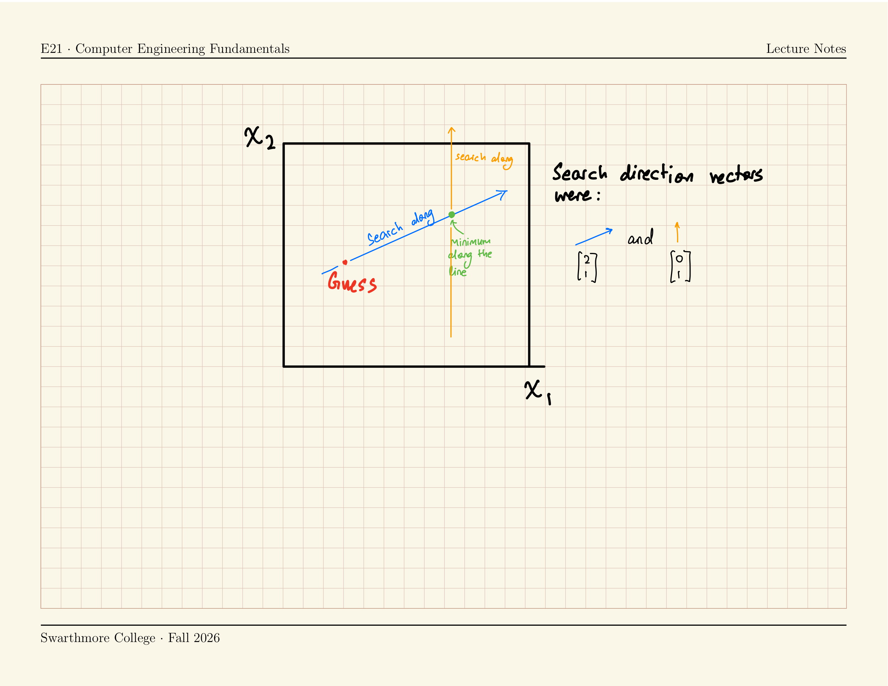
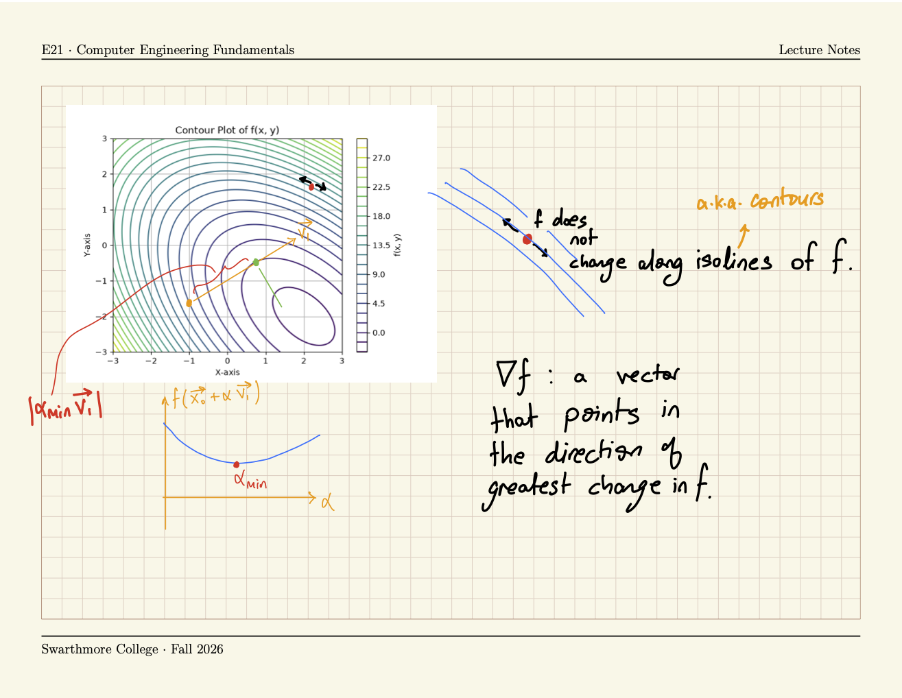
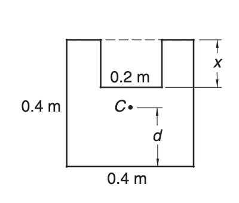
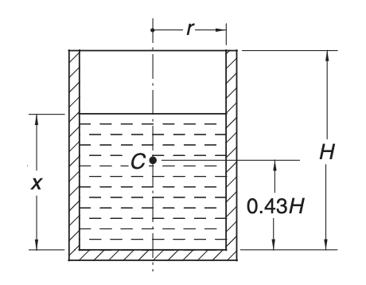

### Multi-dimensional optimization {.smaller}

Find the minimimum of $$f(x,y) = (x-1)^2 + (y+1)^2 + xy$$

- Idea: pick some **direction vectors** in $(x,y)$ space and optimize along each direction
  - Direction vectors should span the entire space, i.e., need as many independent (non-parallel) direction vectors as there are design variables.



### Terminology for multi-dimensional problems

We often need to optimize functions of more than one variable, such as $$f(x,y) = (x-1)^2 + (y+1)^2 + xy.$${#eq-func}

[We can rewrite @eq-func as a **scalar function** of a **vector variable** as follows:]{.fragment}

[$$f \left( \begin{bmatrix} x \\ y \end{bmatrix} \right) =  (x-1)^2 + (y+1)^2 + xy$$]{.fragment}

- We often use the convention that the independent variables in a given $n$-dimensional design problem are named $x_1, x_2, x_3, ... x_n$ instead of $x,y,z$

### Minimization along a direction

1. Write down the direction as a vector, let's call it $\boldsymbol{v}_1$
   - In $n$-dimensional space, the direction vector will have $n$ components
2. Multiply the direction vector with an unknown scalar, let's call it $\alpha$.
3. Substitute $\alpha \boldsymbol{v}_1$ into $f()$
4. Note that $f(\alpha \boldsymbol{v}_1)$ has only one unknown variable, $\alpha$.

### Try it out!

Use [`scipy.optimize.minimize_scalar`](https://docs.scipy.org/doc/scipy/reference/generated/scipy.optimize.minimize_scalar.html#scipy.optimize.minimize_scalar) **and** use calculus.

[Minimize the function]{.inclass}  
$f(x,y) = (x-1)^2 + (y+1)^2 + xy$  
along the direction $\boldsymbol{v} = \begin{bmatrix} 3 \\ 2 \end{bmatrix}$  
starting from an initial guess of $\begin{bmatrix} 1 \\ 1 \end{bmatrix}$

::: {.content-hidden unless-meta="uncover"}
$f(x,y) = (x-1)^2 + (x-1)^2 + (y+1)^2 + xy$

[$f(1+3\alpha,1+2\alpha) = (1+3\alpha-1)^2 + (1+2\alpha+1)^2 + (1+3\alpha) \cdot (1+2 \alpha)$]{.fragment}

[$= 19\alpha^2 + 13\alpha +5$]{.fragment}

- This is minimzed when $38\alpha +13 = 0 \implies \alpha = - \frac{13}{38}$

:::

### Naive n-dimensional optimization

1. Pick $n$ non-parallel direction vectors $\boldsymbol{v}_1, \boldsymbol{v}_2, \dots , \boldsymbol{v}_n$
2. Optimize along each of these directions one by one using `scipy.optimize.minimize_scalar` or your own Golden Section Search program
3. Continue cycling through the directions repeatedly until the update becomes smaller than a desired tolerance.

### Contour plots {.scrollable}

- A multi-dimensional optimization problem can be visualized using a contour plot.
- Tools:
  1. `matplotlib.pyplot` functions: `contourf` and `contour`
  2. `numpy`'s `meshgrid` function
- Contour plots are generally quite expensive

[How many times (at least) did `f` get evaluated to make the plot below?]{.inclass}

```{python}
#| echo: true
#| code-fold: true
from scipy.optimize import minimize_scalar
import matplotlib.pyplot as plt
import numpy as np

def f(x,y):
    return (x-1)**2 + (y+1)**2 + x*y

# Create a grid of points:
x = np.linspace(-5, 5, 101)
y = np.linspace(-4, 4, 101)
xx,yy = np.meshgrid(x,y)

# Apply f to the grid of points
fxy = f(xx,yy)

plt.contourf(xx,yy,fxy)
plt.title("f(x,y) = (x-1)**2 + (y+1)**2 + x*y")
plt.colorbar()
plt.show()
```

### Contour plots and directions

[Find the best direction vector starting from each of the given points]{.inclass}

```{python}
#| echo: true
#| code-fold: true
from scipy.optimize import minimize_scalar
import matplotlib.pyplot as plt
import numpy as np

def f(x,y):
    return (x-1)**2 + (y+1)**2 + x*y

# Create a grid of points:
x = np.linspace(-5, 5, 101)
y = np.linspace(-4, 4, 101)
xx,yy = np.meshgrid(x,y)

# Apply f to the grid of points
fxy = f(xx,yy)

plt.contourf(xx,yy,fxy,levels=10)
plt.scatter([-4],[1],color='red')
plt.scatter([4],[3],color='yellow')
plt.title("f(x,y) = (x-1)**2 + (y+1)**2 + x*y")
plt.colorbar()
plt.show()
```

### The gradient $\nabla f$



### $N$-dimensional optimization in Python

- The `scipy` package provides [`scipy.optimize.minimize`](https://docs.scipy.org/doc/scipy/reference/generated/scipy.optimize.minimize.html)
  - Need to provide the function and an initial guess

```{python}
from scipy.optimize import minimize
import numpy as np

def f(xx):
    x = xx[0]
    y = xx[1]
    return (x-1)**2 + (y+1)**2 + x*y

solution = minimize(f,np.array([0.,0.]),method='Powell')
```

### Constraints

- An optimization problem is sometimes subject to **constraints**
- It is useful to think of the constraint geometrically in the design space
- Examples:
  - Minimize function $f(x,y)$ if $(x,y)$ are the points on a given parabola.
  - Minimize function $f(x,y)$ is $(x,y)$ is located inside a given rectangle

### Constraint: optimize on a curve

Minimize $f(x,y) = (x-1)^2 + (y+1)^2 + xy$ subject to the constraint that $(x,y)$ satisfy the equation $y =-0.2(x-1)(x+4)$

```{python}
#| echo: false
#| code-fold: true
from scipy.optimize import minimize_scalar
import matplotlib.pyplot as plt
import numpy as np

def f(x,y):
    return (x-1)**2 + (y+1)**2 + x*y

# Create a grid of points:
x = np.linspace(-5, 5, 101)
y = np.linspace(-4, 4, 101)
xx,yy = np.meshgrid(x,y)

# Apply f to the grid of points
fxy = f(xx,yy)

# Calculate parabola
y_parabola = -0.2*(x-1)*(x+4)

plt.contourf(xx,yy,fxy)
plt.plot(x,y_parabola,color='red')
plt.xlim([-5,5])
plt.ylim([-4,4])
plt.title("f(x,y) = (x-1)**2 + (y+1)**2 + x*y")
plt.colorbar()
plt.show()
```

### Constraint: optimize inside a region

Minimize $f(x,y) = (x-1)^2 + (y+1)^2 + xy$ subject to the constraint that $(x,y)$ lie on the half of the plane $x \leq -1$

```{python}
#| echo: false
#| code-fold: true
from scipy.optimize import minimize_scalar
import matplotlib.pyplot as plt
import numpy as np

def f(x,y):
    return (x-1)**2 + (y+1)**2 + x*y

# Create a grid of points:
x = np.linspace(-5, 5, 101)
y = np.linspace(-4, 4, 101)
xx,yy = np.meshgrid(x,y)

# Apply f to the grid of points
fxy = f(xx,yy)

# Calculate parabola


plt.contourf(xx,yy,fxy)
plt.axvline(x=-1,color='red')
plt.xlim([-5,5])
plt.ylim([-4,4])
plt.title("f(x,y) = (x-1)**2 + (y+1)**2 + x*y")
plt.colorbar()
plt.show()
```

### Mathematical statement of constraints 1

Minimize $f(\boldsymbol{x})$ subject to the constraints $g(\boldsymbol{x}) = 0$ and $h(\boldsymbol{x}) \leq 0$. Note that $\boldsymbol{x} = [x,y]$ or $[x_1,x_2]$ in 2D.

[Find what $g(\boldsymbol{x})$ should be if:]{.fragment .inclass}

1. $(x,y)$ must lie on the parabola $y = x^2 +2x - 3$, find $g(\boldsymbol{x})$
2. $(x,y)$ must lie on the edge of a circle centered at $(2,1)$ and having a radius of $1.5$

::: {.content-visible when-meta="uncover"}
**Answers**:

1. $g(x,y) = y - x^2 - 2x + 3$
2. $g(x,y) = (x-2)^2 + (y-1)^2 - 1.5^2$  
:::

### Mathematical statement of constraints 2 {.scrollable}

Minimize $f(\boldsymbol{x})$ subject to the constraints $g(\boldsymbol{x}) = 0$ and $h(\boldsymbol{x}) \leq 0$. Note that $\boldsymbol{x} = [x,y]$ or $[x_1,x_2]$ in 2D.

[Find what $h(\boldsymbol{x})$ should be if:]{.fragment .inclass}

1. $(x,y)$ must lie to the left of $x=-1$
2. $(x,y)$ must lie inside a circle centered at $(2,1)$ and having a radius of $1.5$

::: {.content-visible when-meta="uncover"}
**Answers**:

1. In this case, $x \leq -1$ so $h(x,y) = x+1$ because $h \leq 0 \iff x \leq -1$
2. To lie inside a circle centered at $x_0,y_0$, of radius $r$, we need the following inequality to be true:
   $$(x-x_0)^2 + (y-y_0)^2 \leq r^2$$
   - If we define $h(x,y) = (x-2)^2 + (y-1)^2 - 1.5^2$, $h \leq 0$ is equivalent to satisfying $(x-x_0)^2 + (y-y_0)^2 \leq r^2$
:::


### Satisfying constraints with Lagrange Multipliers

Toinimize $f(\boldsymbol{x})$ subject to the constraints $g(\boldsymbol{x}) = 0$ and $h(\boldsymbol{x}) \leq 0$,

Minimize the function 
$$
\begin{align*}
f^*(\boldsymbol{x}) \equiv & f(\boldsymbol{x}) +\lambda P(\boldsymbol{x}) \\
f^*(\boldsymbol{x}) \equiv & f(\boldsymbol{x}) +\lambda \left( [g(\boldsymbol{x})]^2 + \max \{ 0, h(\boldsymbol{x})\} \right)
\end{align*}
$$

- $P$ is a **penalty function**
  - The penalty function is designed to be zero if no constraints are violated
  - It has a strictly positive value when constraints are violated.
- $\lambda$ is a Lagrange multiplier. It is a number.
  - The right value of $\lambda$ is often found by trial and error
  - Start with a small value.
  - We can also choose different $\lambda$'s for the different constraints

### Constrained optimization in Python {.scrollable}

```{python}
from scipy.optimize import minimize_scalar,minimize
from numpy.linalg import norm
import numpy as np
import matplotlib.pyplot as plt

# GLOBAL VARIABLE
LAMBDA = 2.0

def f(xx):
    x = xx[0]
    y = xx[1]
    return (x-1)**2 + (y+1)**2 + x*y

def constraint(x,y):
    return (x+1)**2 + (y)**2 - 2

def f_star(x_vector):
    x = x_vector[0]
    y = x_vector[1]
    lam = LAMBDA      # parameter to change
    return f(x_vector) + lam*(constraint(x,y))**2

solution = minimize(f_star,np.array([0.,0.]),method='Powell')

# The rest of the code is just for plotting.
x = np.linspace(-3, 3, 100)
y = np.linspace(-3, 3, 100)
X, Y = np.meshgrid(x, y)

# Calculate the function values over the grid
Z = f([X,Y])

# Create a contour plot
contours = plt.contour(X, Y, Z, levels=20, cmap='viridis')

# plot the constraint
Z_con = constraint(X,Y)
plt.contour(X,Y, Z_con, levels=[0], colors='red', linestyles='solid', linewidths=2)

# Add labels and a color bar
plt.xlabel('X-axis')
plt.ylabel('Y-axis')
plt.grid()
plt.colorbar(contours, label='f(x, y)')

# plot the minimum
plt.scatter(solution.x[0],solution.x[1],marker='o',color='black',label='found minimum')

# Show the plot
plt.title(f'Contour Plot of f(x, y) when lambda = {LAMBDA}')
plt.show()

```

### Engineering Optimization Problems

Find the value of $x$ that minimizes the distance $d$ between the base of the area shown and its centroid $C$.

{width="40%" fig-align="center"}

### Engineering Optimization Problems

The cylindrical vessel of mass $M$ has it center of gravity at $C$. The water in the vessel has a depth $x$. Determine $x$ so that the center of gravity of the vessel–water combination is as low as possible. Use $M = 115$ kg, $H = 0.8$ m and $r = 0.25$ m

{width="40%" fig-align="center"}


